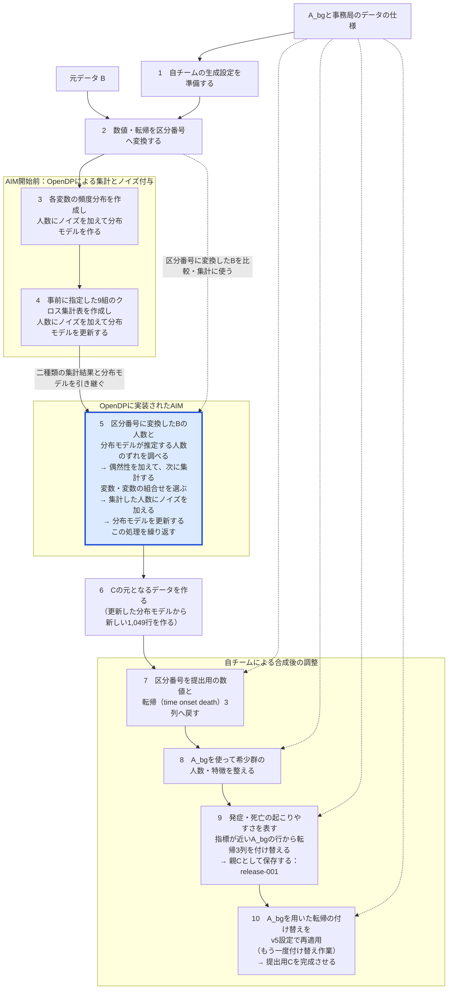

# 第1部　予備戦の匿名化フェーズ：集団の特徴を反映したCを作る

[全体案内](README.md) · [次：攻撃フェーズ](02_attack.md)

この資料は、自チーム（team24）が予備戦で匿名化データCを作った処理を、**ステップ1から10まで、実際の処理の順に説明する**ものである。図の番号と本文のステップ番号は対応している。各ステップには、使うもの、行ったこと、得られるものと、理解に必要な用語をまとめた。

本文だけで「何が行われていたか」を説明できるようにし、AIMの内部の詳しい計算は、[時間があるときに読む補足資料](SUPPLEMENT_AIM.md)にまとめた。本文中の人数例などは、実際の設定・結果と、説明用の架空例を区別して示す。

## はじめに：匿名化フェーズの目標

匿名化フェーズの目標は、自チーム（team24）の元データBから、**研究に利用できる有用性と、個人の情報を守る匿名性を両立した匿名化データCを作ること**である。

有用性の面では、Cを分析したときにも、元データに近い傾向や結論が得られることを目指す。匿名性の面では、Cを見た相手が、特定の個人がBに含まれていたか、その人の追跡年数はいくつかを推測しにくくすることを目指す。

### 大まかに何をしたか

大まかには、**「Bを集計する → 集計から新しい表を作る → A_bgで整えてCを提出する」**という流れである。

1. **Bの特徴を集計した。** 年齢や検査値、追跡結果を区分に分け、区分ごとの人数や列どうしの関係を調べた。
2. **集計から新しい表を作った。** Bから得たノイズを加えた集計結果をもとに、1,049行の合成表を作った。
3. **A_bgで整えて提出した。** 全チームが利用できるA_bgを用いて、希少群の人数・特徴と追跡結果を整え、最終的にv5のCを提出した。

### 有用性の評価方法

予備戦の有用性は、集団全体の特徴、指定された解析の再現性、希少群の特徴、データの妥当性という4つの観点で評価される。**4つの得点のうち、最も低いものが全体の有用性の得点になる。**

| 観点 | 調べたいこと | この提出で関係する工夫 |
|---|---|---|
| U_gen | 分布や集団の発症曲線などが再現されるか | 各変数や二変数の組合せの頻度分布を使う合成 |
| U_spec | 指定された解析の結論・判別性能が再現されるか | 転帰との組合せの集計、A_bgを用いた転帰の付け替え |
| U_rare | 希少群の割合や特徴が再現されるか | 希少群を意識した集計とA_bgを用いた人数・特徴の調整 |
| U_valid | 打ち切りなどの記録に矛盾がないか | 転帰3列を一組として扱う |

たとえば、4つの得点が `0.95, 0.42, 0.90, 0.85` なら、全体の有用性Uは0.42になる。U_genだけを0.99に上げても、Uは変わらない。そこで今回は、得点の低かったU_specの改善に取り組んだ。なお、大会の総合得点は有用性だけで決まるものではなく、匿名性も評価される。［根拠：S1］

## 全体の流れ：図と同じ番号で本文を読む

Bは自チームの元データ、A_bgは全チームが利用できる背景データである。提出するCは、この流れで作る1,049行・13列の匿名化データである。



ステップ3と4は、AIMへ渡す二種類の集計結果を作る工程である。今回の実際の実行順に合わせ、**各変数の頻度分布 → 9組のクロス集計 → AIM**の順に番号を付けた。ステップ3・4のノイズ付与もOpenDPが行い、ステップ5ではOpenDPに実装されたAIMが集計の選択とノイズ付与を繰り返す。ステップ7以降の調整は、自チームが用意した処理である。［根拠：S4・S16］

<a id="step-1"></a>

## ステップ1　使うデータを確認し、生成設定を準備する

**使うもの：** A_bg、事務局のデータの仕様、自チームが決めた処理の方針。

**このステップで得るもの：** 数値の区切り、集計する組合せ、予算配分などをまとめた生成設定。

<a id="terminology"></a>

### 用語の整理：まず、データに何が記録されているかを確認する

| 名前 | この資料での意味 |
|---|---|
| 元データB | 自チームに配布された1,049人分のデータ。集計・合成の対象となる |
| A_bg | 全チームが利用できる背景データ。数値の区切りや、合成後の調整に使う |
| 匿名化データC | 作成して提出する1,049行・13列のデータ |

<a id="outcome"></a>

#### 転帰（てんき）：追跡した結果、どうなったか

**転帰とは、病気や健康状態の経過を追った結果、対象者がどのような状態に至ったかを指す言葉である。** 平たく言えば、「その人を追跡した結果、どうなったか」という意味である。今回のデータでは、糖尿病を発症した、発症前に死亡した、発症も死亡も観測されないまま観察期間が終わった、といった結果を指す。

今回の資料で「転帰3列」と呼ぶのは、その結果と、そこまでの追跡年数を記録する次の3列である。［根拠：S1・S15］

| 列 | 意味 |
|---|---|
| `time` | 発症・死亡・観察終了までの追跡年数 |
| `onset` | 糖尿病を発症したか。1なら発症 |
| `death` | 発症前に死亡したか。1なら死亡 |

次は説明用の架空例である。

| `time` | `onset` | `death` | 読み方 |
|---:|---:|---:|---|
| 3 | 1 | 0 | 追跡開始から3年後に発症した |
| 6 | 0 | 1 | 発症せず、6年後に死亡した |
| 10 | 0 | 0 | 10年間、発症も死亡も観測されずに観察が終了した |

最後のケースを**「打ち切り」**と呼ぶ。「その後も発症しない」と分かったわけではなく、そこで観察が終わったという意味である。`time=10` だけを見て「10年目に発症した」と読まず、`onset`・`death` と合わせて解釈する。

<a id="covariates"></a>

#### 共変量（きょうへんりょう）：転帰を説明する側の変数

**共変量とは、解析で結果を説明・予測したり、条件の違いを考慮したりするために用いる変数である。** 今回であれば、発症・死亡との関係を調べる年齢、性別、検査値、喫煙などがこれに当たる。

本資料では、**提出用Cの13列のうち、転帰の `time`・`onset`・`death` を除く10列を「共変量」と総称する。** 具体的には、年齢（age）、性別（sex）、県（prefecture）、BMI、SBP、TG、HDL、ALT、喫煙（smoking）、FPGである。［根拠：S15］

したがって、転帰の付け替えでは、合成行の年齢や検査値など、共変量10列の値を変えずに、`time`・`onset`・`death` の3列を置き換える。［根拠：S3・S4］

なお、この資料で総称する10列のうち、今回のCoxモデルに実際に用いたのは、県を除く9変数である。［根拠：S4・S20］

### データの仕様：表に入れてよい列と値の決まり

**データの仕様は、事務局が定めた列名、使える値の範囲、許される値の組合せなどの決まりである。** 今回は、これらの情報が `schema.json` にまとめられている。CSVの値が条件に合っているかを確かめたり、合成データの作り方を決めたりする際に使う。

たとえば、実際のデータの仕様には次の情報がある。［根拠：S15］

| 項目 | 実際の内容 | 何に使うか |
|---|---|---|
| 提出Cの列 | `age`、`sex`、…、`time`、`onset`、`death` の13列 | 列の過不足と順序を確認する |
| 配布データの列 | 上記に `record_id` を加えた列 | 入力と提出物の違いを確認する |
| 年齢の範囲 | 40〜74 | 範囲外の値を検出する、区切りの両端を決める |
| BMIの範囲 | 10〜55 | 同上 |
| SBPの範囲 | 40〜250 | 同上 |
| 許される発症・死亡フラグ | `(0,0)`、`(0,1)`、`(1,0)` | この表で許されない組合せを検出する |
| 属性推論の攻撃で公開される属性 | 7列の一覧 | 攻撃者が観測できる情報を特定する |
| 希少群の検出器 | 対象列・基準・閾値など | 共通の基準で希少らしさを評価する |

たとえば、提出Cに `record_id` が混ざっていたり、年齢が82になっていたりすれば、仕様との不一致が分かる。データの仕様は、このような検査や前処理の基準になる。大会の全ルールがこの一ファイルに入っているわけではなく、ルールブックや採点設定も別にある。

**データの仕様に「年齢40〜74」と書いてあることは、Bに40歳や74歳の人が実際にいることを意味しない。** データを見て得た最小値・最大値ではなく、今回のデータとして許す範囲である。

データの仕様だけでは、50歳の人が何人いるか、年齢と発症がどう関係するかは分からない。こうしたBの特徴を調べるために、集計を行う。

### 生成設定：変換・生成の方法を自チームが決める

データの仕様で「年齢は40〜74」と決まっていても、合成するときの扱い方は一通りではない。1歳刻みで扱うか、いくつかの区間にまとめるかを決める必要がある。ほかにも、重視する列の組合せや、プライバシー予算の配り方を決めておく。

**生成設定は、データの変換方法や合成の手順を自チームで決め、まとめたものである。** 次のステップ2では、このうち「数値や転帰を、どの区切りで分類するか」というルールを使う。設定ファイルには、主に次の二種類の情報をまとめた。

1. 事務局が公開したデータの仕様・A_bgから計算できる値。例：区切りの境界、A_bgから学んだ発症・死亡の起こりやすさを比べるCoxモデルの係数。
2. 自チームが決めた手順・設定値。例：集計する変数の組合せ、プライバシー予算の総量と配分、繰り返し方の設定。

ここで使う「公開情報」は、全チームが利用できるA_bgやデータの仕様を指す。**生成設定は、これらの情報に自チームが決めたルールや値を加えて作ったものである。** 設定を一般公開したという意味ではない。

今回、生成設定を作る処理では、A_bgとデータの仕様を使った。ここではBを読み込まず、公開情報から区切りや係数を計算し、自チームが決めたAIMのパラメータや集計項目と合わせた。［根拠：S15］

生成設定を用意した後は、その設定に従ってBを区分番号に変換する。Bを実際に集計するまでは、区分ごとの人数は分からない。

<a id="step-2"></a>

## ステップ2　Bの数値と転帰を、集計に使う区分番号へ変換する

**使うもの：** 元データB、ステップ1で用意した生成設定。

**このステップで得るもの：** 年齢や検査値、転帰を区分番号で表した、集計用のB。

### 年齢や検査値を、あらかじめ決めた区間に分ける

**ビン（bin）は、値をまとめる区間**である。年齢なら「この区間に何人いるか」を数えるための箱、と考えられる。ビン化は、実数や整数の値を、その箱の番号へ変えることである。

実際の親Cの生成に使った年齢の境界は、次であった。

```text
40, 41, 44, 48, 55, 62, 69, 73, 74
```

これは境界9個から区間8個を作る設定である。今回の区切り方では、最初の四つは次のようになる。

| 区分番号 | 元の年齢の範囲 | 年齢が整数の場合の例 |
|---|---|---|
| 0 | 40以上41以下 | 40、41 |
| 1 | 41より大きく44以下 | 42、43、44 |
| 2 | 44より大きく48以下 | 45、46、47、48 |
| 3 | 48より大きく55以下 | 49〜55 |

たとえば、52歳も53歳も区分番号3に変換する。このように、**年齢そのものを使う代わりに、年齢が入る区間の番号を使って集計する**。これが「ビン化」や「符号化」と呼ぶ処理の一例である。区分番号3は「3歳」を意味しない。

境界が5歳刻みになっていないのは、A_bgの分布を使って決めたためである。区切りを作る際は、A_bgの5・15・30・50・70・85・95パーセンタイルを内部境界の候補にし、データの仕様の下限と上限を両端へ置く。パーセンタイルは、小さい順に並べたときに何%の位置にあるか、という区切り方である。年齢は丸め、重複する境界を除く。**等幅でも、各ビンの人数が等しくなる区切りでもない。**［根拠：S15］

<a id="outcome-state"></a>

### 転帰3列を、一つの区分番号にまとめる

**time・onset・deathの情報も、AIMを含む集計・合成の対象に入れた。** この3列は、転帰の種類と時間帯を表す `outcome_state` という1列にまとめる。今回の設定では、打ち切り1区分、発症6時間帯、死亡6時間帯の計13区分を使った。［根拠：S4・S15］

元データの各行の `time`（追跡年数）・`onset`（発症の有無）・`death`（死亡の有無）を、次の対応で一つの区分番号へ変換する。**番号は転帰の種類と時間帯を識別するためのもので、重症度や年数そのものを表す値ではない。**

| outcome_state | 転帰 | timeの範囲（入力を番号へ変換するとき） | onset | death |
|---:|---|---|---:|---:|
| 0 | 打ち切り（発症も死亡も観測されていない） | 追跡年数にかかわらず同じ区分 | 0 | 0 |
| 1 | 発症 | 約1日以上〜1年以下 | 1 | 0 |
| 2 | 発症 | 1年超〜2年以下 | 1 | 0 |
| 3 | 発症 | 2年超〜4年以下 | 1 | 0 |
| 4 | 発症 | 4年超〜6年以下 | 1 | 0 |
| 5 | 発症 | 6年超〜8年以下 | 1 | 0 |
| 6 | 発症 | 8年超〜10年以下 | 1 | 0 |
| 7 | 死亡 | 約1日以上〜1年以下 | 0 | 1 |
| 8 | 死亡 | 1年超〜2年以下 | 0 | 1 |
| 9 | 死亡 | 2年超〜4年以下 | 0 | 1 |
| 10 | 死亡 | 4年超〜6年以下 | 0 | 1 |
| 11 | 死亡 | 6年超〜8年以下 | 0 | 1 |
| 12 | 死亡 | 8年超〜10年以下 | 0 | 1 |

例えば、`time=3.2, onset=1, death=0` なら `outcome_state=3`、`time=3.2, onset=0, death=1` なら `9` になる。発症も死亡も観測されていなければ `0` である。境界ちょうどの値は早い側の時間帯に入るため、2年ちょうどでの発症は `2`、4年ちょうどでの発症は `3` になる。［根拠：S4・S15］

時間の区切りと番号の意味は、自チームの生成設定で事前に固定している。AIMが区切り方を自動で決めるわけではない。［根拠：S4・S15］

### 集計に使うBは、内部で扱う12列の表になる

共変量10列に、転帰をまとめた `outcome_state` と、希少かどうかの判定を表す補助列 `rare_flag` を加えた12列を集計に使った。希少群とは、年齢や検査値の組合せが基準集団の一般的な傾向から大きく離れた集団である。詳しい判定方法は、希少群を調整するステップ8で説明する。

`rare_flag` は、事務局が提供した公開判定器で各行を判定して作った補助列である。事務局が持つ真の希少群のラベルを入力したものではなく、提出Cの列にも含めない。また、個人を区別する `record_id` は集計・合成の対象から除いた。［根拠：S4・S15］

以後の「区分番号に変換したB」は、この集計用の表を指す。

<a id="step-3"></a>

## ステップ3　OpenDPで各変数の頻度分布を作り、人数にノイズを加える

**使うもの：** 区分番号に変換したB、生成設定。

**このステップで得るもの：** 内部12列の頻度分布にノイズを加えた集計結果と、最初の分布モデル。

### Bの各区分に、何人いるかを数える

**ここで作る頻度分布は、元データBの各変数について、区分ごとの人数を数えたものである。** 本資料では「度数分布」と同じ意味で用いる。例えば年齢なら、ステップ2で作った各年齢区分にBの人が何人いるかを数える。対象は、内部で使う12列すべてである。

人数を数えた後、OpenDPが区分ごとの人数にノイズを加える。このステップは、AIMを開始する前の処理である。［根拠：S4・S15・S16］

<a id="count-noise"></a>

### OpenDPによるノイズ付与：集計した人数に、偶然の増減を加える

**今回のOpenDPは、各変数の頻度分布の区分ごとの人数と、クロス集計表の各マスの人数に、離散ガウス分布に従うノイズを加えた。** これは、正規分布に似た、ゼロを中心とする左右対称の確率分布から、整数の増減量を選ぶ方法である。ゼロに近い増減量ほど選ばれやすく、大きく増減するほど選ばれにくい。「離散」とは、この場合、増減量が整数の値を取ることを指す。［根拠：S16］

たとえば、年齢の三つの区分について、次のように人数を変える。**人数とノイズの値は、すべて説明用の架空例である。**

| 年齢の区分 | Bで数えた人数 | 加えるノイズ | ノイズを加えた人数 |
|---|---:|---:|---:|
| 区分① | 200 | ＋6 | 206 |
| 区分② | 40 | −3 | 37 |
| 区分③ | 7 | 0 | 7 |

区分ごとに別々の乱数を使うため、すべての人数が同じだけ増減するわけではない。クロス集計表でも、各マスの人数に対して同じ考え方でノイズを加える。最初の頻度分布、事前に指定した9組のクロス集計、AIMが選んだ集計のいずれにも、この人数へのノイズ付与がある。

ここで変更するのは、年齢や検査値の値そのものではなく、**その区分に該当する人数**である。ノイズを加えた集計結果を分布モデルの作成に使い、その分布モデルから新しい合成行を作る。

ノイズの大きさは、各処理に割り当てたプライバシー予算などに応じてOpenDPが計算する。同じ集計なら、予算を小さくするとノイズは大きくなり、予算を大きくするとノイズは小さくなる。今回、最初に内部12列の頻度分布を作る段階では、設定から計算したノイズの大きさは、標準偏差に相当する値で約13.1人である。これは増減のばらつきの目安であり、必ず13人変える、あるいは増減を13人以内に収めるという意味ではない。後の集計では予算配分が異なるため、同じ大きさのノイズを使うとは限らない。［根拠：S4・S15・S16］

<a id="privacy-budget"></a>

### プライバシー予算：自チームが総量を決め、OpenDPが管理する

**プライバシー予算とは、個人のデータを利用する処理で許容するプライバシー損失の上限を管理するための数値である。** 今回は、その値を表す記号としてρ（ロー）を使い、親Cを生成する一連の集計・合成処理の総予算を0.1に設定した。同じ条件なら、値を小さくするほどプライバシーの保証は強くなるが、集計に加えるノイズが大きくなり、元の分布を再現しにくくなる。

総予算の0.1と、各段階への配分は、自チームが生成設定に記載した値である。**OpenDPがBを分析して、総予算や配分を自動的に決めたわけではない。** OpenDPは、指定された上限と配分に従って、各処理に使える予算やノイズの大きさを計算した。［根拠：S4・S15・S16］

#### 今回の予算は、ステップ3・4・5へ分けた

最初に、総予算の35％を各変数の頻度分布に割り当てた。残りの65％を、事前に指定した9組のクロス集計とAIMに3対1で分けた。その結果、全体の配分は次のようになる。

| 予算を使う段階 | 総予算に占める割合 | 割り当てた予算ρ |
|---|---:|---:|
| ステップ3：内部12列の各変数の頻度分布にノイズを加える | 35％ | 0.035 |
| ステップ4：事前に指定した9組のクロス集計にノイズを加える | 48.75％ | 0.04875 |
| ステップ5：AIMが次の集計を選び、その人数にノイズを加える | 16.25％ | 0.01625 |
| **合計** | **100％** | **0.1** |

この表は、実際の設定値から計算した配分である。例えば0.035は、12列の頻度分布を合わせた予算であり、各列や各区分に0.035ずつ使うという意味ではない。［根拠：S15・S16］

9組のクロス集計には、AIMに任せる部分よりも多くの予算を割り当てた。これは、Cox解析に使う9変数と転帰との関係を、先に集計して合成へ反映する構成である。ただし、**総予算0.1、最初の35％、残りの3対1という数値が最適であると示した比較検証の記録は、今回確認した資料にはない。** 使用した設定と、その最適性が検証されているかは区別する必要がある。

#### OpenDPが担当したこと

今回の設定では、1人を1行として扱い、1人分の行が追加・削除された場合を保護の単位とした。OpenDPは、その1行によって集計結果がどの程度変わり得るかと、同じデータを使う複数の処理を合わせた予算を考慮して、ノイズの大きさを計算する。自チームが、各マスに加える増減量を手作業で指定したわけではない。［根拠：S4・S15・S16］

使った機能の名称と役割を対応させると、次のようになる。名称は、後から使用した機能を確認するために併記している。

| 担当すること | 使用したOpenDPの機能 |
|---|---|
| 一連の処理に総予算0.1を設定し、予算を管理する | `Context.compositor` |
| 最初の頻度分布へ35％を確保する設定を渡し、残りを9組のクロス集計とAIMへ3対1で分ける | `opendp.extras.mbi` の `Sequential` |
| 9組のクロス集計に割り当てられた予算で、人数にノイズを加える | 同じく `Fixed` |
| 各回の予算を選択と人数へのノイズ付与に分け、残り予算を管理しながら繰り返す | 同じく `AIM` |

最初の35％を実際に取り分けるのは、OpenDPのクロス集計表を作る共通処理である。`Sequential`はその割合の設定を受け渡し、残りの予算を後続の二つの処理へ分ける。つまり、予算配分は一つの機能だけで完結せず、それぞれの役割を持つ機能が連携している。［根拠：S4・S16］

なお、今回の生成処理ではρを使って予算を管理した。設定にあるδ（デルタ）は、生成記録で保護の強さを別の表し方に換算するための値であり、今回のノイズ付与に渡した値ではない。また、ここでの総予算0.1がどこまでの処理を対象とするかは、最後のステップ10で説明する。［根拠：S3・S4・S15］

<a id="distribution-model"></a>

### 分布モデル：集計結果から、特徴の組合せごとの人数を推定する仕組み

**ここでいう分布モデルとは、年齢や検査値などの区分の組合せごとに、何人程度いるかを計算できるようにした仕組みである。** 各変数の頻度分布やクロス集計表にノイズを加え、それらの集計結果にできるだけ合うように作る。今回、この分布モデルの作成・更新にはPrivate-PGMを使った。［根拠：S4・S16］

例えば、ある「年齢区分とBMI区分の組合せ」に該当する人数が、区分番号に変換したBでは20人、現在の分布モデルの推定では12人だったとする。このマスでは8人のずれがある。これは説明用の架空例である。AIMは、候補となる集計ごとにこうしたずれを調べ、次の集計を選ぶ際の判断材料にする。

「分布モデルを更新する」とは、新たに人数を数えてノイズを加えた結果も取り込み、各組合せの人数の推定を見直すことである。それまでの集計結果も使いながら更新し、最後に得られた分布モデルから、Cの元となる1,049行を作る。**「分布モデルが推定する人数」は、合成行を作る前に計算できる値である。**［根拠：S4・S16］

なお、後の転帰の付け替えで使うCoxモデルは、年齢や検査値などと発症・死亡の起こりやすさとの関係を表すものである。それぞれの役割が分かるよう、本資料では「分布モデル」と「Coxモデル」と呼び分ける。

このステップでは、各変数の頻度分布にノイズを加えた結果から、最初の分布モデルを作る。次のステップ4では、変数どうしの関係も集計し、人数にノイズを加えた結果を分布モデルに反映する。

<a id="step-4"></a>

## ステップ4　事前に指定した9組のクロス集計表を作る

**使うもの：** 区分番号に変換したB、事前に指定した9組、ステップ3の集計結果と分布モデル。

**このステップで得るもの：** 9組のクロス集計にノイズを加えた結果と、それを反映した分布モデル。

### クロス集計表は、二つの変数の関係を人数で表した表である

**クロス集計表（分割表）とは、二つの変数を組み合わせ、区分の組合せごとに人数を数えて並べた表である。** 例えば、行を年齢区分、列を転帰区分とすると、各マスには両方の区分に該当する人数が入る。

今回は、元データBを集計できる形へ変換した後、自チーム（team24）が事前に指定した9組のクロス集計表を作成し、各マスの人数にノイズを加えた。事前に指定したのは、どの二変数を組み合わせるかである。9組は大会のルールで義務付けられたものではなく、転帰との関係を重視して自チームが選んだ。［根拠：S4・S15・S16］

> **9組を先に集計する意義：** この工程も、AIMを開始する前の準備に当たる。AIMに選択を任せるだけでは、重視する組合せが集計されないこともある。そのため、9組を先に集計し、ノイズを加えた結果をAIMに引き継ぐ。この人数へのノイズ付与にもプライバシー予算を使う。

人数を数える段階は、Excelのピボットテーブルで、行に年齢区分、列に転帰区分、値に人数を置く場面に近い。今回の合成に用いるのは、この人数にノイズを加えた集計結果である。

たとえば、次の6人を考える。全員架空で、分かりやすさのため年齢区分・転帰区分も簡略化している。

| 人 | 年齢区分 | 転帰区分 |
|---|---|---|
| 人1 | 40代 | 発症 |
| 人2 | 40代 | 発症 |
| 人3 | 40代 | 打ち切り |
| 人4 | 50代 | 発症 |
| 人5 | 50代 | 打ち切り |
| 人6 | 50代 | 打ち切り |

この6人を年齢区分と転帰区分でクロス集計すると、次の表になる。ここでは、ノイズを加える前の人数を示す。

| 年齢区分 | 発症 | 打ち切り |
|---|---:|---:|
| 40代 | 2 | 1 |
| 50代 | 1 | 2 |

この表全体で、一つの集計項目と数える。「2」「1」「1」「2」の各マスを、それぞれ別の集計として数えるわけではない。実際の処理では、こうして数えた人数にノイズを加え、その集計結果を分布モデルの更新に使う。

**事前に決めるのは「年齢×転帰を集計する」という組合せである。各マスの人数はBを集計して求める。** 同じ組合せでも、入力Bが変われば人数は変わり、加えるノイズによっても、合成に使う集計結果は変わる。

### 今回の9組と、それを選んだ理由

親Cを作る際は、次の9組を事前に指定し、元データBから各組合せのクロス集計表を作成した。各マスの人数にはノイズを加えた。［根拠：S4・S15］

| クロス集計する変数の組合せ | 調べる関係 |
|---|---|
| `age × outcome_state` | 年齢区分と転帰 |
| `sex × outcome_state` | 性別と転帰 |
| `BMI × outcome_state` | BMI区分と転帰 |
| `SBP × outcome_state` | 血圧区分と転帰 |
| `TG × outcome_state` | 中性脂肪区分と転帰 |
| `HDL × outcome_state` | HDL区分と転帰 |
| `ALT × outcome_state` | ALT区分と転帰 |
| `smoking × outcome_state` | 喫煙と転帰 |
| `FPG × outcome_state` | 空腹時血糖区分と転帰 |

`×` は数値の掛け算ではなく、「この二列で分類して人数を数える」という意味である。9変数全部と転帰を一度に組み合わせた一枚の巨大な表ではなく、**一変数と転帰を組み合わせたクロス集計表を9種類**作る。

**`outcome_state` は、`time`・`onset`・`death` を一つにまとめた区分番号である。** 今回は、打ち切り1区分、発症6時間帯、死亡6時間帯の計13区分を使った。年齢は8区分なので、年齢と転帰の組合せは8×13＝104マスのクロス集計表になる。この表全体で、一つの集計項目と数える。

事前にこの9組を選んだのは、**事務局が有用性の評価に使うCox解析の9個の説明変数と、転帰との関係をCでも再現したかったためである。** 説明変数とは、発症の起こりやすさを説明するために使う年齢や検査値などの変数を指す。評価で使う9変数それぞれを転帰と組み合わせたため、9組となる。評価に使う変数は事務局の設定であり、その9変数と転帰を先にクロス集計する方針は自チームが決めた。［根拠：S4・S15・S20］

Cox解析は、発症までの時間を使い、年齢や検査値などが発症の起こりやすさとどう関係するかを、複数の変数を同時に考慮して調べる解析手法である。今回の特定の解析での有用性U_specでは、追跡年数と発症の有無を使い、元データBと合成データCで解析の結論や予測性能がどの程度再現されるかを評価する。［根拠：S20］

年齢だけの頻度分布を作っても、年齢と転帰の関係は分からない。そのため、両者のクロス集計表にノイズを加えた結果も、分布モデルに反映させた。ただし、複数の変数を同時に使うCox解析の結果が、9種類のクロス集計だけで完全に再現されるとは限らない。

この9組の人数へのノイズ付与はOpenDPの `Fixed` という機能で行い、割り当てたプライバシー予算は0.04875である。各変数の頻度分布にノイズを加えた結果も引き継ぎ、二種類の集計結果を使って分布モデルを更新した。この時点で、AIMが処理を始めるための材料がそろう。［根拠：S4・S16］

<a id="step-5"></a>

## ステップ5　AIMが次の集計を選び、分布モデルを更新する

**使うもの：** 区分番号に変換したB、ステップ3・4のノイズを加えた集計結果と分布モデル、集計候補の一覧。

**このステップで得るもの：** 選んだ集計の結果を取り込んだ、更新後の分布モデル。

### AIMが受け取るもの

**AIMは、各変数の頻度分布と9組のクロス集計から得た、ノイズを加えた集計結果と分布モデルを引き継ぐ。** 加えて、次の集計を選び、その人数を数えるため、区分番号に変換したBも処理内部で参照する。［根拠：S4・S16］

ここで「集計を選ぶ」とは、**次に人数を数え、ノイズを加えた結果を分布モデルに反映する変数・変数の組合せを選ぶこと**である。例えば「年齢区分×BMI区分」を選んだ場合、そのクロス集計表を作る。

### 自チームが候補を用意し、AIMがその中から選ぶ

自チームは、先に集計した9組を含む、二変数39組と、その重要度に関わる重みを用意した。この一覧を設定では `workload` と呼ぶ。OpenDPは、この39組に含まれる単変数11種類も加え、計50種類を候補にする。最初の頻度分布は内部12列すべてを対象としたが、県は二変数39組に含まれないため、ここで加わる単変数は11種類である。［根拠：S4・S15・S16］

### OpenDPに実装されたAIMが、比較、選択、ノイズ付与、更新を繰り返す

1. **Bと分布モデルの人数を比較する。** 候補ごとに、区分番号に変換したBで数えた人数と、現在の分布モデルが推定する人数とのずれを調べる。
2. **次の集計を選ぶ。** ずれの大きさ、候補の重要度、ノイズの大きさや集計表のマス数などを考慮し、さらに偶然性を加えて選ぶ。既に集計した項目を再び選ぶこともある。
3. **選んだ集計の人数にノイズを加える。** この段階でも、人数に離散ガウス分布のノイズを加える。
4. **分布モデルを更新する。** 新たな集計結果と、それまでのノイズを加えた集計結果を使い、分布モデルの人数の推定を見直す。［根拠：S16］

また、**AIMが「次にどの集計を選ぶか」を決める処理にも、偶然性を加えている。** 今回の選択方法は、候補ごとの評価値にガンベル分布という確率分布のノイズを加え、その中で最も大きいものを選ぶ方法に相当する。評価値には、Bと分布モデルの人数のずれなどを使う。選択結果もBの情報に左右されるため、この処理にもプライバシー予算を使う。人数へのノイズ付与と、集計を選ぶための偶然性は、役割が異なる。［根拠：S16］

### 繰り返しに使った予算と設定

AIMでは、一回分の予算のうち90％を選んだ集計の人数へのノイズ付与に、10％を次の集計の選択に使った。**この90％と10％は、AIMの各回の予算に対する割合である。** 総予算0.1を直接90％と10％に分ける設定ではない。［根拠：S15・S16］

一回分の予算の初期値は、AIMに割り当てた0.01625を、設定値の16で割って決める。その後、集計を加えても分布モデルの変化がノイズの大きさに比べて小さい場合は、次の一回に使う予算を増やす。一回に多く使う分だけ残りの予算は少なくなり、AIM全体の上限0.01625は増えない。そのため、設定値の16は、実際に16回集計したことを意味しない。［根拠：S16］

分布モデルが大きくなりすぎないよう、集計候補には大きさの制約も設けた。今回の基準値は32メガバイトであり、予算をどこまで使ったかに応じて、各回に使える大きさが変わる。この制約を満たす候補から集計を選び、残り予算や候補の状況に応じて処理を終える。［根拠：S15・S16］

| 設定の名称 | 今回の値 | このステップでの意味 |
|---|---:|---|
| `workload` | 二変数39組 | 自チームが用意した集計の一覧。内部では単変数を加えた50種類が候補になる |
| `measure_split` | 0.9 | 一回分の予算の90％を人数へのノイズ付与に使う |
| `rounds` | 16 | 一回分の予算の初期値を決める。実際の集計回数を示す値ではない |
| `max_size_mb` | 32 | 分布モデルの大きさの制約の基準。単位はメガバイト |

集計候補の内訳や、候補ごとの評価値の詳しい計算は、[補足資料のA2節・A3節・A5節](SUPPLEMENT_AIM.md)にまとめる。

<a id="step-6"></a>

## ステップ6　更新した分布モデルから、Cの元となるデータを作る

**使うもの：** ステップ5までの集計結果を取り込んだ分布モデル。

**このステップで得るもの：** 区分番号で表した、1,049行・内部12列の新しい合成表。

各変数の頻度分布、事前に指定した9組のクロス集計、AIMが選んだ集計のそれぞれで、人数にノイズを加えた。その集計結果をもとに分布モデルを作成・更新し、**最後の分布モデルから新しい1,049行を作った。これが、提出用Cの元となるデータである。** 行の作成にはPrivate-PGMを使った。［根拠：S4・S16］

作る行数は、生成設定の `output_rows` で1,049と指定した。この合成表は、Bにあった人物の行をそのまま残した表ではなく、Bの集団としての特徴をもとに作った新しい表である。

この時点では、年齢や検査値は区分番号で表し、転帰は `outcome_state` の1列にまとめている。補助列 `rare_flag` も含むため、まだ提出形式の13列にはなっていない。**年齢や検査値だけでなく、転帰の情報も、この合成の対象に含めていた。**

次のステップ7で、年齢や検査値に具体的な数値を与え、転帰を `time`・`onset`・`death` の3列の形に戻す。

<a id="step-7"></a>

## ステップ7　区分番号を、提出用の数値と転帰3列へ戻す

**使うもの：** ステップ6の合成表、生成設定、A_bg、データの仕様。

**このステップで得るもの：** 年齢・検査値の数値と転帰3列を持つ、提出形式の13列の表。

合成表の年齢や検査値は、「区分番号3」のような形で記録されている。提出する表には年齢や血圧などの数値を入れる必要があるため、区分番号を具体的な値へ変換した。**ここで「戻す」とは、合成された区分番号に具体的な数値を与えることであり、Bにあった元の人の数値を復元することではない。**
このステップ以降は、自チームが用意した「後処理」である。後処理とは、集計・合成で得た表を、提出する形へ整える処理を指す。

### 年齢・検査値：同じ区分に入るA_bgの値を選ぶ

**年齢・検査値は、合成された区分と同じ区分に入るA_bgの値を、ランダムに選んで当てはめた。** 対象は、年齢・BMI・SBP・TG・HDL・ALT・FPGの7変数である。

年齢を例にすると、次の手順である。区分番号3と年齢範囲の対応は実際の生成設定に基づくが、以下の候補の値と選択結果は説明用の架空例である。

1. **合成された区分番号を確認する。** ある合成行の年齢が区分番号3なら、今回の設定では「48歳超〜55歳以下」に対応する。

2. **A_bgの年齢も、同じ区切りで分類する。** A_bgから、同じ区分番号3に入る年齢の値を集める。

3. **候補からランダムに一つ選ぶ。** 候補が `49、50、50、53、55` なら、この中から例えば `53` を選び、合成行の年齢を53歳にする。候補は重複を残して扱うため、この例で50歳が選ばれる確率は2/5である。同じ候補を複数の合成行に使うこともある。

4. **ほかの合成行・変数にも、同じ処理を行う。** BMIならBMIの区分、血圧なら血圧の区分を使い、それぞれに対応するA_bgの値を選ぶ。［根拠：S4・S15］

この段階では、**変数ごとに別々に値を選ぶ。** 例えば、年齢はA_bgのある行から、BMIは別の行から選ばれることがある。合成表が持つ「年齢の区分とBMIの区分の組合せ」を土台に、それぞれの区分内の具体的な値を決める処理である。A_bgの一人分の年齢・検査値をまとめて移す処理とは異なる。

A_bgにその区分の候補がない場合に備えた代替処理もある。その場合は、区間の下限・上限を使い、年齢なら整数、検査値なら連続的な数値を一様乱数で生成する。一様乱数とは、指定した範囲の特定の場所を優先せずに値を選ぶ方法である。この代替処理が今回実際に使われた件数は確認していない。［根拠：S4］

### 転帰：区分の意味から3列の値を作る

転帰の区分番号 `outcome_state` は、`time`・`onset`・`death` の3列へ変換する。**区分が表す転帰の種類から発症・死亡の有無を決め、時間帯から追跡年数を生成する。**

| 合成された区分番号 | 意味 | この段階で作る値 |
|---|---|---|
| 0 | 打ち切り | `onset=0`、`death=0`、`time=10` |
| 3 | 2〜4年の時間帯で発症 | `onset=1`、`death=0`、`time`は2〜4年の範囲から一様乱数で生成 |
| 9 | 2〜4年の時間帯で死亡 | `onset=0`、`death=1`、`time`は2〜4年の範囲から一様乱数で生成 |

表は実際の変換ルールから三つの区分を抜き出したものである。ほかの発症・死亡の区分でも、それぞれに対応する時間帯から追跡年数を生成する。区分の意味は、ステップ2で用いた対応表と同じである。ここで生成する追跡年数も、Bにあった元の人の正確な追跡年数を復元したものではない。［根拠：S4・S15］

**この時点の追跡年数は、A_bgから選んだ値ではない。** 転帰はいったん合成結果から3列の形に戻し、ステップ9で、発症・死亡の起こりやすさを表す指標が近いA_bgの行から3列まとめて付け替える。

### カテゴリと値の範囲を整える

性別・県・喫煙は、合成されたカテゴリの値をそのまま使う。また、数値への変換後は、年齢の小数部分を切り捨てて整数に整え、年齢・検査値・追跡年数が事務局の定めた範囲に収まるように調整する。範囲を外れた値は、対応する下限または上限に置き換える。［根拠：S4・S15］

提出に使わない補助列を除き、13列の形に整える。この後、ステップ8で希少群を調整し、ステップ9・10で転帰を付け替える。

<a id="step-8"></a>

## ステップ8　A_bgを使って、希少群の人数と特徴を整える

**使うもの：** 数値へ変換した合成表、A_bg、事務局の公開判定器。

**このステップで得るもの：** 希少群の人数と、年齢・検査値7列の組合せを調整した合成表。

<a id="rare-group"></a>

### 用語の整理：希少群（きしょうぐん）とは

**今回の資料でいう希少群とは、年齢や検査値の組合せが、基準となる集団の一般的な傾向から大きく離れた特徴を持つ人々の集団である。** 匿名化処理では、事務局が提供した公開判定器を使い、希少かどうかを判定した。

判定に使うのは、**年齢（age）・BMI・SBP・TG・HDL・ALT・FPGの7変数**である。それぞれの値を一組として見て、基準集団からの離れ具合を調べる。その指標を「マハラノビス距離」と呼ぶ。変数ごとの単位の違いと、変数どうしの関係を考慮した指標であり、今回の公開判定器では、この距離が4.0以上の行を希少と判定する。［根拠：S4・S15］

特定の性別や県の人数が少ないという理由だけでは、希少群とは判定しない。**年齢・検査値の組合せが、基準集団に照らしてどの程度珍しいか**に着目している。

この判定結果は、事務局が持つ真の希少群のラベルと常に一致するとは限らない。自チームの匿名化処理では、真のラベルを入力せず、公開判定器の結果を使って希少群の人数や特徴を調整した。このステップでも、以下の「希少」「非希少」は公開判定器の判定を指す。［根拠：S4・S20］

### 合成後に希少群を調整する理由

**希少群の調整とは、A_bgを使って、合成表の希少群の人数と年齢・検査値の組合せを整える処理である。** 人数の少ない集団の特徴は、合成や区分番号から数値への変換を経るうちに薄まることがある。値どうしの組合せが崩れる場合もあるため、A_bgで観測された組合せを使って補った。

### A_bgを基準に、人数と7変数の組合せを整える

**「コピー元の行」とは、合成行へ移す値が記録されているA_bgの行である。** 実装や補足資料にある「ドナー」も、このコピー元の行を意味する。このステップでは年齢・検査値の7列、次のステップ9では転帰の3列を、選んだA_bgの行から移す。

調整の内容は次の三点である。

1. **A_bgを基準に、希少群の目標人数を決める。** A_bgで希少と判定される行の割合に、作成する合成表の行数を掛け、整数に丸めて目標人数とする。
2. **合成表からマハラノビス距離が大きい順に目標人数分の行を選び、7列を付け替える。** 各行のage・BMI・SBP・TG・HDL・ALT・FPGを、A_bgの希少な行から一組としてコピーする。
3. **目標人数を超えて希少と判定される行を調整する。** 選択した行以外にも希少と判定される行が残っていれば、その7列をA_bgの非希少な行の値で置き換え、人数を整える。［根拠：S4・S15］

人数の計算を示す架空例として、A_bgの希少率を2％、作成する合成表を1,000行とする。この場合、希少群の目標人数は20行となる。**この2％・1,000行・20行は説明用の数値であり、予備戦の実測値ではない。** 実際の親Cの行数は1,049行である。

**7列を同じA_bgの行から、値を変えずにまとめて移すことで、その行に記録された年齢や検査値の組合せを使う。** 例えば、BMIと血糖値などを別々の行から選ぶと、A_bgにあった値どうしの関係が失われる場合がある。一組で移すことで、A_bgで観測された7列の関係を合成表へ取り込む。

この工程と、その後に行う転帰の付け替えでは、変更する列と目的が異なる。

| 工程 | A_bgから付け替える列 | 主な目的 |
|---|---|---|
| 希少群の調整 | age・BMI・SBP・TG・HDL・ALT・FPGの7列 | 希少群の人数と、年齢・検査値の組合せを整える |
| 転帰の付け替え | time・onset・deathの3列 | 調整後の年齢や検査値に対応する追跡結果を与える |

**希少群の調整では、合成した年齢や検査値そのものを置き換える。** その後、調整した値に合わせて、次のステップ9で説明する転帰の付け替えを行う。目標人数はA_bgを基準に決める。この処理で参照するのは、差分プライバシーによる合成表、A_bg、公開された判定基準である。

<a id="step-9"></a>

## ステップ9　A_bgから転帰を付け替え、親Cを保存する

**使うもの：** 希少群を調整した合成表、A_bg、あらかじめ用意したCoxモデルと距離の重み。

**このステップで得るもの：** 転帰3列を付け替えた、保存済みの親C。保存名は release-001。

### 合成行の共変量10列の値を変えずに、転帰3列を付け替える

**ここで行うのは、A_bgを用いた転帰の付け替えである。** 合成した各行について、発症・死亡のしやすさが似ている行をA_bgから選び、その行の `time`・`onset`・`death` をまとめてコピーする。**この工程では、合成行の年齢や検査値などの10列の値を変えずに、すでにある転帰の3列だけを置き換える。**［根拠：S3・S4］

処理の順序は次の通りである。

1. あらかじめA_bgで学習したCoxモデルを使い、合成行とA_bgの各行について、発症・死亡のしやすさを比べる二つのリスク指標を求める。これらは比較用の値であり、発症確率や死亡確率そのものではない。
2. 自チームが定めた重み付きの距離で、二つの指標が最も近いA_bgの行を選ぶ。選んだ行が、転帰のコピー元となる。
3. コピー元の行の `time`・`onset`・`death` を、合成行へ3列まとめて移す。

### 「リスクが似ている」とは、発症・死亡の起こりやすさを表す指標が近いことである

ここでいうリスクは、発症・死亡の起こりやすさである。今回は、A_bgの追跡結果と共変量の関係を学んだ二つのCoxモデルを使った。一つは発症側、もう一つは死亡側の関係を表す。どちらも、県を除く9変数を使う。［根拠：S4・S15］

合成行とA_bgの各行をこれらのモデルに当てはめ、発症側・死亡側の二つの指標を計算する。指標は、起こりやすさを比較するための値であり、発症確率・死亡確率そのものではない。例えば指標が0.3であっても、発症確率が30％という意味ではない。

次に、A_bgでの平均やばらつきを使って二つの指標の尺度をそろえ、重みを付けて距離を計算する。距離が最も小さいA_bgの行を選び、その行の転帰3列をまとめて移した。**このステップで親Cを作る際は、死亡側の指標の差に掛ける重みを0.25とした。**［根拠：S3・S4・S15］

このCoxモデルは、ステップ3〜6で使った分布モデルとは役割が異なる。分布モデルは特徴の組合せごとの人数を推定し、ここでのCoxモデルは転帰を移す行を選ぶために使う。

### 転帰を付け替える例

例えば、選ばれたA_bgの行に「6年後に発症した」と記録されていた場合、付け替えは次のようになる。**以下は説明用の架空例であり、実際の個票や処理結果ではない。**

| 行 | time：追跡年数 | onset：発症 | death：死亡 |
|---|---:|---:|---:|
| 後処理前の合成行 | 10 | 0 | 0 |
| 選ばれたA_bgの行 | 6 | 1 | 0 |
| 後処理後の合成行 | **6** | **1** | **0** |

この例では、合成行の転帰が「10年間、発症も死亡も観測されず観察終了」から「6年後に発症」へ置き換わる。年齢や検査値は、この付け替えの前後で変わらない。

`time`・`onset`・`death` を別々の行から移すと、追跡年数と発症・死亡の記録に矛盾が生じる場合がある。そこで、同じA_bgの行から3列の値を変えずにまとめて移した。

この処理の目的は、**Cでも年齢や検査値の特徴と、追跡結果との関係を再現すること**である。AIMによる合成の後に、自チームが行った後処理に当たる。

ただし「整合する組を移した」ことだけで、全体のU_validが1になるわけではない。合成された共変量との関係も評価されるためである。

この処理を終えた表を `release-001` として保存した。本資料では、この保存済みの表を、提出v5の元となる「親C」と呼ぶ。親Cは、希少群の調整と転帰の付け替えをすでに済ませた表である。

<a id="step-10"></a>

## ステップ10　転帰の付け替えをv5設定でもう一度行い、Cを提出する

**使うもの：** ステップ9で保存した親C、A_bg、変更後の距離の重み。

**このステップで得るもの：** 実際に提出した匿名化データC：postprocess-v5-uspec-001/C.csv。

### なぜ「再適用」なのか

**「再適用」は、保存済みの親Cに対して、設定を変えて転帰をもう一度付け替えた経緯を表す。** 親Cを作るときは死亡側のリスク指標の差に掛ける重みが0.25であり、v5では0.31に変更した。親Cの年齢や検査値などの10列の値を変えずに、A_bgの行を選び直して転帰の3列を置き換えた。二度付け替えること自体が差分プライバシーのために必要だったわけではない。［根拠：S3・S15］

**ここで行ったのは、A_bgを用いた転帰の付け替えの再適用（もう一度付け替え作業）である。** ステップ3〜6の集計・合成をやり直したわけではなく、AIMも再実行していない。

| 作成したC | 死亡側の指標の差に掛けた重み | 実際に行った処理 |
|---|---:|---|
| 親C（release-001） | 0.25 | A_bgからコピー元の行を選び、転帰3列を付け替えた |
| 提出v5 | 0.31 | 親Cの共変量10列の値を変えずに、コピー元の行を選び直して転帰3列をもう一度付け替えた |

**0.31はA_bgからコピー元の行を選ぶための重みであり、AIMのパラメータではない。** 数式による距離の計算と数値例は、[補足資料のB節](SUPPLEMENT_AIM.md)に記載する。

### 親Cと提出v5で、何が変わったか

親Cと提出v5を読み直したところ、共変量10列は一致した。変更対象は転帰3列である。記録上、死亡側の重み0.31は練習段階で選んだ設定を適用したもので、予備戦Bで多数の候補を探索して選んだものではない。［根拠：S2・S3］

以下は、予備戦データで行った**有用性の自己採点**の結果である。このPCに保存された記録を示しており、公式の匿名化総合順位や匿名性の得点を示すものではない。

| 指標 | 親C | 提出v5 |
|---|---:|---:|
| U_gen | 0.948522 | 0.948522 |
| U_spec | 0.416072 | 0.533590 |
| U_rare | 0.900853 | 0.900853 |
| U_valid | 0.847709 | 0.846091 |
| **U＝4観点の最小** | **0.416072** | **0.533590** |

改善幅は約0.1175である。最も低いU_specが上がったため、Uも上がった。U_validはわずかに下がっており、全観点が一斉に改善した結果ではない。また、この表だけから匿名性の改善までは判断できない。

<a id="postprocessing-guarantee"></a>

### 保存前に付け替えてもよいか：後処理の条件

差分プライバシーの保証で重要なのは、**保存する前か後かではなく、処理にどの情報を使うか**である。A_bgを固定の公開情報として扱い、設定をあらかじめ決めておく。その条件で、差分プライバシーによって得た表とA_bgだけを使って転帰を付け替えるなら、元の差分プライバシー保証を引き継げる。付け替え自体に追加のプライバシー予算は必要ない。これが、後処理に対する保証である。［根拠：S17］

次の表では、転帰の付け替えと保存に関わる工程を抜き出して示す。

| 場合 | 処理の流れ |
|---|---|
| 実際に行った流れ | 差分プライバシーによる合成 → 重み0.25で転帰を付け替える → 親Cをrelease-001として保存 → 重み0.31で転帰を付け替える |
| 最初からv5設定を使う場合 | 差分プライバシーによる合成 → 重み0.31で転帰を付け替える → Cを保存 |

設定の決め方などの条件が同じなら、後者も差分プライバシーの後処理として扱える。**release-001として保存する前でも、差分プライバシーによる合成が済んだ表に対して、上記の条件でA_bgを使う付け替えは行える。** 実際、親Cの生成時にも保存前に付け替えを行っている。保存という操作が差分プライバシー保証を成立させるわけではない。［根拠：S4・S17］

一方、Bを直接使う操作は、付け替えだけの後処理とは分けて考える必要がある。また、Bと比較した差分プライバシーを適用していない自己採点を見て、設定や提出物を選ぶ過程も、別に検討する必要がある。今回の確認記録は、人の判断を含む全過程をρ＝0.1で保証したものではない。生成記録の対象範囲を、以下に示す。

<a id="privacy-scope"></a>

### 生成記録にあるプライバシー予算の対象範囲

記録されたρ=0.1は、親Cの生成に割り当てたプライバシー予算である。v5で行ったA_bgによる転帰の付け替えでは、AIMを再実行せず、追加のρ予算も使っていない。

ただし、この値は生成処理とその後処理についての記録である。差分プライバシーを適用していない自己採点を見て人が設定を選ぶ過程や、ほかの探索まで含めた全過程の差分プライバシー保証・総予算を示してはいない。上記の後処理の条件と、S3の選択過程の監査を合わせて参照する。

以上の処理で、提出用のCが完成した。提出済みCと、保存されたv5出力が一致することを確認している。［根拠：S2・S3］

## 最後に、10ステップのつながりを確認する

| ステップ | 行ったこと |
|---|---|
| [1](#step-1) | A_bgとデータの仕様をもとに、自チームの生成設定を準備した |
| [2](#step-2) | Bの数値・転帰を、集計しやすい区分番号へ変換した |
| [3](#step-3) | Bの各変数の頻度分布を作り、人数にノイズを加えて分布モデルを作った |
| [4](#step-4) | 転帰に関係する9組のクロス集計表を作り、人数にノイズを加えて分布モデルを更新した |
| [5](#step-5) | AIMが次の集計を選び、人数へのノイズ付与と分布モデルの更新を繰り返した |
| [6](#step-6) | 分布モデルから、Cの元となる新しい1,049行を作った |
| [7](#step-7) | 区分番号を年齢・検査値の数値と、転帰3列へ変換した |
| [8](#step-8) | A_bgを使って、希少群の人数と年齢・検査値の組合せを整えた |
| [9](#step-9) | 発症・死亡の指標が近いA_bgの行から転帰を付け替え、親Cを保存した |
| [10](#step-10) | 転帰の付け替えをv5設定でもう一度行い、Cを提出した |

第2部では、自チームが他チームのCをどう調べたかを説明する。匿名化側で守ろうとした「Bに含まれていたか」「追跡年数はいくつか」が、攻撃側では推測の対象になる。他チームの加工方式にはAIM以外もあるため、その違いへの対応も必要になる。

根拠番号は [SOURCES.md](SOURCES.md) に対応する。

[次：攻撃フェーズ](02_attack.md) · [時間があるときに読む補足](SUPPLEMENT_AIM.md)
