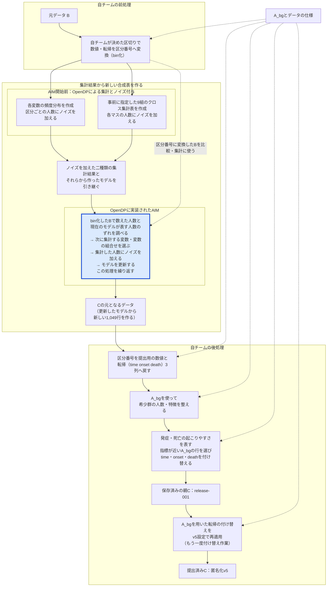
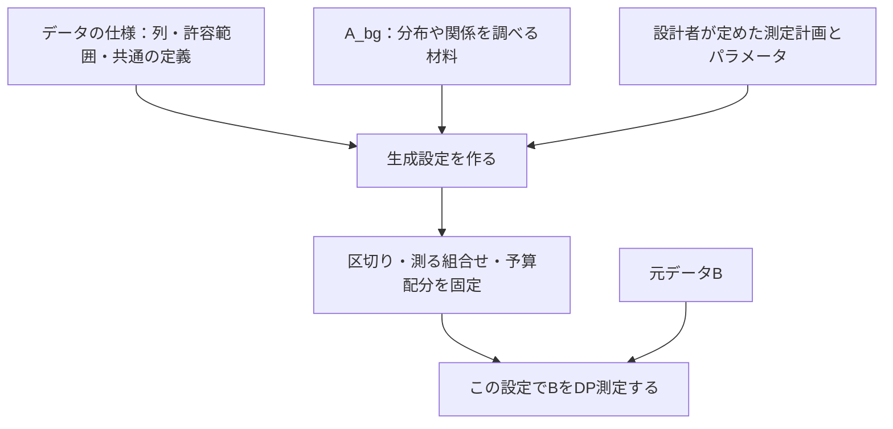

# 第1部　予備戦の匿名化フェーズ：集団の特徴を保ってCを作る

[全体案内](README.md) · [次：攻撃フェーズ](02_attack.md)

この部では、**何を使い、どの順序で処理し、何を提出したか**を説明する。全体の流れを確認してから、準備、集計と合成、A_bgによる調整、提出v5の結果を順に見ていく。

AIMの役割と主な設定は本編で説明する。集計の選び方やモデルの更新、予算配分の詳しい計算は、[時間があるときに読む補足資料](SUPPLEMENT_AIM.md)にまとめた。

## 1. 匿名化フェーズの目標

匿名化フェーズの目標は、自チーム（team24）の元データBから、**研究に利用できる有用性と、個人の情報を守る匿名性を両立した匿名化データCを作ること**である。

有用性の面では、Cを分析したときにも、元データに近い傾向や結論が得られることを目指す。匿名性の面では、Cを見た相手が、特定の個人がBに含まれていたか、その人の追跡年数はいくつかを推測しにくくすることを目指す。

### 大まかに何をしたか

大まかには、**「Bを集計する → 集計から新しい表を作る → A_bgで整えてCを提出する」**という流れである。

1. **Bの特徴を集計した。** 年齢や検査値、追跡結果を区分に分け、区分ごとの人数や列どうしの関係を調べた。
2. **集計から新しい表を作った。** Bから得たノイズ付きの集計結果をもとに、1,049行の合成表を作った。
3. **A_bgで整えて提出した。** 全チームが利用できるA_bgを用いて、希少群の人数・特徴と追跡結果を整え、最終的にv5のCを提出した。

転帰などの用語の意味は、[第3節「用語の整理」](#terminology)にまとめる。

### 有用性の評価方法

予備戦の有用性は、集団全体の特徴、指定された解析の再現性、希少群の特徴、データの妥当性という4つの観点で評価される。**4つの得点のうち、最も低いものが全体の有用性の得点になる。**

| 観点 | 調べたいこと | この提出で関係する工夫 |
|---|---|---|
| U_gen | 分布や集団の発症曲線などが保たれるか | 各変数や二変数の組合せの頻度分布を使う合成 |
| U_spec | 指定された解析の結論・判別性能が再現されるか | 転帰との組合せの測定、A_bgを用いた転帰の付け替え |
| U_rare | 希少群の割合や特徴が保たれるか | 希少群を意識した測定とA_bgを用いた人数・特徴の調整 |
| U_valid | 打ち切りの整合性などが保たれるか | 転帰3列を一組として扱う |

たとえば、4つの得点が `0.95, 0.42, 0.90, 0.85` なら、全体の有用性Uは0.42になる。U_genだけを0.99に上げても、Uは変わらない。そこで今回は、得点の低かったU_specの改善に取り組んだ。なお、大会の総合得点は有用性だけで決まるものではなく、匿名性も評価される。［根拠：S1］

## 2. 何を使い、どの順序でCを作ったか

提出済みCは、postprocess-v5-uspec-001/C.csvである。このCができるまでの流れを、以下に示す。［根拠：S2・S3］

Bは自チームの元データ、A_bgは全チームが利用できる背景データである。

また、提出v5の元にした保存済みのCを「親C」と呼ぶ。親Cは、A_bgによる調整を済ませ、`release-001` として保存した表である。

### 2.1 準備、集計と合成、A_bgによる調整の順に進めた

まず、Bの数値や転帰を集計しやすい形に変換し、その集計結果から新しい合成表を作った。次に、A_bgを使って希少群の特徴と転帰を整え、提出するCに仕上げた。

**AIMは、各変数の頻度分布と、事前に指定した9組のクロス集計から得た、ノイズを加えた集計結果とモデルを引き継いだ。** その後、Bとのずれを調べて次の集計を選び、モデルを更新した。AIMの前の値の変換や、合成後のA_bgによる調整は、自チームが用意した処理である。



この図は、情報がどこで使われるかを示している。各変数の頻度分布と9組のクロス集計表は、AIMへ引き継ぐ二つの材料として横に並べた。実際の処理では、各変数の頻度分布、9組のクロス集計の順に人数を数えてノイズを加え、その過程でモデルを作成・更新した。

図中の「各変数の頻度分布」は、元データBの各変数について、区分ごとの人数を示したものである。ここでは「度数分布」と同じ意味で用いている。例えば年齢なら、それぞれの年齢区分にBの人が何人含まれるかを数える。9組のクロス集計表では、二つの変数の区分の組合せごとに人数を数える。いずれも、数えた人数にノイズを加えた集計結果をモデルの作成に用いる。

**ノイズを加える処理は、初期集計の段階と、AIMが集計を選んで測る段階の両方にある。** OpenDPは、差分プライバシーの処理を実行するためのライブラリである。AIMは、集計の選択とモデルの更新を繰り返す手法であり、今回はOpenDPに実装されたAIMを使った。それぞれの段階でノイズを加える処理は、次のとおりである。

| 段階 | ノイズを加える処理の担当 | ノイズを加えるタイミング |
|---|---|---|
| 各変数の頻度分布 | OpenDPの初期集計処理 | 区分ごとの人数を数えた後、モデルを作る前 |
| 事前に指定した9組のクロス集計 | OpenDPの事前に指定した集計を行う処理 | 各マスの人数を数えた後、モデルに反映する前 |
| AIMが選ぶ集計 | OpenDPに実装されたAIM | 選んだ集計の人数を数えた後、モデルに反映する前 |

**今回、最初の頻度分布と9組のクロス集計へのノイズ付与は、AIMを開始する前に行った。** 頻度分布の人数にノイズを加えてモデルを作り、続く9組のクロス集計でも人数にノイズを加えてモデルを更新した。その後、AIMが選んだ集計にもノイズを加え、モデルの更新を繰り返した。いずれの段階でも、設定したDP予算に従ってOpenDPがノイズを加えた。［根拠：S4・S16］

AIMは、最初の二種類の集計結果とモデルに加えて、区分番号へ変換（bin化）したBも処理内部で参照する。図では、この参照を点線で示した。**「集計を選ぶ」とは、用意した候補の中から、次にノイズを加えた集計結果を作り、モデルに反映する変数・変数の組合せを選ぶことである。** 例えば「年齢区分×BMI区分」が選ばれたら、そのクロス集計の各マスの人数にノイズを加え、その結果でモデルを更新する。

集計を選ぶ際は、候補ごとに、bin化したBで数えた人数と、現在のモデルが表す人数とのずれを調べる。そのずれの大きさなどを参考に、プライバシーを保つためのランダム性も加えて選ぶ。選択にもDP予算を使い、選んだ集計の人数にもノイズを加えて、モデルを更新する。［根拠：S4・S16］

図中の「転帰」「データの仕様」などの意味は、[第3節「用語の整理」](#terminology)で説明する。

図の最初の工程では、**あらかじめ自チームが決めた区切りに従い、Bの年齢・検査値・転帰を区分番号に変換する。** 区切り方を決める材料には、A_bgやデータの仕様などの公開情報を使った。

こうした変換や生成のルールを、本資料では「自チームが用意した生成設定」、以後は「生成設定」と呼ぶ。公開情報をもとに作った設定という意味であり、設定ファイルを一般公開したという意味ではない。区切り方と変換の具体例は、第3節で説明する。

「AIM開始前」の枠では、OpenDPの初期集計・事前に指定した集計の処理がノイズを加える。続く青い枠では、OpenDPに実装されたAIMが、集計の選択、人数へのノイズ付与、モデルの更新を繰り返す。集計と合成には、OpenDP・Private-PGMの機能を使った。それぞれが内部でどの役割を担ったかは、補足資料のA1節で説明する。［根拠：S4・S16］

親Cでは、希少群の人数・特徴の調整と、転帰の付け替えをすでに終えている。v5では、この親Cの年齢や検査値など10列を保ち、転帰の3列だけをもう一度付け替えた。以後、転帰以外の10列を「共変量」と呼ぶ。v5を作る際に、AIMは再実行していない。

### 2.2 各工程で、何を受け取り、何を作ったか

| 工程 | 使ったもの | 行ったことと、得られたもの |
|---|---|---|
| 準備 | A_bg、事務局のデータの仕様、自チームの設計 | 数値の区切りや測る組合せなどの生成設定を用意した |
| 区分番号への変換 | B、生成設定 | 年齢・検査値・転帰を、集計で扱う区分番号へ変換した |
| 集計と合成 | 区分番号へ変換したB、生成設定 | 各変数の頻度分布と、事前に指定した9組のクロス集計表を作成した。各区分・各マスの人数にノイズを加え、AIMによる測定結果も使って1,049行の合成表を作った |
| 提出用の値への変換 | 合成表、生成設定、A_bgなど | 区分番号を年齢・検査値と転帰3列の形へ戻した |
| 希少群と転帰の調整 | 合成表、A_bg | 希少群の年齢・検査値7列を調整し、その後、転帰3列を付け替えて親Cを保存した |
| v5設定での再適用 | 保存済みの親C、A_bg | 共変量10列を保ち、転帰3列をもう一度付け替えて提出Cを作った |

集計と合成にはOpenDP・AIM・Private-PGMを使い、準備とA_bgによる調整には自チームが用意した処理を使った。**親Cから提出v5を作る際に、AIMを再実行したわけではない。**［根拠：S3・S4・S16］

### 2.3 合成直後の表を、提出用のCに整える

集計結果から最初に作ったのは、内部で使う12列を持つ、1,049行の合成表である。年齢や検査値は区分番号で表し、転帰の情報は `outcome_state` という1列にまとめた。希少かどうかを示す補助列 `rare_flag` も含んでいる。この時点では、提出用の13列の形にはなっていない。

**time・onset・deathの情報も、合成の対象に含まれている。** この3列は、転帰の種類と時間帯を表す `outcome_state` という1列にまとめ、年齢や検査値と一緒に集計・合成した。

今回の設定では、打ち切り1区分・発症6時間帯・死亡6時間帯の計13区分に分けた。発症や死亡までの年数は、一定の幅を持つ時間帯にまとめている。一方、打ち切りは追跡年数にかかわらず、一つの区分にまとめている。［根拠：S4・S15］

<a id="outcome-state"></a>

#### 転帰の区分番号 outcome_state：0〜12の対応表

元データの各行の `time`（追跡年数）・`onset`（発症の有無）・`death`（死亡の有無）を、次の対応で一つの区分番号へ変換する。**番号は転帰の種類と時間帯を識別するためのもので、重症度や年数そのものを表す値ではない。**

| outcome_state | 転帰 | timeの範囲（入力を番号へ変換するとき） | onset | death |
|---:|---|---|---:|---:|
| 0 | 打ち切り（発症も死亡も観測されていない） | 追跡年数にかかわらず同じ区分 | 0 | 0 |
| 1 | 発症 | 約1日以上〜1年以下 | 1 | 0 |
| 2 | 発症 | 1年超〜2年以下 | 1 | 0 |
| 3 | 発症 | 2年超〜4年以下 | 1 | 0 |
| 4 | 発症 | 4年超〜6年以下 | 1 | 0 |
| 5 | 発症 | 6年超〜8年以下 | 1 | 0 |
| 6 | 発症 | 8年超〜10年以下 | 1 | 0 |
| 7 | 死亡 | 約1日以上〜1年以下 | 0 | 1 |
| 8 | 死亡 | 1年超〜2年以下 | 0 | 1 |
| 9 | 死亡 | 2年超〜4年以下 | 0 | 1 |
| 10 | 死亡 | 4年超〜6年以下 | 0 | 1 |
| 11 | 死亡 | 6年超〜8年以下 | 0 | 1 |
| 12 | 死亡 | 8年超〜10年以下 | 0 | 1 |

例えば、`time=3.2, onset=1, death=0` なら `outcome_state=3`、`time=3.2, onset=0, death=1` なら `9` になる。発症も死亡も観測されていなければ `0` である。境界ちょうどの値は早い側の時間帯に入るため、2年ちょうどでの発症は `2`、4年ちょうどでの発症は `3` になる。［根拠：S4・S15］

時間の区切りと番号の意味は、自チームの生成設定で事前に固定している。AIMが区切り方を自動で決めるわけではない。［根拠：S4・S15］

#### 区分番号を集計・合成し、3列へ戻す

この区分番号を使った集計・合成の流れは、次のようになる。元データの3列を一つの区分番号に変換し、その区分を含む新しい行を合成してから、再び3列の形へ変換する。

```text
元データBの time・onset・death
  ↓ 事前に決めた対応で、一つの区分番号へ変換
outcome_state（0〜12）
  ↓ 年齢などとのクロス集計表を作成し、各マスの人数にDPノイズを加える
ノイズ付きの集計結果
  ↓ 集計結果から分布を推定し、新しい行を合成する（Private-PGM）
合成された outcome_state（0〜12）
  ↓ 番号が表す転帰の種類と時間帯に従って変換
復元された time・onset・deathの値のセット
```

**ノイズを加える対象は、`outcome_state` の番号そのものではなく、集計した人数である。** したがって、合成後の列は「ノイズ付きの集計結果から生成した `outcome_state`」と捉えるとよい。合成された番号も0〜12のいずれかであり、その番号に対応する発症・死亡の有無と追跡年数を生成する。区分番号を3列へ戻す具体例は第5.1節で示す。［根拠：S4・S15・S16］

| 段階 | 年齢・検査値 | 転帰 | 列構成 |
|---|---|---|---|
| 集計結果をもとに作った合成表 | 区分番号 | `outcome_state` | 内部12列。`rare_flag`を含む |
| 区分番号を提出用の値へ戻した表 | 実際の年齢・検査値の形 | 合成した `outcome_state` から戻した `time`・`onset`・`death` | 提出形式の13列 |
| A_bgで調整した親C | 実際の年齢・検査値の形 | `time`・`onset`・`death` | 提出形式の13列 |
| 転帰をもう一度付け替えた提出v5 | 親Cの共変量を維持 | A_bgからもう一度付け替えた3列 | 提出形式の13列 |

AIMを含む集計・合成の段階では、年齢や検査値と転帰との関係を扱っている。合成した `outcome_state` はいったん3列の形に戻し、その後、A_bgを用いて3列を付け替える。**A_bgによる付け替えは、すでに作られた合成行の転帰を調整する後処理**である。［根拠：S4］

このように、合成表の区分番号を数値へ戻し、希少群と転帰を調整して、提出用のCを作った。今回の手法は、**公開情報を使った準備、事前に指定した組合せのクロス集計とAIM・Private-PGMによる集計・合成、A_bgを使った調整**を組み合わせたものである。

<a id="terminology"></a>

## 3. 用語の整理

この節では、転帰、共変量、希少群、データの仕様、生成設定など、本文で使う用語の意味と、今回の処理でどのように使ったかを説明する。

### 転帰（てんき）：追跡した結果、どうなったか

**転帰とは、病気や健康状態の経過を追った結果、対象者がどのような状態に至ったかを指す言葉である。** 平たく言えば、「その人を追跡した結果、どうなったか」という意味である。今回のデータでは、糖尿病を発症した、発症前に死亡した、発症も死亡も観測されないまま観察期間が終わった、といった結果を指す。

今回の資料で「転帰3列」と呼ぶのは、その結果と、そこまでの追跡年数を記録する次の3列である。［根拠：S1・S15］

| 列 | 意味 |
|---|---|
| `time` | 発症・死亡・観察終了までの追跡年数 |
| `onset` | 糖尿病を発症したか。1なら発症 |
| `death` | 発症前に死亡したか。1なら死亡 |

次は説明用の架空例である。

| `time` | `onset` | `death` | 読み方 |
|---:|---:|---:|---|
| 3 | 1 | 0 | 追跡開始から3年後に発症した |
| 6 | 0 | 1 | 発症せず、6年後に死亡した |
| 10 | 0 | 0 | 10年間、発症も死亡も観測されずに観察が終了した |

最後のケースを**「打ち切り」**と呼ぶ。「その後も発症しない」と分かったわけではなく、そこで観察が終わったという意味である。`time=10` だけを見て「10年目に発症した」と読まず、`onset`・`death` と合わせて解釈する。

後で出てくる「年齢×転帰を集計する」は、例えば「年齢層ごとに、何年以内に発症した人が何人いたかを数える」ということである。また「転帰を付け替える」は、合成した行にある `time`・`onset`・`death` の値を、選んだA_bgの行の値へ置き換える処理を指す。

<a id="covariates"></a>

### 共変量（きょうへんりょう）：転帰を説明する側の変数

**共変量とは、解析で結果を説明・予測したり、条件の違いを考慮したりするために用いる変数である。** 今回であれば、発症・死亡との関係を調べる年齢、性別、検査値、喫煙などがこれに当たる。

本資料では、**提出用Cの13列のうち、転帰の `time`・`onset`・`death` を除く10列を「共変量」と総称する。** 具体的には、年齢（age）、性別（sex）、県（prefecture）、BMI、SBP、TG、HDL、ALT、喫煙（smoking）、FPGである。［根拠：S15］

したがって、「共変量10列を保って転帰を付け替える」とは、合成行の年齢や検査値などの特徴を保ったまま、`time`・`onset`・`death` の3列を置き換えることである。［根拠：S3・S4］

なお、この資料で総称する10列のうち、今回のCoxモデルに実際に用いたのは、県を除く9変数である。モデルに使う変数の範囲は、各処理の説明で示す。［根拠：S4・S20］

### 希少群（きしょうぐん）：年齢・検査値の組合せが珍しい集団

**今回の資料でいう希少群とは、年齢や検査値の組合せが、基準となる集団の一般的な傾向から大きく離れた特徴を持つ人々の集団である。** 匿名化処理では、事務局が提供した公開判定器を使い、希少かどうかを判定した。

判定に使うのは、**年齢（age）・BMI・SBP・TG・HDL・ALT・FPGの7変数**である。それぞれの値を一組として見て、基準集団からの離れ具合を調べる。その指標を「マハラノビス距離」と呼ぶ。変数ごとの単位の違いと、変数どうしの関係を考慮した指標であり、今回の公開判定器では、この距離が4.0以上の行を希少と判定する。［根拠：S4・S15］

したがって、単に人数が少ない性別や県などを希少群と呼んでいるわけではない。**年齢・検査値の組合せが、基準集団に照らしてどの程度珍しいか**に着目している。

この判定結果は、事務局が持つ真の希少群のラベルと常に一致するとは限らない。自チームの匿名化処理では、真のラベルを入力せず、公開判定器の結果を使って希少群の人数や特徴を調整した。具体的な調整方法は第5.2節で説明する。［根拠：S4・S20］

### 処理の準備と集計に関する用語

次に、処理を理解するうえで必要な三つの用語を整理する。

| 用語 | 意味 | 今回の例 |
|---|---|---|
| データの仕様 | 表の列や、入れてよい値・組合せ | 提出Cの列一覧、年齢40〜74、BMI10〜55 |
| 生成設定 | その表から合成データを作るための具体的な手順・設定値 | 年齢の区切り、測る列の組合せ、AIMの予算配分 |
| クロス集計表（分割表） | 二つの変数を組み合わせ、区分の組合せごとの人数を示した表 | 年齢区分と転帰区分の組合せごとの人数表 |

データの仕様は**表に入れてよい列や値の決まり**、生成設定は**合成データの作り方を定めたもの**である。クロス集計表は**変数どうしの関係を人数で表したもの**であり、今回は自チームが事前に指定した9組について、ノイズを加えた表を合成に用いた。以下では、実際の設定と明記した数値以外は、説明用の架空例を使う。

### 3.1 データの仕様：表に何を入れてよいかを定義する

**データの仕様は、事務局が定めた列名、使える値の範囲、許される値の組合せなどの決まりである。** 今回は、これらの情報が `schema.json` にまとめられている。CSVの値が条件に合っているかを確かめたり、合成データの作り方を決めたりする際に使う。

たとえば、実際のデータの仕様には次の情報がある。［根拠：S15］

| 項目 | 実際の内容 | 何に使うか |
|---|---|---|
| 提出Cの列 | `age`、`sex`、…、`time`、`onset`、`death` の13列 | 列の過不足と順序を確認する |
| 配布データの列 | 上記に `record_id` を加えた列 | 入力と提出物の違いを確認する |
| 年齢の範囲 | 40〜74 | 範囲外の値を検出する、区切りの両端を決める |
| BMIの範囲 | 10〜55 | 同上 |
| SBPの範囲 | 40〜250 | 同上 |
| 許される発症・死亡フラグ | `(0,0)`、`(0,1)`、`(1,0)` | この表で許されない組合せを検出する |
| AIAで公開される属性 | 7列の一覧 | AIAで観測できる情報を特定する |
| 希少群の検出器 | 対象列・基準・閾値など | 共通の基準で希少らしさを評価する |

たとえば、提出Cに `record_id` が混ざっていたり、年齢が82になっていたりすれば、仕様との不一致が分かる。データの仕様は、このような検査や前処理の基準になる。大会の全ルールがこの一ファイルに入っているわけではなく、ルールブックや採点設定も別にある。

**データの仕様に「年齢40〜74」と書いてあることは、Bに40歳や74歳の人が実際にいることを意味しない。** データを見て得た最小値・最大値ではなく、今回のデータとして許す範囲である。

データの仕様だけでは、50歳の人が何人いるか、年齢と発症がどう関係するかは分からない。こうしたBの特徴を調べるために、集計を行う。

### 3.2 生成設定：自チームが変換・生成の方法を決める

データの仕様で「年齢は40〜74」と決まっていても、合成するときの扱い方は一通りではない。1歳刻みで扱うか、いくつかの区間にまとめるかを決める必要がある。ほかにも、重視する列の組合せや、DP予算の配り方を決めておく。

**生成設定は、データの変換方法や合成の手順を自チームで決め、まとめたものである。** 図の最初の工程で使うのは、このうち「数値や転帰を、どの区切りで分類するか」というルールである。設定ファイルには、主に次の二種類の情報をまとめた。

1. 事務局が公開したデータの仕様・A_bgから計算できる値。例：区切りの境界、A_bgから学んだ発症・死亡のリスクを比べるモデルの係数。
2. 設計者が固定した手順・設定値。例：測る列の組合せ、ρ、反復の設定、予算の配分比。

ここで使う「公開情報」は、全チームが利用できるA_bgやデータの仕様を指す。**生成設定は、これらの情報に自チームが決めたルールや値を加えて作ったものである。** 設定を作る処理と、その設定の採用を決める過程との違いは、第8節で説明する。

今回、生成設定を作る処理では、A_bgとデータの仕様を使った。ここではBを読み込まず、公開情報から区切りや係数を計算し、自チームが決めたAIMのパラメータや集計項目と合わせた。［根拠：S15］



生成設定を用意した後は、その設定に従ってBを区分番号に変換し、集計を行う。Bを実際に集計するまでは、区分ごとの人数は分からない。

### 3.3 生成設定の例：年齢を「ビン」に分ける

**ビン（bin）は、値をまとめる区間**である。年齢なら「この区間に何人いるか」を数えるための箱、と考えられる。ビン化は、実数や整数の値を、その箱の番号へ変えることである。

実際の親Cの生成に使った年齢の境界は、次であった。

```text
40, 41, 44, 48, 55, 62, 69, 73, 74
```

これは境界9個から区間8個を作る設定である。今回の区切り方では、最初の四つは次のようになる。

| 区分番号 | 元の年齢の範囲 | 年齢が整数の場合の例 |
|---|---|---|
| 0 | 40以上41以下 | 40、41 |
| 1 | 41より大きく44以下 | 42、43、44 |
| 2 | 44より大きく48以下 | 45、46、47、48 |
| 3 | 48より大きく55以下 | 49〜55 |

たとえば、52歳も53歳も区分番号3に変換する。このように、**年齢そのものを使う代わりに、年齢が入る区間の番号を使って集計する**。これが「ビン化」や「符号化」と呼ぶ処理の一例である。区分番号3は「3歳」を意味しない。

境界が5歳刻みになっていないのは、A_bgの分布を使って決めたためである。区切りを作る際は、A_bgの5・15・30・50・70・85・95パーセンタイルを内部境界の候補にし、データの仕様の下限と上限を両端へ置く。パーセンタイルは、小さい順に並べたときに何%の位置にあるか、という区切り方である。年齢は丸め、重複する境界を除く。**等幅でも、各ビンの人数が等しくなる区切りでもない。**［根拠：S15］

この例では、三つの役割を次のように分けられる。

- データの仕様：年齢として扱う範囲は40〜74。
- 生成設定：その範囲を上記の8区間へ分ける。
- 測定結果：Bの各区間に何人いるかを、DPで測って得る。

### 3.4 事前に指定した組合せのクロス集計表を作成する

**クロス集計表（分割表）とは、二つの変数を組み合わせ、区分の組合せごとに人数を数えて並べた表である。** 例えば、行を年齢区分、列を転帰区分とすると、各マスには両方の区分に該当する人数が入る。

今回は、元データBを集計できる形へ変換した後、自チーム（team24）が事前に指定した9組のクロス集計表を作成し、各マスの人数にノイズを加えた。事前に指定したのは、どの二変数を組み合わせるかである。9組は大会のルールで義務付けられたものではなく、転帰との関係を重視して自チームが選んだ。［根拠：S4・S15・S16］

> **9組を先に集計する意義：** この工程はAIMの下準備に当たる。AIMに選択を任せるだけでは、重視する組合せが測られないこともある。そのため、9組を先に集計し、ノイズを加えた結果をAIMに引き継ぐ。この測定にもDP予算を使う。

人数を数える段階は、Excelのピボットテーブルで、行に年齢区分、列に転帰区分、値に人数を置く場面に近い。今回の合成に用いるのは、この人数にノイズを加えた集計結果である。

たとえば、次の6人を考える。全員架空で、分かりやすさのため年齢区分・転帰区分も簡略化している。

| 人 | 年齢区分 | 転帰区分 |
|---|---|---|
| 人1 | 40代 | 発症 |
| 人2 | 40代 | 発症 |
| 人3 | 40代 | 打ち切り |
| 人4 | 50代 | 発症 |
| 人5 | 50代 | 打ち切り |
| 人6 | 50代 | 打ち切り |

この6人を年齢区分と転帰区分でクロス集計すると、次の表になる。ここでは、ノイズを加える前の人数を示す。

| 年齢区分 | 発症 | 打ち切り |
|---|---:|---:|
| 40代 | 2 | 1 |
| 50代 | 1 | 2 |

この表全体で、一つの集計項目と数える。「2」「1」「1」「2」の各マスを、それぞれ別の集計として数えるわけではない。実際のDP測定では、こうして数えた人数にノイズを加え、その測定値をモデル作成に使う。

**事前に決めるのは「年齢×転帰を集計する」という組合せである。各マスの人数はBを集計して求める。** 同じ組合せでも、入力Bが変われば人数は変わり、加えるノイズによっても測定値は変わる。

### 3.5 事前に指定した9組のクロス集計

親Cを作る際は、次の9組を事前に指定し、元データBから各組合せのクロス集計表を作成した。各マスの人数にはノイズを加えた。［根拠：S4・S15］

| クロス集計する変数の組合せ | 調べる関係 |
|---|---|
| `age × outcome_state` | 年齢区分と転帰 |
| `sex × outcome_state` | 性別と転帰 |
| `BMI × outcome_state` | BMI区分と転帰 |
| `SBP × outcome_state` | 血圧区分と転帰 |
| `TG × outcome_state` | 中性脂肪区分と転帰 |
| `HDL × outcome_state` | HDL区分と転帰 |
| `ALT × outcome_state` | ALT区分と転帰 |
| `smoking × outcome_state` | 喫煙と転帰 |
| `FPG × outcome_state` | 空腹時血糖区分と転帰 |

`×` は数値の掛け算ではなく、「この二列で分類して人数を数える」という意味である。9変数全部と転帰を一度に組み合わせた一枚の巨大な表ではなく、**一変数と転帰を組み合わせたクロス集計表を9種類**作る。

**`outcome_state` は、`time`・`onset`・`death` を一つにまとめた区分番号である。** 今回は、打ち切り1区分、発症6時間帯、死亡6時間帯の計13区分を使った。年齢は8区分なので、年齢と転帰の組合せは8×13＝104マスのクロス集計表になる。この表全体で、一つの集計項目と数える。

事前にこの9組を選んだのは、**事務局が有用性の評価に使うCox解析の9個の説明変数と、転帰との関係を保ちたかったためである。** 説明変数とは、発症の起こりやすさを説明するために使う年齢や検査値などの変数を指す。評価で使う9変数それぞれを転帰と組み合わせたため、9組となる。評価に使う変数は事務局の設定であり、その9変数と転帰を先にクロス集計する方針は自チームが決めた。［根拠：S4・S15・S20］

Cox解析は、発症までの時間を使い、年齢や検査値などが発症の起こりやすさとどう関係するかを、複数の変数を同時に考慮して調べる解析手法である。今回の特定の解析での有用性U_specでは、追跡年数と発症の有無を使い、元データBと合成データCで解析の結論や予測性能がどの程度再現されるかを評価する。［根拠：S20］

年齢だけの分布を測っても、年齢と転帰の関係は分からない。そのため、両者のクロス集計表にノイズを加えた結果も、モデルに反映させた。ただし、複数の変数を同時に使うCox解析の結果が、9種類のクロス集計だけで完全に再現されるとは限らない。

### 3.6 9組のクロス集計の後、AIMが必要な集計を測った

各変数の頻度分布と、事前に指定した9組のクロス集計表を作成し、人数にノイズを加えた後、AIMが次に測る集計を選んだ。その測定結果を加えることで、合成表を作るための情報を補った。

自チームが関心のある集計項目と、その重みを指定したリストを `workload` と呼ぶ。今回は、先に集計する9組を含む二変数39組を用意した。OpenDPは、この39組に含まれる単変数11種類も加え、計50種類を候補にする。その後、モデルのサイズ制約を満たす候補から、AIMが次の集計を選ぶ。既に集計した項目が再び選ばれることもある。選択と、人数にノイズを加えるDP測定は、あらかじめ配分した予算内で行った。［根拠：S4・S15・S16］

ここで説明する要点は、**先に自チームが重視する9組を測り、その後、AIMが選んだ集計の測定結果を加えた**という順序である。集計を選ぶ仕組みと39組の内訳は、補足資料のA2節に記載する。

### 3.7 後処理に出てくる用語

| 用語 | 意味 |
|---|---|
| 共変量 | 結果を説明・予測するために用いる変数。本資料では転帰以外の10列を総称する。[定義と列の一覧](#covariates)を参照 |
| ドナー | 合成行へコピーする値の元となるA_bgの行 |
| 親C | 提出v5の元になった保存済みのC（release-001）。希少群と転帰の調整を済ませている |
| 後処理 | 集計・合成の後に、得られた表を整える処理。今回はA_bgを使って希少群や転帰を調整した |

以降は、集計からどのような表ができ、その表のどの列をA_bgで調整したかを確認する。

## 4. 測定結果から、1,049行の合成表を作った

### 4.1 ノイズ付きの測定結果から、新しい行を作った

ここまでの変数ごとの集計・事前に指定した9組のクロス集計・AIMの測定で、ノイズ付きの集計結果が得られた。その結果が示す頻度分布や列どうしの関係をもとに、新しい行を1,049行作った。Bから人物を選んでその行を残すのではなく、集計から新しい表を作ったのである。

この時点でできたのは、第2.3節で示した内部12列の合成表である。年齢や検査値は区分番号で表し、転帰は `outcome_state` にまとめている。希少かどうかを示す補助列 `rare_flag` もある。**年齢や検査値だけでなく、転帰の情報も合成していた。**

`rare_flag` は、事務局の公開判定器による判定をもとに内部で使った補助列である。事務局が持つ真の希少群のラベルを入力したものではなく、提出Cの列にも含めない。［根拠：S4・S15］

得られた合成表に対して、次の第5節で説明する値への変換とA_bgによる調整を行った。合成表を作る内部の分布推定については、補足資料のA3節・A4節で説明する。

### 4.2 実際に使った主な設定

親Cの生成に使った主な設定を、次の表に示す。処理の規模や、どの設定が何に使われたかを確認するための表である。［根拠：S3・S15］

| 設定 | 実際の値 | 本編で押さえる意味 |
|---|---|---|
| `privacy.rho` | 0.1 | 親Cの生成に割り当てた総DP予算 |
| `oneway` | `all` | 最初に内部12列すべてについて、各変数の頻度分布を作成する |
| 事前に指定したクロス集計 | 9組 | 自チームが重視する、転帰と各変数の組合せを先に集計し、人数にノイズを加える |
| `workload` | 39組 | 自チームが指定した二変数の集計リスト。OpenDPが単変数11種類も加え、計50種類を候補にする |
| `rounds` | 16 | AIMの反復と一回当たりの予算に関わる設定値 |
| `max_size_mb` | 32 | AIMが測定候補を選ぶ際のモデルサイズ制約の基準（MB） |
| `output_rows` | 1,049 | 作成する合成行の数 |

`rounds=16` は、実際に16回測定したことを示す値ではない。予算配分の全設定、各パラメータの詳しい意味と計算は、[補足資料のA5節](SUPPLEMENT_AIM.md)にまとめる。

## 5. A_bgを使って何を補ったか

### 5.1 区分番号を提出用の値へ戻す操作

合成表の年齢や検査値は、「区分番号3」のような形で記録されている。提出する表には年齢や血圧などの数値を入れる必要があるため、区分番号を具体的な値へ変換した。**ここで「戻す」とは、合成された区分番号に具体的な数値を与えることであり、Bにあった元の人の数値を復元することではない。**
なお、この変換は、自チームが用意した後処理である。

**年齢・検査値は、合成された区分と同じ区分に入るA_bgの値を、ランダムに選んで当てはめた。** 対象は、年齢・BMI・SBP・TG・HDL・ALT・FPGの7変数である。

年齢を例にすると、次の手順である。区分番号3と年齢範囲の対応は実際の生成設定に基づくが、以下の候補の値と選択結果は説明用の架空例である。

1. **合成された区分番号を確認する。** ある合成行の年齢が区分番号3なら、今回の設定では「48歳超〜55歳以下」に対応する。

2. **A_bgの年齢も、同じ区切りで分類する。** A_bgから、同じ区分番号3に入る年齢の値を集める。

3. **候補からランダムに一つ選ぶ。** 候補が `49、50、50、53、55` なら、この中から例えば `53` を選び、合成行の年齢を53歳にする。候補は重複を残して扱うため、この例で50歳が選ばれる確率は2/5である。同じ候補を複数の合成行に使うこともある。

4. **ほかの合成行・変数にも、同じ処理を行う。** BMIならBMIの区分、血圧なら血圧の区分を使い、それぞれに対応するA_bgの値を選ぶ。［根拠：S4・S15］

この段階では、**変数ごとに別々に値を選ぶ。** 例えば、年齢はA_bgのある行から、BMIは別の行から選ばれることがある。合成表が持つ「年齢の区分とBMIの区分の組合せ」を土台に、それぞれの区分内の具体的な値を決める処理である。A_bgの一人分の年齢・検査値をまとめて移す処理とは異なる。

A_bgにその区分の候補がない場合に備えた代替処理もある。その場合は、区間の下限・上限を使い、年齢なら整数、検査値なら連続的な数値を一様乱数で生成する。一様乱数とは、指定した範囲の特定の場所を優先せずに値を選ぶ方法である。この代替処理が今回実際に使われた件数は確認していない。［根拠：S4］

#### 転帰：区分の意味から3列の値を作る

転帰の区分番号 `outcome_state` は、`time`・`onset`・`death` の3列へ変換する。**区分が表す転帰の種類から発症・死亡の有無を決め、時間帯から追跡年数を生成する。**

| 合成された区分番号 | 意味 | この段階で作る値 |
|---|---|---|
| 0 | 打ち切り | `onset=0`、`death=0`、`time=10` |
| 3 | 2〜4年の時間帯で発症 | `onset=1`、`death=0`、`time`は2〜4年の範囲から一様乱数で生成 |
| 9 | 2〜4年の時間帯で死亡 | `onset=0`、`death=1`、`time`は2〜4年の範囲から一様乱数で生成 |

表は実際の変換ルールから三つの区分を抜き出したものである。ほかの発症・死亡の区分でも、それぞれに対応する時間帯から追跡年数を生成する。全区分の対応は第2.3節に示す。ここで生成する追跡年数も、Bにあった元の人の正確な追跡年数を復元したものではない。［根拠：S4・S15］

**この時点の追跡年数は、A_bgから選んだ値ではない。** 第2.3節で示したように、転帰はいったん合成結果から3列の形に戻し、後の工程でリスクが近いA_bgの行から3列まとめて付け替える。

#### カテゴリと値の範囲を整える

性別・県・喫煙は、合成されたカテゴリの値をそのまま使う。また、数値への変換後は、年齢の小数部分を切り捨てて整数に整え、年齢・検査値・追跡年数が事務局の定めた範囲に収まるように調整する。範囲を外れた値は、対応する下限または上限に置き換える。［根拠：S4・S15］

この変換の後に、希少群の年齢・検査値の調整と、転帰の付け替えを行って提出用のCを仕上げた。希少群の調整は第5.2節、転帰の付け替えと再適用の経緯は第5.3節・第5.4節、ドナーの選び方は第6節で説明する。

### 5.2 A_bgを用いて、希少群の人数と特徴の組合せを整える

**希少群の修復とは、A_bgを使って、合成表の希少群の人数と年齢・検査値の組合せを整える処理である。** 人数の少ない集団の特徴は、合成や区分番号から数値への変換を経るうちに薄まることがある。値どうしの組合せが崩れる場合もあるため、A_bgで観測された組合せを使って補った。

この後処理では、事務局が提供した公開判定器を使い、次の7列の組合せが基準集団からどの程度離れているかを調べる。

**age・BMI・SBP・TG・HDL・ALT・FPG**

この離れ具合を「外れ度」と呼び、判定基準を満たす行を希少と判定する。外れ度の指標には、マハラノビス距離を使う。年齢や検査値の単位の違いと、値どうしの関係を考慮して、基準集団からの離れ具合を測る指標である。以下の「希少」「非希少」は、この公開判定器の判定を指す。［根拠：S4・S15］

調整の内容は次の三点である。

1. **A_bgを基準に、希少群の目標人数を決める。** A_bgで希少と判定される行の割合に、作成する合成表の行数を掛け、整数に丸めて目標人数とする。
2. **合成表から外れ度が高い順に目標人数分の行を選び、7列を付け替える。** 各行のage・BMI・SBP・TG・HDL・ALT・FPGを、A_bgの希少な行から一組としてコピーする。このコピー元の行を「ドナー」と呼ぶ。
3. **目標人数を超えて希少と判定される行を調整する。** 選択した行以外にも希少と判定される行が残っていれば、その7列をA_bgの非希少な行の値で置き換え、人数を整える。［根拠：S4・S15］

人数の計算を示す架空例として、A_bgの希少率を2％、作成する合成表を1,000行とする。この場合、希少群の目標人数は20行となる。**この2％・1,000行・20行は説明用の数値であり、予備戦の実測値ではない。** 実際の親Cの行数は1,049行である。

**7列を同じA_bgの行からまとめて移すことで、年齢や検査値の組合せを保つ。** 例えば、BMIと血糖値などを別々の行から選ぶと、A_bgにあった値どうしの関係が失われる場合がある。一組で移すことで、A_bgで観測された7列の関係を合成表へ取り込む。

この工程と、その後に行う転帰の付け替えでは、変更する列と目的が異なる。

| 工程 | A_bgから付け替える列 | 主な目的 |
|---|---|---|
| 希少群の修復 | age・BMI・SBP・TG・HDL・ALT・FPGの7列 | 希少群の人数と、年齢・検査値の組合せを整える |
| 転帰の付け替え | time・onset・deathの3列 | 調整後の年齢や検査値に対応する追跡結果を与える |

**希少群の修復では、合成した年齢や検査値そのものを置き換える。** その後、調整した値に合わせて、第5.3節で説明する転帰の付け替えを行う。目標人数はA_bgを基準に決める。この処理で参照するのは、DPによる合成表、A_bg、公開された判定基準である。

### 5.3 A_bgを用いて、転帰の3列を付け替える

**ここで行うのは、A_bgを用いた転帰の付け替えである。** 合成した各行について、発症・死亡のしやすさが似ている行をA_bgから選び、その行の `time`・`onset`・`death` をまとめてコピーする。**この工程では、合成行の年齢や検査値などの10列を保ったまま、すでにある転帰の3列だけを置き換える。**［根拠：S3・S4］

処理の順序は次の通りである。

1. あらかじめA_bgで学習したCoxモデルを使い、合成行とA_bgの各行について、発症・死亡のしやすさを比べる二つのリスク指標を求める。これらは比較用の値であり、発症確率や死亡確率そのものではない。
2. 自チームが定めた重み付きの距離で、二つの指標が最も近いA_bgの行を選ぶ。この選ばれた行を「ドナー」と呼ぶ。
3. ドナーの `time`・`onset`・`death` を、合成行へ3列まとめて移す。近さの比べ方とv5での重みは、第6節で説明する。

例えば、選ばれたA_bgの行に「6年後に発症した」と記録されていた場合、付け替えは次のようになる。**以下は説明用の架空例であり、実際の個票や処理結果ではない。**

| 行 | time：追跡年数 | onset：発症 | death：死亡 |
|---|---:|---:|---:|
| 後処理前の合成行 | 10 | 0 | 0 |
| 選ばれたA_bgの行 | 6 | 1 | 0 |
| 後処理後の合成行 | **6** | **1** | **0** |

この例では、合成行の転帰が「10年間、発症も死亡も観測されず観察終了」から「6年後に発症」へ置き換わる。年齢や検査値は、この付け替えの前後で変わらない。

`time`・`onset`・`death` を別々の行から移すと、追跡年数と発症・死亡の記録に矛盾が生じる場合がある。そこで、同じA_bgの行から3列をまとめて移し、記録の組合せを保った。

この処理の目的は、**Cでも年齢や検査値の特徴と、追跡結果との関係を保つこと**である。AIMによる合成の後に、自チームが行った後処理に当たる。

ただし「整合する組を移した」ことだけで、全体のU_validが1になるわけではない。合成された共変量との関係も評価されるためである。

### 5.4 再適用とDP：保存の前後で扱いは変わるか

**「再適用」は、保存済みの親Cに対して、設定を変えて転帰をもう一度付け替えた経緯を表す。** 親Cを作るときは死亡側のリスク指標に掛ける重みが0.25であり、v5では0.31に変更した。親Cの年齢や検査値などの10列を再利用し、A_bgの行を選び直して転帰の3列を置き換えた。二度付け替えること自体がDPのために必要だったわけではない。［根拠：S3・S15］

DPの保証で重要なのは、**保存する前か後かではなく、処理にどの情報を使うか**である。A_bgを固定の公開情報として扱い、設定をあらかじめ決めておく。その条件で、DPによって得た表とA_bgだけを使って転帰を付け替えるなら、元のDP保証を引き継げる。付け替え自体に追加のプライバシー予算は必要ない。これが、後処理に対する保証である。［根拠：S17］

次の表では、転帰の付け替えと保存に関わる工程を抜き出して示す。

| 場合 | 処理の流れ |
|---|---|
| 実際に行った流れ | DPによる合成 → 重み0.25で転帰を付け替える → 親Cをrelease-001として保存 → 重み0.31で転帰を付け替える |
| 最初からv5設定を使う場合 | DPによる合成 → 重み0.31で転帰を付け替える → Cを保存 |

設定の決め方などの条件が同じなら、後者もDPの後処理として扱える。**release-001として保存する前でも、DPによる合成が済んだ表に対して、上記の条件でA_bgを使う付け替えは行える。** 実際、親Cの生成時にも保存前に付け替えを行っている。保存という操作がDP保証を成立させるわけではない。［根拠：S4・S17］

一方、Bを直接使う操作は、付け替えだけの後処理とは分けて考える必要がある。また、Bと比較した非DPの自己採点を見て、設定や提出物を選ぶ過程も、別に検討する必要がある。今回の確認記録は、人の判断を含む全過程をρ＝0.1で保証したものではない。詳しくは、第8節とS3の選択過程の監査を参照する。

## 6. 転帰の付け替えでは、発症・死亡のリスクが近い行を選んだ

A_bgから転帰を移す際は、年齢や血圧が単純に近い行を選ぶだけでなく、**発症・死亡の起こりやすさを比べる二つの指標**を使った。

まず、A_bgの追跡結果と年齢・検査値などの関係をCoxモデルで学んだ。このモデルに合成行とA_bgの各行を当てはめ、発症側・死亡側の二つの指標を求めた。これらは比較用の値であり、発症確率・死亡確率そのものではない。

次に、二つの指標の尺度をそろえ、重みを使って近さを比較した。最も近いA_bgの行をドナーに選び、その行の `time`・`onset`・`death` を合成行へまとめて移した。［根拠：S3・S4］

| 作成したC | 死亡側の指標に掛けた重み | 実際に行った処理 |
|---|---:|---|
| 親C（release-001） | 0.25 | A_bgからドナーを選び、転帰3列を付け替えた |
| 提出v5 | 0.31 | 親Cの共変量10列を保ち、ドナーを選び直して転帰3列をもう一度付け替えた |

**0.31はA_bgのドナーを選ぶための重みであり、AIMのパラメータではない。** 数式による距離の計算と数値例は、[補足資料のB節](SUPPLEMENT_AIM.md)に記載する。

## 7. v5で実際に何が変わったか

親Cと提出v5を読み直したところ、共変量10列は一致した。変更対象は転帰3列である。記録上、死亡側の重み0.31は練習段階で選んだ設定を適用したもので、予備戦Bで多数の候補を探索して選んだものではない。［根拠：S2・S3］

以下は、予備戦データで行った**有用性の自己採点**の結果である。このPCに保存された記録を示しており、公式の匿名化総合順位や匿名性の得点を示すものではない。

| 指標 | 親C | 提出v5 |
|---|---:|---:|
| U_gen | 0.948522 | 0.948522 |
| U_spec | 0.416072 | 0.533590 |
| U_rare | 0.900853 | 0.900853 |
| U_valid | 0.847709 | 0.846091 |
| **U＝4観点の最小** | **0.416072** | **0.533590** |

改善幅は約0.1175である。最も低いU_specが上がったため、Uも上がった。U_validはわずかに下がっており、全観点が一斉に改善した結果ではない。また、この表だけから匿名性の改善までは判断できない。

## 8. パラメータと生成記録の対象範囲

記録されたρ=0.1は、親Cの生成に割り当てたDP予算である。v5で行ったA_bgによる転帰の付け替えでは、AIMを再実行せず、追加のρ予算も使っていない。

ただし、この値は生成処理とその後処理についての記録である。非DPの自己採点を見て人が設定を選ぶ過程や、ほかの探索まで含めた全過程のDP保証・総予算を示してはいない。第5.4節の後処理の条件と、S3の選択過程の監査を合わせて参照する。

## 9. まとめ

一連の処理は、次のように説明できる。

> 自チームの元データBを、年齢や検査値、転帰の区分ごとに集計できる形へ変換した。最初に、Bの各変数について区分ごとの人数を数え、ノイズを加えた頻度分布を作成した。次に、事前に指定した転帰に関係する9組のクロス集計表を作成し、各マスの人数にもノイズを加えた。その後、AIMが必要な集計を選んで測り、これらの測定結果から1,049行の合成表を作った。転帰の情報も、この合成に含めていた。
>
> 次に、区分番号を年齢・検査値と転帰3列の形に戻し、A_bgを使って希少群の人数と特徴を整えた。さらに、発症・死亡のリスクが近いA_bgの行から転帰3列をまとめて移し、親Cを保存した。
>
> 最後に、A_bgの行を選ぶ重みを変え、親Cの転帰3列だけをもう一度付け替えた。このようにして作ったCが、提出v5である。

説明できるかを確認する際は、次の点を押さえる。

1. B・A_bg・生成設定を、それぞれどの段階で使ったか。
2. 自チームが事前に組合せを指定したクロス集計と、AIMが組合せを選ぶ集計はどう違うか。
3. 合成直後の表には、転帰の情報がどの形で含まれていたか。
4. 希少群の調整と転帰の付け替えでは、それぞれどの列を変えたか。
5. 親Cから提出v5を作る際に、何を変え、何を保ったか。

第2部では、自チームが他チームのCをどう調べたかを説明する。匿名化側で守ろうとした「Bに含まれていたか」「追跡年数はいくつか」が、攻撃側では推測の対象になる。他チームの加工方式にはAIM以外もあるため、その違いへの対応も必要になる。

根拠番号は [SOURCES.md](SOURCES.md) に対応する。

[次：攻撃フェーズ](02_attack.md) · [時間があるときに読む補足](SUPPLEMENT_AIM.md)
