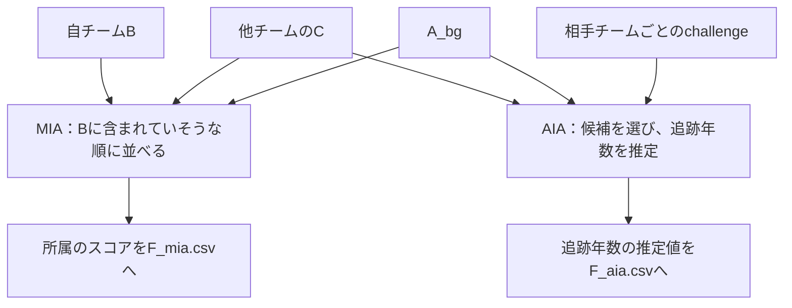
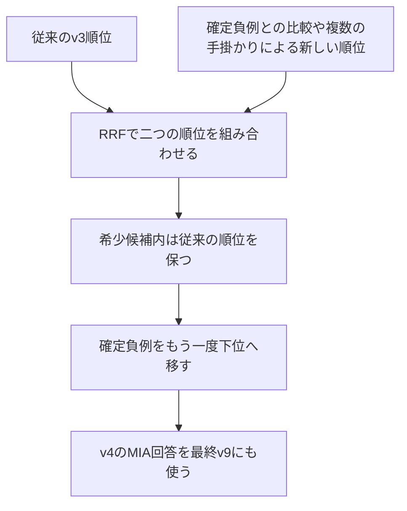

# 第2部　予備戦の攻撃フェーズ：Cから何が推測できるか

[全体案内](README.md) · [前：匿名化フェーズ](01_anonymization.md)

この部では、**どのデータを使って何を推測し、どの回答を提出したか**を説明する。

指標を作る過程を順に知りたい場合は、[ステップごとの詳細資料](ATTACK_STEP_BY_STEP.md)を参照する。計算式や判定条件を短く確認するための[補足資料](SUPPLEMENT_ATTACK.md)もある。

## 10. 攻撃フェーズの目標と、全体で行ったこと

攻撃フェーズでは、**他チームのCを手掛かりに、ある人が相手のBに含まれていたか、その人の追跡年数はいくつかを推測する。** 自チーム（team24）は、予備戦で20チームを相手に回答を提出した。

大まかには、次の三つを行った。

1. **人物の特徴と、相手のCを比べた。** 似た特徴の行がCにあるかを調べ、A_bgとの比較も判断に使った。
2. **Bに含まれていたか、追跡年数はいくつかを推測した。** 前者の回答をMIA、後者の回答をAIAとして作った。
3. **提出する回答を選んだ。** 複数の方式で作った回答を過去の採点結果で比較し、採用する回答を二つのCSVにまとめた。

### 10.1 MIAとAIAでは、候補と回答する内容が違う

MIAは「メンバーシップ推論」、AIAは「属性推論」の略である。推測の対象となる人物を「候補」、そのうち相手のBに含まれていた人物を「メンバー」と呼ぶ。また、対象IDは相手チームを区別する番号である。

| | MIA：メンバーシップ推論 | AIA：属性推論 |
|---|---|---|
| 問い | 自チームBにいる人は、相手のBにもいたか | 候補の人物の追跡年数はいくつか |
| 候補 | 自チームBの1,049行 | 相手チームごとに配られる候補データ（challenge）の326行 |
| 答える値 | 相手のBに含まれていそうな順に付ける、0〜1のスコア | 各候補の追跡年数を推定した値 `time_hat` |
| 最終ファイル | F_mia.csv | F_aia.csv |
| 推測の手掛かり | 候補とCの近さ、A_bgでの珍しさなど | 公開された7属性（QI）とCの対応、転帰の整合性など |

QIは、AIAの候補について公開される7属性である。今回は、年齢・SBP・TG・HDL・ALT・性別・県が該当する。これらの属性をまとめた表がchallengeで、追跡年数は伏せられている。AIAでは、この伏せられた `time` の値を推定して回答する。

### 10.2 使用した手元のデータ

| 使ったデータ | 主な使い方 |
|---|---|
| 他チームのC | 候補に似た行があるか、属性と追跡結果の関係が残っているかを調べた |
| 自チームのB | MIAで調べる1,049人の候補として使った |
| A_bg | Cで見つかった特徴が一般的なものかを比べる基準にした。また、属性と転帰の関係を学ぶためにも使った |
| 相手チームごとのchallenge | AIAで追跡年数を回答する人物の一覧として使った |
| 自チーム向けのchallenge | 自チームBと照合し、他チームのBには含まれない人物を特定した |

自チームBには、自チームだけに含まれる313人と、他の29セットのいずれかにも含まれる736人がいる。前者を「非共有」、後者を「共有」と呼ぶ。相手1チームと共有する人数は25〜27人である。この29セットはデータ全体の設計上の数であり、実際に攻撃した相手は20チームである。

AIAのchallengeは326行である。この中には、相手チームの非共有部分から選ばれたメンバー163人と、相手のBにいない「対照」163人が混ざっている。どの行がメンバーかは伏せられている。MIAとAIAでは、推測の対象となる人物の一覧が異なる。［根拠：S1・S5］

図は、回答を作るまでの大きな流れを示している。実際には複数の方式で回答を作り、最後に提出するものを選んだ。採用した回答は第16節にまとめる。

## 11. MIA：Bに含まれていたかを推測する手掛かり

### 11.1 候補とCの近さを、A_bgとの比較で評価した

最初に、候補の人物の特徴とCの各行の値を比べ、似た行があるかを調べた。最も似ている行までの距離を「最近傍距離」と呼ぶ。

ただし、よくある特徴を持つ人物なら、相手のBにいなくても似た行がCにあるかもしれない。そこで、A_bgにも似た特徴の行がどの程度あるかを調べた。**似た行がCにあるだけでなく、A_bgと比べても、その特徴がCで目立っているかを確認した。**

初期の方式では、使う属性の組合せを変えて距離を測った。さらに、候補に似た特徴の行がCとA_bgにどれくらい集まっているかも比べた。これを「密度の比較」と呼ぶ。距離と密度を手掛かりにしたが、Cの行がその人物に由来すると確認できたわけではない。［根拠：S6］

### 11.2 相手のBにいないことが分かる163人を特定した

相手のBにいない候補を「負例」と呼ぶ。

自チーム向けAIAのメンバーは、自チームだけに含まれる非共有の人物から選ばれる。このため、自チームのchallengeとBを照合すると、他チームのBにはいない人物を特定できる。

実際に照合すると、QIの7列が完全に一致し、Bのどの行に対応するかを一つに絞れる人物が163人いた。この163人を「確定負例」と呼ぶ。**確定負例を順位の下位に移し、相手のBにいないと分かっている人物を上位に並べないようにした。**［根拠：S7］

こうして特定できたのは、非共有313人のうち163人である。残る886行がすべて相手のBに含まれている、と分かったわけではない。

### 11.3 複数の相手への評価も合わせて調整した

共有された人物は、自チームのほかには一つのセットだけに含まれる。初期の方式では、この設計を踏まえて、複数の相手チームに対する評価をまとめて調整した。同じ人物を、どの相手のBにも含まれていそうだと高く評価しすぎないためである。［根拠：S6］

この調整の仕組みと共有人数の仮定は、補足資料のA節で説明する。

## 12. MIA：手掛かりを組み合わせ、最終的な順位を作った

最終提出には、v4で作ったMIAの回答を使った。v4では、それまでの方式で作った順位に、確定負例との比較などから作った新しい順位を組み合わせた。

### 12.1 相手のBにいない人を、比較の基準にした

確定負例163行は、ほかの候補を評価する際の比較にも使った。「Bにいない人でも、Cにどれくらい似た行が見つかるか」を知るためである。

ある候補とCとの距離が0.10だったとする。これは説明用の架空例である。確定負例の距離も多くが0.10前後なら、その候補だけが特に近いとはいえない。一方、確定負例の距離がほぼ0.50以上なら、0.10という距離はかなり近い。**このように、確定負例の距離を基準にして、候補の近さを評価した。**［根拠：S8］

このように基準に合わせて評価を調整することを「較正」と呼ぶ。計算式と、確定負例を基準にする際の注意点は、補足資料のB1節で説明する。

### 12.2 近さ以外の手掛かりも確認した

| 確認したこと | 何を見たか |
|---|---|
| 互いに近いか | 候補から見てCの行が近く、逆にそのCの行から見ても候補が近いか。これを相互最近傍と呼ぶ |
| 比べる属性を変えても、同じ行が近いか | 年齢・検査値などの組合せを変えても、同じCの行が対応先として選ばれるか |
| ほかのCと比べても近いか | どのチームのCにも似ているのか、あるチームのCに特に似ているのか |

これらを組み合わせて候補を評価した。ただし、共通のデータや属性を使っているため、それぞれを独立した証拠として扱うことはしない。［根拠：S8］

### 12.3 従来の順位と新しい順位を合わせた

以前の方式であるv3の順位と、v4で新たに作った順位を、RRFという方法で組み合わせた。二つの順位の両方で上位にいる候補を重視する方法である。

その後、事務局の公開判定器で希少とされた候補については、その候補どうしの順序をv3と同じに戻した。最後に、確定負例をもう一度下位へ移した。こうして、全体の順位を調整しつつ、希少な候補どうしの順序は従来のまま保った。［根拠：S8］

**最終v9のMIAファイルは、v4とバイト単位で同一である。** RRFの計算方法と、途中で使った割当の条件が最終順位にどう関わるかは、補足資料のB3節で説明する。

### 12.4 提出したスコアは、所属の順位を表す値である

提出したスコアは0〜1の値で、「相手のBに含まれていそうな順」を表す。0.9というスコアが、所属確率90%を意味するわけではない。

MIAでは、相手のBにいない人を誤って上位に置くことを抑えながら、実際に含まれていた人をどれだけ上位に集められるかが重要である。全員を非メンバーと答えて約98%正解しても、有効な攻撃を示したことにはならない。［根拠：S1・S8］

## 13. AIA：候補を選び、その人の追跡年数を推定した

### 13.1 まず、追跡年数を当てにいく候補を選んだ

AIAのchallengeには、相手のBに含まれるメンバーと、含まれない対照が混ざっている。そこで、回答を作る作業を次の二段階に分けた。

1. **選別：** 相手のBに含まれていそうな人物を選び、その人の追跡年数を当てることを目指す。
2. **推定：** 選んだ人物について、Cで対応すると考えた行などを使い、回答する追跡年数を決める。

選ばなかった人物についても、回答欄を空にすることはできない。今回は、その人の追跡年数を当てないための値として11.0を使った。候補の選び方と追跡年数の決め方は第14節で、11.0を使う理由は第15節で説明する。

### 13.2 メンバーの追跡年数を、対照より高い割合で当てる

回答と実際の追跡年数との差が±0.5年以内なら、的中と判定される。ただし、メンバーの追跡年数をよく当てるだけでは、高い得点になるとは限らない。対照の追跡年数も同じように当たっていると、得点は伸びにくい。

| 説明用の予測 | メンバーの的中率 | 対照の的中率 | 全体側の得点例 |
|---|---:|---:|---:|
| メンバーにも対照にもよく当たる | 0.90 | 0.90 | 0.00 |
| 対照よりメンバーによく当たる | 0.80 | 0.60 | 0.50 |
| 対照の方によく当たる | 0.60 | 0.80 | 0.00 |

全員に同じように当たりやすい年数を答えても、対照にも当たってしまい、得点につながらない場合がある。そこで、**Cを手掛かりにメンバーらしい人物を選び、対照より高い割合で追跡年数を当てることを目指した。**

メンバーを選べても、追跡年数を外せば得点にはつながらない。反対に、対照の追跡年数を多く当てると、メンバーとの的中率の差が小さくなる。このため、人物の選び方と年数の予測方法を、両方とも工夫する必要があった。採点式と希少群の評価に使う補正は、補足資料のC1節で説明する。［根拠：S1・S9］

## 14. AIAでは、三つの方式で回答を作った

候補とCを比べる方法を変え、三つの方式で回答を作った。保存した回答を区別するため、それぞれをv4・independent・routedと呼んでいる。

### 14.1 候補とCの行を一対一で組み合わせた（v4系）

challengeから163人を選ぶ作業と、その人たちにCの行を割り当てる作業を同時に行った。QIの近さなどから組合せのコストを求め、全体のコストが小さくなる一対一の対応を選んだ。同じCの行を、別の候補にも重ねて割り当てることはしなかった。

メンバーが半数であることを踏まえ、326行から163行を選んだ。この163行は、モデルがメンバーらしいと判断した行であり、実際の所属を確認できたわけではない。

回答する追跡年数は、割り当てたCの行をもとに決めた。対応が十分近く、発症や死亡の記録がある場合は、Cの追跡年数を答えた。打ち切りの記録や、対応が遠い場合は、観察上限の10年に切り替えた。［根拠：S6〜S8］

### 14.2 属性の組を変えて、対応を探した（independent系）

使う属性を変え、六つの組合せでCの行との近さを調べた。それぞれの組合せで見つけた対応を総合して、追跡年数を推定した。

この方式では、同じCの行を複数の候補に割り当てることができる。Cの追跡年数を参照するほか、予測モデルを使った補正も加えた。［根拠：S10］

independentは、この方式を区別するための名前である。他の方式と統計的に独立していることを示す名前ではない。

### 14.3 相手のCに応じて、選び方を変えた（routed系）

相手チームによってCの作り方が異なるため、どのCにも同じ比べ方が有効とは限らない。そこで、Cの特徴に応じて、近い行を探す方法や、CとA_bgの密度を比べる方法などを使い分けた。

最終v9では、対象10と20にこの方式の回答を使った。対象10では、v4による対応を重視して、発症・死亡までの年数を推定した。対象20では、CとA_bgの密度を比べて候補を選び、観察上限の年数を答えた。最終版には、これらの保存済みの回答を使った。［根拠：S11・S12］

### 14.4 Cの追跡結果を使えるかも確認した

v4系とindependent系では、まずA_bgを使い、QIと発症・死亡の有無との関係を学んだ。そのモデルを相手のCにも当てはめ、同じ関係を捉えられるかを確認した。捉えにくい場合は、行ごとに追跡年数を推定する方法から、観察上限を答える方法へ切り替えた。

これは、Cの追跡結果を予測に使ってよいかを判断するための確認である。人物が相手のBに含まれていたかや、本当の追跡年数を確かめたわけではない。確認に使ったAUCという指標と、方式ごとの判定基準は、補足資料のC2節・C3節で説明する。［根拠：S8・S10］

## 15. 得点が0だった7チームでは、候補の選び方と回答値を変えた

### 15.1 11.0は、追跡年数を当てにいかないための値

実際の追跡年数は0年より長く10年以内であり、正解と判定される誤差は0.5年以内である。11.0と答えると、どの正解からも0.5年を超えて離れる。そのため、追跡年数を当てる対象から外した人物には、11.0と回答した。

提出CSVには、空欄や棄権を示す記号ではなく、数値の11.0を記入した。「11年後に発症する」と予測したわけではない。

### 15.2 三方式すべてが選んだ行を除き、9.5と答えた

v4・independent・routedの三方式のいずれでも、AIA得点が0だった相手が7チームあった。v7では、この7チームに対して候補の選び方を変えた。

**三方式すべてが選んだ人物には11.0、それ以外の人物には9.5と答えた。**

| 三方式による選別 | v7での回答 | 意味 |
|---|---:|---|
| 三方式すべてが選んだ行 | 11.0 | この行では的中を狙わない |
| 少なくとも一方式が選ばなかった行 | 9.5 | 観察上限に近い年数を答え、追跡年数を当てることを狙う |

たとえば、二つの方式が選び、残る一つが選ばなかった人物には9.5と答える。この規則は多数決ではない。三方式が共通して誤った人物を選んでいる可能性を考え、すべての方式が選んだ人物を除いて試したものである。選ぶ人数は相手チームによって変わり、必ず163行になるわけではない。［根拠：S13］

### 15.3 9.5と答えると、9.0〜10.0年の追跡年数を当てられる

正解と判定される誤差は±0.5年なので、9.5と答えれば、実際の追跡年数が9.0〜10.0年の場合に的中する。10.0と答えた場合に的中するのは、9.5〜10.0年の範囲である。

ただし、9.5は対照の追跡年数にも当たることがある。大切なのは、回答する年数だけでなく、誰にその年数を答えるかである。候補を選ぶ規則と合わせて、メンバーと対照の的中率にどれだけ差がついたかを確認する必要がある。

最終v9でこの規則を使ったのは、対象6・7・8・9・17・18・19である。すでに得点が出ていたチームには、過去の採点で結果が確認できている回答を使った。この規則を集合で表した式は、補足資料のD節に示す。

## 16. 最終提出v9 guardedの構成

最終提出の名前はv9 guardedである。MIAにはv4の回答をそのまま使った。AIAでは、相手チームごとに以下の回答を採用した。このとき、1チーム分の326行をひとまとまりとして選んだ。［根拠：S12］

| 採用したAIAの回答 | 対象ID | チーム数 | 選んだ理由 |
|---|---|---:|---|
| v4 | 1, 2, 4, 5, 12, 29 | 6 | そのチームの過去の採点で最も高得点。同点の場合は、決めておいた規則で選択 |
| independent | 3, 13, 22, 23, 26 | 5 | そのチームの過去の採点で最も高得点 |
| routed | 10, 20 | 2 | そのチームの過去の採点で最も高得点 |
| v7の規則による回答 | 6, 7, 8, 9, 17, 18, 19 | 7 | 過去の三方式すべてで得点が0だったため、候補の選び方を変更 |
| **計** |  | **20** |  |

すでに得点が出ていた13チームでは、過去に作った回答のうち、そのチームで最も高い得点が出たものを使った。**公式フィードバックは、チームごとにどの方式の回答を使うかを決めるために利用した。** 個々の正解を知って、当たった行だけを集めたわけではない。

最終MIAのファイルはv4と完全に一致する。最終AIAについても、CSVを数値として読み込み、各チームの回答が採用元と一致することを確認した。詳しい確認方法は、根拠と確認記録に示す。

## 17. 実測結果と、改善の内訳

公式採点で表示された最終スコアは **0.3407** である。以下は、採点後に共有され、リポジトリに保存された結果である。［根拠：S14］

| 表示指標 | 前回routed-guided v6 | 最終v9 |
|---|---:|---:|
| 合計 | 0.3004 | 0.3407 |
| MIA全体 | 0.1024 | 0.1024 |
| MIA希少 | 0.3333 | 0.3333 |
| AIA全体 | 0.1256 | 0.1658 |
| AIA希少 | 0.1000 | 0.1000 |

合計スコアは、相手チームごとに全体と希少群の得点をまとめてから計算する。そのため、表にある四つの内訳を足しても、合計にはならない。

AIAの攻撃力を表す「AIA力」は、チーム別の評価値を平均したものである。最終AIA力は、保存済みの評価値 `aia_per_target` を20チームで平均した **0.1827450677** である。

最終MIAにはv4の回答を使い、採点結果は前回と同じだった。今回のスコア改善は、AIAの回答を変えたことによるものである。

| AIA力の差の内訳 | 寄与 |
|---|---:|
| 得点が出ていた13チームで、過去に最も良かった回答を使った分 | +0.0081392605 |
| 得点が0だった7チームで、今回新たに得点した分 | +0.0321246551 |
| **合計差** | **+0.0402639156** |

この7チームのうち、対象6・8・17・18・19で新たに得点が出た。対象7・9は0のままだった。表示された合計スコアの差は+0.0403であり、上のAIA力の差を丸めた値と一致する。

## 18. 新しく検討した手法と、実際に採用した手法を区別する

v9に向けて、新たに四つの攻撃手法も検討した。しかし、採用基準を満たさなかったため、最終提出には使っていない。検討内容と不採用の理由は、[補足資料のE節](SUPPLEMENT_ATTACK.md)にまとめた。［根拠：S12・S14］

最終v9は、従来のMIAと、相手チームごとに選んだAIAの回答を組み合わせたものである。今回の得点改善を、新たに検討した四手法の効果として説明することはできない。また、v7単体は提出していないため、v9とv7のどちらが優れていたかは分からない。

## 19. 匿名化と攻撃をつなぐ

匿名化では、一人ひとりの行への依存を抑えながら、集団の傾向を残すことを目指した。攻撃では、Cに残った情報から、個人がBに含まれていたかや、その人の追跡年数まで推測できるかを調べた。

A_bgから学べる一般的な傾向は、分析に役立つ合成表を作る助けになる。一方、その傾向だけで追跡年数を予測すると、AIAの対照にも当たり、得点につながらない場合がある。

匿名化では、A_bgを使って年齢・検査値と転帰の関係を補った。攻撃では、A_bgとの比較や候補の選別を通して、Cを見たことで新たに推測できる情報を探した。

ただし、有用性の自己採点や、他チームへの攻撃で得たスコアだけでは、自チームのCがどれほど個人の情報を守れたかは判断できない。実測で確認できた結果と、仕組みから期待される効果は分けて考える必要がある。

## 20. 他の人へ説明するときのまとめ

攻撃フェーズで行ったことは、次のように説明できる。

> 自チームは20チームのCを調べ、MIAとAIAの回答を作った。MIAでは、自チームBの人物が相手のBにも含まれていたかを推測した。人物の特徴とCの行を比べ、A_bgや、相手のBにいないと分かる人の情報も使って順位を付けた。最終提出には、複数の順位を組み合わせたv4の回答を使った。
>
> AIAでは、相手のBに含まれていそうな人物を選び、その人の追跡年数を推定した。すでに得点が出ていた13チームには、三つの方式のうち、過去の採点で最も良かった回答を使った。どの方式でも得点が0だった7チームには、v7で候補の選び方を変えた回答を使った。この組合せをv9として提出し、公式の最終スコアは0.3407となった。改善したのはAIAの得点である。

説明できるかを確認する際は、次の点を押さえる。

1. 候補がCに近くても、所属していたと言い切れないのはなぜか。
2. 自チームのchallengeとの照合で見つかった163人が、他チームへのMIAで負例になるのはなぜか。
3. AIAで90%当たる予測が、80%当たる予測より低得点になるのはどんな場合か。
4. 三方式すべてが選んだ人物を除くv7の規則は、多数決とどう違うか。
5. 最終v9で採用した手法と、v9で新しく検討した手法は何が違うか。

根拠番号は [SOURCES.md](SOURCES.md) に対応する。

[前：匿名化フェーズ](01_anonymization.md) · [時間があるときに読む補足](SUPPLEMENT_ATTACK.md)
