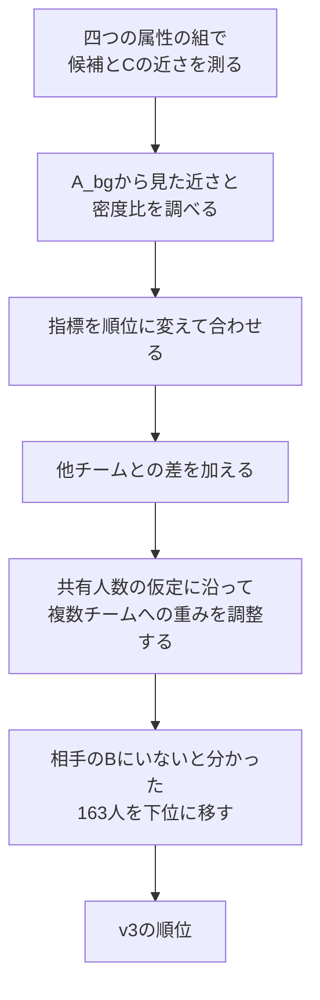
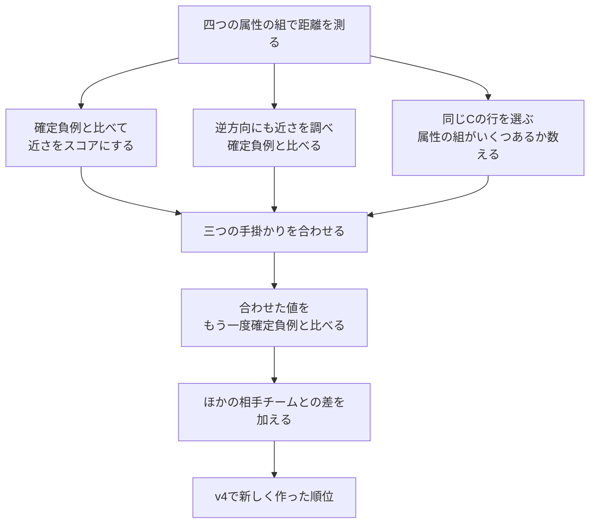
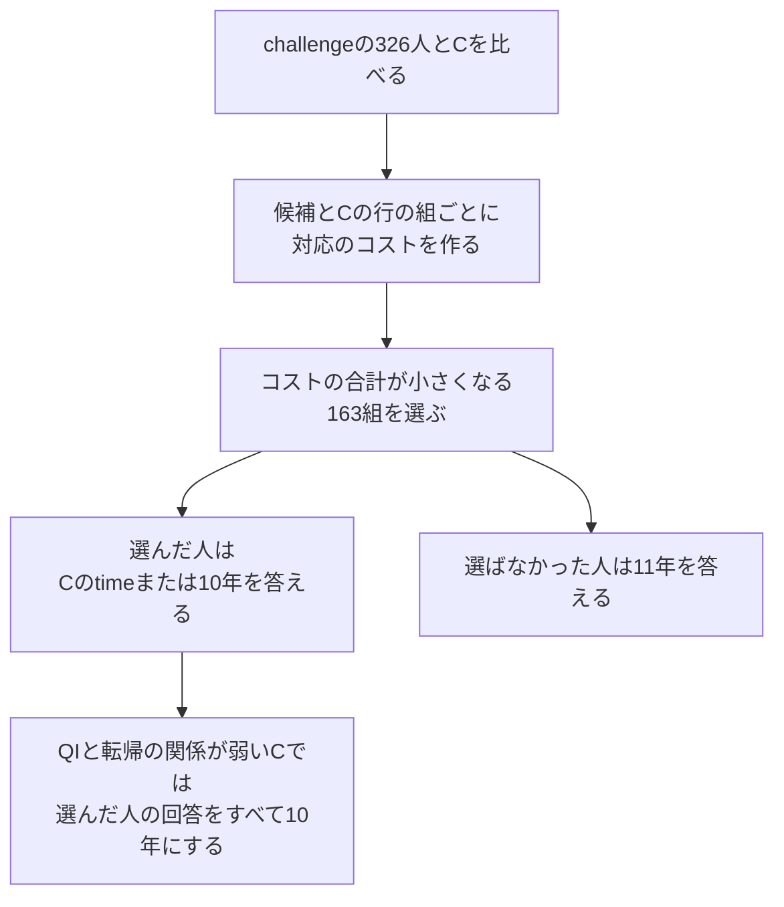

# 別資料：予備戦の攻撃手法を、指標と計算の順に理解する

[全体案内](README.md) · [攻撃フェーズの本編](02_attack.md) · [短い数式補足](SUPPLEMENT_ATTACK.md)

2026-09-10 · 初稿

この資料では、自チーム（team24）が予備戦で行った攻撃を、**何を比べ、どの指標を作り、その値をどう回答に結び付けたか**という順に説明する。

扱うのは、最終提出v9につながったMIAとAIAである。実装の関数やコードの読み方ではなく、処理の意味を追う。数式は、文章と計算例を理解した後に、計算方法を確認するために置く。

**「計算例」と記した人物・距離・順位は、説明用に作った架空のものである。実際の個票ではない。** 実際の設定値、保存された集計値、公式採点の記録は、それぞれ区別して示す。

## この資料の読み方

| 章 | 分かること |
|---|---|
| 1〜2 | 攻撃に使える情報と、「距離」「順位」「スコア」の読み方 |
| 3 | MIAの土台となったv3の順位を、どう作ったか |
| 4〜5 | 確定負例を使ったv4の指標と、最終MIAの作り方 |
| 6〜7 | v4のAIAで、誰を選び、何年と答えたか |
| 8 | independentのAIAで、対応と追跡年数をどう求めたか |
| 9 | routedで、相手のCに合わせて何を変えたか |
| 10〜11 | v7の規則と、最終v9への組合せ |
| 12〜13 | 自チームの指標と事務局の評価指標の違い、指標一覧 |

最初は第5章まででMIAを一度区切り、その後、第6章からAIAを読むと流れを追いやすい。

## 1. 最初に、何が分かっていて何が分からなかったか

### 1.1 MIAは、自チームBの人物が相手のBにもいたかを推測する

MIAで調べる人物は、自チームのBにいる1,049人である。自チームBの年齢・検査値・転帰は手元にある。一方、相手チームのBは見えず、そのチームが作ったCだけを見ることができる。

そのため、MIAでは自チームBの各人物と、相手のCの各行を比べた。追跡年数や発症・死亡の記録も、MIAでは比較に使える。**AIAで伏せられている情報と、MIAで手元にある情報は異なる。**

自チームBには、ほかのセットにも含まれる共有の人物736人と、自チームだけに含まれる非共有の人物313人がいる。共有された人物は、自チーム以外では一つのセットに属する。相手1チームとの共有人数は25〜27人である。

データ全体では自チーム以外に29セットがあるが、予備戦で実際に攻撃した相手は20チームである。［根拠：S1・S5］

### 1.2 AIAは、候補データで伏せられた追跡年数を推測する

AIAでは、相手チームごとに326人分の候補データ（challenge）が配られる。公開される属性は、次の7列である。

| 列 | 内容 |
|---|---|
| age | 年齢 |
| SBP | 収縮期血圧 |
| TG | 中性脂肪 |
| HDL | HDLコレステロール |
| ALT | 肝機能に関係する検査値 |
| sex | 性別 |
| prefecture | 県 |

この7属性をQIと呼ぶ。説明中の「数値5列」は、ここから性別と県を除いたage・SBP・TG・HDL・ALTである。

challengeには、相手のBの非共有部分から選ばれたメンバー163人と、相手のBにはいない対照163人が混ざっている。各行がどちらに当たるかも、追跡年数timeも伏せられている。

したがってAIAでは、**メンバーらしい人物を選ぶ作業と、その人の追跡年数を決める作業**が必要になる。MIAの候補1,049人を、そのままAIAの候補として使うわけではない。［根拠：S1・S5］

### 1.3 A_bgは、比較の基準と予測の材料に使った

A_bgは、全チームが利用できる背景データである。攻撃では、主に次の三つに使った。

1. 年齢や検査値の尺度をそろえる。
2. 候補の特徴が、一般的にもよく見られるものかを調べる。
3. QIと追跡結果の関係を学び、Cの転帰を確認したり、追跡年数を補正したりする。

A_bgは、相手のBの正解表ではない。A_bgに似ているかどうかは、推測の材料である。

## 2. 指標を読むための共通準備

### 2.1 「距離」と「スコア」では、大きい値の意味が違う

この資料では、基本的に次の向きで指標を読む。

| 値 | 小さい場合 | 大きい場合 |
|---|---|---|
| 距離 | 特徴が近い | 特徴が離れている |
| 対応のコスト | 対応させやすい | 対応させにくい |
| 近さを表すスコア | 手掛かりが弱い | 手掛かりが強い |
| メンバー候補の選別スコア | 選ぶ優先度が低い | 選ぶ優先度が高い |
| 順位 | 「1位」を最上位とする | 数字が大きいほど下位 |
| 提出用MIAスコア | 相手のBにいなさそう | 相手のBにいそう |

途中のスコアが高くても、その人物がメンバーだと確定するわけではない。**ここで作る多くの値は、候補を比較して並べるための値である。**

### 2.2 年齢と検査値を、そのまま足して距離にしなかった

年齢の差5と、中性脂肪の差50を、そのまま比較することは難しい。列ごとに単位も、値の広がりも違うためである。

v1〜v4の距離計算では、まずA_bgを基準に列ごとの尺度をそろえた。中心には中央値、広がりには主に「上位25%と下位25%の境界の差」を使った。この差を四分位範囲と呼ぶ。

変換後の値をzとすると、計算は次の形である。

$$
z=\frac{v-m}{s},
\qquad
s=\frac{Q_{75}-Q_{25}}{1.349}
$$

vは変換前の値、mはA_bgの中央値、Qの二つの値はA_bgの75・25パーセンタイルである。広がりがほぼ0の列では標準偏差を使い、それもほぼ0なら尺度を1とした。

**計算例：** 年齢の中心が55、尺度が10なら、60歳は0.5になる。血圧の中心が130、尺度が20なら、140は0.5になる。これで、各列の広がりに対してどれくらい離れているかを比べられる。

TG・ALTなど、極端に大きい値が出やすい列は、方式や属性の組に応じて先にlog(1＋値)へ変換した。大きな値の差を圧縮するためである。どの列を変換したかは、各章で示す。［根拠：S6・S8］

### 2.3 尺度をそろえてから、行どうしの距離を測った

ある属性の組にm列ある場合、各列の差を二乗し、平均してから平方根を取った。

$$
d(x,y)=\sqrt{\frac{1}{m}\sum_{j=1}^{m}(z_{x,j}-z_{y,j})^2}
$$

xは候補の人物、yは比較するCの行である。

**計算例：** 二列の差が0.3と0.4なら、距離は約0.354になる。この値は、年数や血圧の単位を持たない。

距離が最小の行を「最近傍」、二番目に小さい行を「第2近傍」と呼ぶ。最も近い行だけでなく、二番目との差も、対応の曖昧さを調べる材料になる。

### 2.4 性別と県の扱いも、方式によって異なる

v1〜v4で「最近傍を探す」ときは、原則として性別と県が一致する行の中で探した。該当する行がなければ、同じ性別の行、それもなければ全行に比較範囲を広げた。

ただし、AIAの最終的な一対一の対応を決める段階では、不一致を禁止するのではなく、コストを加えた。independentでは性別と県を距離の中に組み込んだ。**どの方式も同じ条件で近さを測っていたわけではない。**

### 2.5 尺度の違うスコアを合わせる際は、順位に変換した

あるスコアは0〜5、別のスコアは−10〜10という場合、そのまま足すと数値の幅が大きい方に影響されやすい。そこで、候補内での順位を0〜1の値に変換してから合わせる処理を使った。

以下の式に出てくるRankは、「値が大きい候補ほど1に近い値になるように並べ直す操作」を表す。これは所属確率への変換ではない。同点の場合は、あらかじめ決めた順序で順位を分けた。IDは同点処理に使い、人物の特徴を表す指標としては使っていない。

## 3. MIAの土台：v3の順位をどう作ったか

最終MIAには、v3の順位と、v4で新しく作った順位の両方が使われている。まず、前者の作り方を追う。

### ステップ1：四つの属性の組で、近さを測った

一つの列の加工に影響されすぎないよう、比較する属性の組を変えた。このような属性の組をviewと呼ぶ。

| v3の土台で使ったview | 距離に使う列 | 先にlog(1＋値)へ変換する列 |
|---|---|---|
| QIの数値5列 | age・SBP・TG・HDL・ALT | なし |
| QIの数値5列を変換 | age・SBP・TG・HDL・ALT | TG・ALT |
| 年齢と検査値 | age・BMI・SBP・TG・HDL・ALT・FPG | TG・ALT・FPG |
| 年齢・検査値・転帰 | 上の7列とtime・smoking・onset・death | TG・ALT・FPG |

性別と県は、第2.4節のように比較する行の範囲を決める際に使った。

### ステップ2：A_bgの行もCと比べ、候補の近さを評価した

候補xからCへの最近傍距離をdとする。次に、A_bgの各行についても、Cへの最近傍距離を求める。

そのうえで、「A_bgの行でも、d以下の距離でCに近づくことはどれくらいあるか」を数えた。A_bgの行の多くも同程度に近ければ、候補xの近さは特別とはいえない。

ここでは、性別と県が同じA_bgの集団を比較の基準にした。その集団が20行未満なら性別だけでまとめ、それでも不足する場合はA_bg全体を使った。

比較に使う行数をn、距離がd以下の行数をaとすると、近さの強さは次の形になる。

$$
L=-\log_{10}\frac{a+1}{n+1}
$$

aが少ないほどLは大きくなる。分子・分母に1を足すのは、該当する行が0でも計算を続けられるようにするためである。

さらに、第2近傍の距離d₂と最近傍の距離d₁から、最も近い行がどれくらい際立っているかを加えた。

$$
L_{\mathrm{view}}
=
L+0.10\log\left(1+\frac{d_2}{\max(d_1,10^{-12})}\right)
$$

二番目の行が遠いほど、最も近い行を選ぶ理由が強くなる、という考え方である。logは自然対数、log₁₀は常用対数を表す。［根拠：S6］

### ステップ3：CとA_bgの密度を比べた

距離に加え、候補xに似た特徴がCとA_bgにどれくらい多いかも調べた。これがDOMIASの考え方を取り入れた密度比である。

$$
L_{\mathrm{density}}(x)=\log \widehat p_C(x)-\log \widehat p_{bg}(x)
$$

pの二つの値は、CとA_bgから推定した密度である。密度は「ある人物がいる確率」ではなく、その特徴の周りに行がどれくらい集まっているかを表す。

今回の実装では、age・BMI・SBP・TG・HDL・ALT・FPGの7列を使った。この密度推定では、A_bgの平均と標準偏差で尺度をそろえ、各行の周りに滑らかな山を置いて全体の密度を近似する方法（KDE）を用いた。前の距離計算とは、尺度のそろえ方が異なる。

**計算例：** 推定密度がCで0.04、A_bgで0.01なら、対数密度比はlog(4)≒1.386である。同じ特徴がA_bgよりCで目立っていることを示す。

DOMIASの一般的な考え方は[原論文](https://proceedings.mlr.press/v206/breugel23a.html)に基づく。ここで使った列や計算方法は、自チームの実装に基づく。［根拠：S6］

### ステップ4：五つの指標を合わせ、相手ごとの評価を作った

四つのviewのスコアと密度比を、それぞれ候補内の順位に変換した。重みは次の通りである。

| 指標 | 重み |
|---|---:|
| QIの数値5列 | 0.20 |
| QIの数値5列を変換 | 0.20 |
| 年齢と検査値 | 0.30 |
| 年齢・検査値・転帰 | 0.20 |
| 密度比 | 0.10 |

これらの加重平均を、候補xが相手kのBに含まれていそうかを表す一次スコアAₖ(x)とした。密度推定が成立せず差を付けられない場合は、密度比を除いた重みで平均した。

次に、一人の候補について20チーム分の一次スコアを比べた。

- 相手kの値そのもの。
- 20チームの中央値より、どれくらい高いか。
- 相手k以外で最も高い値より、どれくらい高いか。

三つをそれぞれ相手チーム内の順位に変え、次の重みで合わせた。

$$
A'_{k}
=
0.55\,\mathrm{Rank}(A_k-\mathrm{median}_{\ell}A_{\ell})
+
0.25\,\mathrm{Rank}(A_k)
+
0.20\,\mathrm{Rank}(A_k-\max_{\ell\ne k}A_{\ell})
$$

どのCにも似ている人物と、あるCに特に似ている人物を区別するための処理である。［根拠：S6］

### ステップ5：複数チームへの重みを、人数の仮定に合わせて調整した

一人の共有者が、自チーム以外の多数のセットに同時に属する設計ではない。そこで、各候補と各相手の組を別々に評価するだけでなく、全体として辻褄が合うように調整した。

まず、一次スコアをもとに、相手ごと25〜27人、20チーム合計508人という条件で仮の割当を求めた。508は736×20÷29を丸めた事前仮定であり、実際の20チームの正解人数を知っていたわけではない。

次に、その人数配分を使って、各人物がどの相手に属しそうかという重みを調整した。この処理がsoft transportである。

1. 一人の候補に、20チームと「どの相手にも割り当てない」の計21通りの重みを持たせる。
2. 一人分の重みの合計を1にそろえる。
3. 各相手に集まる重みの合計を、先に決めた人数にそろえる。
4. 両方の条件が数値的にそろうまで調整を繰り返す。

**計算例：** ある候補に「相手Aへ0.7、相手Bへ0.2、どちらでもないへ0.1」という重みを持たせるイメージである。これも所属確率を検証した値ではない。

得られた重みを相手ごとに並べ直し、MIAの順位にした。［根拠：S6］

### ステップ6：確定負例163人を、順位の下位へ移した

自チーム向けのchallengeと自チームBを、QIの7列で照合した。完全に一致し、対応するBの行を一つに絞れた人物は163人だった。

自チーム向けAIAのメンバーは、自チームBの非共有部分から選ばれる。この照合で特定した163人は、他チームのBにはいないと判断できる。このような人物を「確定負例」と呼ぶ。

v3では、この163人を残りの候補より下位へ移した。残る886人についての順序は保った。これが、v4と組み合わせる際のv3の順位である。［根拠：S7］

**採用した処理の範囲：** v2では別の近傍密度指標や希少群専用の調整も試したが、主方式にはv1のtransportを残した。したがって、最終MIAのv3側に、v2で試したすべての指標が入っているわけではない。

## 4. v4で新しく作ったMIA指標：確定負例を比較の基準にする

v3では、確定負例を最後に下位へ移した。v4ではさらに、**その163人でも、Cにどれくらい似た行が見つかるか**を調べ、ほかの候補を評価する基準にした。

この章では、一人の候補xと、一つの相手チームkに注目して計算を追う。同じ処理を全候補・全相手について行った。

### ステップ1：四つのviewで、候補とCを比べた

v4の新しい指標では、次の四つを使った。第3章の四つのviewとは、列の組合せが少し異なる。

| view | 距離に使う列 | 先にlog(1＋値)へ変換する列 |
|---|---|---|
| qi | age・SBP・TG・HDL・ALT | TG・ALT |
| stable | age・SBP・HDL | なし |
| clinical | BMI・SBP・TG・HDL・ALT・FPG | TG・ALT・FPG |
| outcome | BMI・SBP・TG・HDL・ALT・FPG・time・smoking・onset・death | TG・ALT・FPG |

各列の尺度はA_bgから求めた。最近傍を探す範囲は、原則として同じ性別・県である。

viewごとに、次の二つを記録した。

- 候補xから最も近いCの行までの距離。
- 最も近かったCの行の番号。

この段階では、距離が小さいほど「近い」というだけである。［根拠：S8］

### ステップ2：確定負例と比べ、「どれほど近いか」を数値にした

候補xの距離をdとする。確定負例163人のうち、距離がd以下の人を数え、その人数をaとする。

$$
p_d=\frac{a+1}{164},
\qquad
E_d=-\log p_d
$$

p_dは「確定負例でも同程度以上に近づく人が、どれくらいいるか」を表す比較用の値である。E_dはその向きを反転したスコアで、大きいほど負例と比べて近い。

**計算例：** xの距離以下の確定負例が3人なら、p_d＝4÷164≒0.0244、E_d≒3.7136になる。80人いればp_d＝81÷164≒0.4939で、近さはそれほど際立っていない。

このp_dを「非メンバーである確率2.44%」と読むことはできない。比較に使った163人に対して、どれくらい極端かを表している。［根拠：S8］

### ステップ3：Cの行から逆に探しても、同じ人物が近いかを調べた

候補xにとって、Cの行yが最も近かったとする。次はyを起点に、自チームBの候補全体から最も近い人物を探す。

- yから見てもxが最も近ければ、「相互最近傍」である。
- yにはもっと近い別の候補がいれば、xとの対応は競合している。

今回の実装では、逆方向の距離も使い、次の比を作った。

$$
q=\frac{d(x,y)}{\max(d(y,\text{yに最も近い候補}),10^{-12})}
$$

相互最近傍なら、この比をさらに0.5倍した。小さいほど、双方向の対応を支持する値になる。

**計算例：** xからyへの距離が0.10で、yから最も近い候補までの距離も0.10、しかもその候補がxなら、qは1×0.5＝0.5となる。一方、yに距離0.02の別候補がいるなら、qは0.10÷0.02＝5となる。

このqも、確定負例163人のqと比べた。q以下の負例の人数を数え、ステップ2と同じ形で−logに変換した。こうして、双方向の近さを表すE_rをviewごとに作った。［根拠：S8］

### ステップ4：四つのviewの結果をまとめた

距離のスコアE_dは、四つのうち大きい二つの平均と、四つ全体の中央値を合わせた。

$$
D
=
0.55\times\text{E_dの上位二つの平均}
+
0.45\times\text{E_dの中央値}
$$

よく一致する属性の組を重視しながら、残る組の情報も使うためである。

双方向のスコアE_rについては、大きい二つの平均をRとした。

$$
R=\text{E_rの上位二つの平均}
$$

ここでRはMIA内部の指標であり、第12章に出てくるAIAの採点値とは別物である。

### ステップ5：同じCの行に対応するviewの割合を求めた

四つのviewで選ばれたCの行番号を数え、最も多く選ばれた行の割合を求めた。これを一致度cとする。

**計算例：** 選ばれた行が「行12、行12、行12、行88」なら、c＝3÷4＝0.75である。全部別の行なら0.25、全部同じなら1になる。

次に、距離・双方向の近さ・一致度をまとめた。

$$
H=D+0.20R+0.25c
$$

Hは、候補xと相手kのCの対応を、三つの観点から評価した値である。三つは同じデータを使っているため、独立した証拠として数えられるわけではない。［根拠：S8］

### ステップ6：まとめたHを、もう一度確定負例と比べた

Hを作った後、確定負例にも同じ計算を行った。

今度はHが大きいほど強いので、「候補xのH以上の値を持つ確定負例」を数える。その人数をbとする。

$$
p_H=\frac{b+1}{164},
\qquad
E=-\log p_H
$$

最初の比較では「距離が小さい側」を数えたが、今回は「スコアが大きい側」を数える。

この二段階の比較により、**複数の手掛かりを合わせても、相手のBにいない人に普通に生じる程度ではないか**を確認した。

### ステップ7：ほかの相手より、どれくらい強いかを加えた

一人の候補について、相手kのEと、ほかの相手で最も高いEとの差を求めた。

$$
M_k=E_k-\max_{\ell\ne k}E_{\ell}
$$

M_kが正なら、その候補はほかの相手よりも相手kで強く評価されている。負なら、もっと強く対応する別の相手がある。

最終的に、新しい順位を作るためのスコアを次のようにした。

$$
S_k=E_k+0.50M_k
$$

0.50は、今回採用した相手間の差の重みである。差を加えない方式と0.25を使う方式も比較用に作ったが、v4の主方式は0.50である。［根拠：S8］

### ステップ8：同点を処理し、新しい順位を作った

確定負例が163人なので、人数を数える部分の値は飛び飛びになる。そのため、複数の候補が同じSになることがある。

まずSで並べ、同点なら、人数に置き換える前の連続的なスコアHを使った。それでも同点ならrecord_idで順序を決めた。また、確定負例はほかの候補より下位に置いた。

こうして得たのが、次章でv3と組み合わせる「v4の新しい順位」である。

### 一人の候補について、計算を通してみる

以下は、ここまでの式をつないだ**架空の計算例**である。比較に使う確定負例の人数だけは実際と同じ163人とし、数え上げの結果を仮定する。

| view | 候補の距離以下の負例数 | 距離のスコアE_d | 候補のq以下の負例数 | 双方向のスコアE_r |
|---|---:|---:|---:|---:|
| qi | 3 | 3.7136 | 7 | 3.0204 |
| stable | 7 | 3.0204 | 15 | 2.3273 |
| clinical | 15 | 2.3273 | 31 | 1.6341 |
| outcome | 31 | 1.6341 | 63 | 0.9410 |

この場合、次のように進む。計算は丸める前の値で行い、表示だけを丸めている。

| 段階 | 計算結果 | 何を表しているか |
|---|---:|---|
| 距離のまとめD | 3.0551 | 四つのviewをまとめた近さ |
| 双方向のまとめR | 2.6739 | 強い二つのviewの双方向の近さ |
| 一致度cを0.75と仮定 | 0.7500 | 四つのうち三つが同じCの行を選んだ |
| H＝D＋0.20R＋0.25c | 3.7774 | 三つの手掛かりを合わせた値 |
| H以上の負例が1人と仮定 | E＝4.4067 | −log(2÷164) |
| ほかの相手の最大Eを−log(4÷164)と仮定 | 3.7136 | もっとも強い別の相手の値 |
| 相手間の差M | 0.6931 | 相手kの方が強い |
| S＝E＋0.50M | 4.7533 | 新しい順位を決めるための値 |

4.7533は提出用のスコアではない。この値をほかの候補と比較して順位を付け、さらにv3の順位と組み合わせる。

なお、確定負例は自チームの非共有部分から得た集団である。共有部分と同じ分布とは限らないため、この処理を、未知の相手にも誤り率を保証する方法としては説明しない。今回の実装では、経験的な比較による順位付けに使った。

## 5. v3と新しい順位を合わせ、最終MIAを作った

### ステップ1：RRFで二つの順位を合わせた

v3と第4章の順位は、作り方も途中のスコアの尺度も異なる。そこで、スコアそのものではなく、順位を組み合わせた。

RRFは、順位に定数を足し、その逆数を足し合わせる方法である。[原論文](https://cormack.uwaterloo.ca/cormack/cormacksigir09-rrf.pdf)の方法を用い、自チームは定数を10とした。

$$
F(x)=\frac{1}{10+r_{v3}(x)}+\frac{1}{10+r_{\mathrm{new}}(x)}
$$

rは1位を最上位とする順位である。Fが大きいほど、組合せ後の順位を高くする。

**計算例：**

| 候補 | v3の順位 | 新しい順位 | RRFの値 |
|---|---:|---:|---:|
| 人物A | 2位 | 3位 | 1/12＋1/13≒0.1603 |
| 人物B | 1位 | 100位 | 1/11＋1/110＝0.1000 |

この例では、両方で上位の人物Aが高くなる。片方だけで上位でも値は加わるため、「両方式が選んだ人物だけを残す」という規則ではない。［根拠：S8］

### ステップ2：希少な候補どうしの順序をv3に合わせた

事務局の公開判定器で希少とされた候補については、RRF後に割り当てられたスコアを、その候補どうしの順序がv3と同じになるように入れ替えた。

**計算例：** 希少な候補A・B・Cが持つスコアが0.90・0.95・0.99だったとする。v3ではB、A、Cの順に高かったなら、Bに0.99、Aに0.95、Cに0.90を割り当て直す。

希少でない候補の値や、希少な候補に割り当てるスコアの組は、この操作では変えない。保つのは、希少な候補どうしの順序である。

### ステップ3：確定負例をもう一度下位へ移し、0〜1の値にした

順位を組み合わせた後にも、確定負例163人をほかの候補より下位へ移した。そのうえで、最終順位を0〜1の提出用スコアへ変換した。

1,049人を高い方からr位とすると、今回のスコアは次の形になる。

$$
\mathrm{confidence}=\frac{1050-r}{1050}
$$

例えば2位なら約0.9981である。**これは「99.81%の確率でメンバー」という意味ではない。**

各相手チームについてこの値を作り、F_mia.csvにまとめた。最終v9では、このv4のMIAファイルをそのまま使った。［根拠：S8・S12・S14］

途中のsoft transportは人数の条件を使うが、その後に負例の降格やRRFなどを行っている。最終スコアが、途中の割当の重みや人数制約をそのまま表しているわけではない。

## 6. AIAのv4方式：163人を選び、対応するCの行から年数を決めた

AIAで最初に作るのは、「この候補の追跡年数を当てにいくか」という選別である。選んだ後に、回答する年数を決める。

ここで「選ばない」とした行にも、提出CSVでは数値を入れる。今回は11.0を使った。実際の追跡年数は10年以内で、正解と認められる差は0.5年以内なので、11.0はどの正解にも当たらない。

### ステップ1：三つのviewで、候補とCの近さを測った

| view | 比べる数値列 | 先にlog(1＋値)へ変換する列 |
|---|---|---|
| 数値5列 | age・SBP・TG・HDL・ALT | なし |
| 数値5列を変換 | age・SBP・TG・HDL・ALT | TG・ALT |
| 三つの数値列 | age・SBP・HDL | なし |

尺度をA_bgでそろえ、第3章と同様に、A_bgからCへの距離と比べた近さの強さも求めた。性別と県は、近さを比較する集団の区切りに使った。

候補xについて、三つのviewの「近さの強さ」の最大値をs(x)とした。これとは別に、候補xとCの行yの距離を三つのviewで測り、その最小値をd_min(x,y)とした。

**最も強い手掛かりを出すviewと、ある行との距離が最小になるviewは、同じとは限らない。**［根拠：S6］

### ステップ2：候補とCの行の組ごとに「対応のコスト」を作った

コストは、この二つの行を対応させる際の扱いにくさを表す。小さいほど、その組を選びやすい。

$$
K(x,y)
=
d_{\min}(x,y)
+1.50\,I_{\mathrm{sex}}
+0.75\,I_{\mathrm{pref}}
-0.35\,s(x)
$$

I_sexは性別が異なれば1、同じなら0である。I_prefも、県が異なれば1、同じなら0になる。式では、同点処理のためのごく小さい調整を省いている。

- 距離が小さいほど、コストは小さくなる。
- 性別や県が異なると、コストは大きくなる。
- A_bgと比べて目立つ候補は、s(x)が大きくなり、コストが小さくなる。

**計算例：** 距離0.10、性別・県が一致、s(x)＝2なら、コストは0.10−0.35×2＝−0.60である。県だけが異なるなら、0.75が加わり0.15になる。

コストが負でも問題はない。候補と行の組を比較するための値であり、距離や確率そのものではない。

s(x)の項は、一人の候補から全てのCの行へ共通して引かれる。そのため、主に「どの候補を163人に含めるか」に働き、同じ候補の中での対応先の順序は変えない。

### ステップ3：163組を、全体のコストが小さくなるように選んだ

326人の全員に先にCの行を割り当てるのではなく、**163人の選別と、その163人への対応先の割当を同時に決めた。**

条件は次の三つである。

1. 選ぶ候補は163人である。
2. 選んだ候補には、Cの行を一つ割り当てる。
3. 同じCの行を、別の候補へ重ねて割り当てない。

この条件のもとで、選んだ組のコストの合計が最小になる対応を求めた。一対一の割当と呼ぶ。

**計算例：** 説明のため、候補3人から2人を選び、Cの2行に対応させるとする。

| 候補 | Cの行aへのコスト | Cの行bへのコスト |
|---|---:|---:|
| 人物A | 0.10 | 0.40 |
| 人物B | 0.11 | 0.80 |
| 人物D | 0.90 | 0.12 |

この場合はA→a、D→bを選べば、合計0.22になる。Bにもaは近いが、aを二人に割り当てることはできない。

このように、各人物が最も近い行を自由に選ぶ方法とは異なる。選ばれた163人は、あくまでこの方法でメンバーらしいと判断した人物であり、真のメンバーを特定したわけではない。［根拠：S6・S7］

### ステップ4：対応が十分近い発症・死亡の記録だけ、Cの年数を使った

Cの対応先に発症または死亡の記録があれば、「イベントあり」とする。発症も死亡もなく観察を終えた行は、「打ち切り」である。

選ばれた人物について、次の規則で年数を決めた。

| 対応先の記録と距離 | 回答 |
|---|---|
| 発症・死亡があり、対応が十分近い | Cの対応先のtime |
| 発症・死亡があるが、対応が遠い | 10.0 |
| 打ち切り | 10.0 |
| 候補として選ばなかった | 11.0 |

対応を信頼するかの判定には、ステップ2のコストに0.35s(x)を足し戻した値を使った。つまり、距離と性別・県の不一致による加算だけを残し、候補の選ばれやすさを差し引く項を取り除いた。

通常は、この値が0.20以下なら、発症・死亡の年数を使った。C全体のイベント率が0.50を超える場合は、基準を0.08以下に厳しくした。

**計算例：** Cに「6年後に発症」とある場合、通常の基準で対応の距離が0.10なら6.0と答え、0.30なら10.0と答える。

**v4系のこの処理は、中間の年数へ少しずつ寄せる計算ではない。Cの年数を使うか、10.0へ切り替えるかの二択である。** その後、次章の確認でも、C全体について切替を判断した。［根拠：S7・S8］

### v4の主方式に入っていない選別指標

v2では、近さ・近傍密度・最近傍コストの順位を0.50・0.30・0.20で合わせてから163人を選ぶ方法も作った。しかし、v4につながる主方式では、第6章で説明した一対一の割当による選別を維持した。

この三つの重みを「最終v4の候補選別式」と説明すると、実際の採用経路と異なる。指標を計算したことと、提出回答に採用したことは分ける必要がある。

## 7. Cの転帰を信頼できるか：QIとイベントの関係をAUCで確認した

### ステップ1：A_bgから、QIとイベントの関係を学んだ

A_bgのQIの7属性を使い、発症または死亡が記録されているかを予測するモデルを作った。モデルはロジスティック回帰であり、複数の属性からイベントが起こりやすい側かどうかを評価する。

数値列の尺度をそろえ、性別・県は種類ごとの情報として扱った。相手のBの所属ラベルを学習したのではない。

### ステップ2：同じモデルをCに当てはめた

CのQIからイベントの予測スコアを求め、それをCに記録されているイベントの有無と比べた。

A_bgで学んだ関係がCでも残っているなら、イベントのある行に高いスコアを付けられるはずである。この並べ分けの程度をAUCで測った。

### ステップ3：AUCを「イベントのある行を上に置けた割合」として読む

二値分類のAUCは、イベントのある行とない行を一つずつ比べたとき、ある行の方へ高いスコアを付けられる程度として読める。同点は半分として数える。

**計算例：**

| 行 | Cの記録 | 予測スコア |
|---|---|---:|
| A | イベントあり | 0.8 |
| B | イベントあり | 0.6 |
| C | イベントなし | 0.7 |
| D | イベントなし | 0.2 |

あり・なしの組は4通りである。AはC・Dの両方より高く、BはDより高いがCより低い。したがって、3組÷4組＝0.75となる。

これは「4人中3人のイベントを正解した」という正解率ではない。スコアの順序を評価している。[AUCの公式説明](https://scikit-learn.org/stable/modules/generated/sklearn.metrics.roc_auc_score.html)

### ステップ4：AUCが基準未満なら、選んだ人物への回答を10年にした

| 方式 | 10年に切り替える条件 | 候補の選別 |
|---|---|---|
| v4 | AUCが0.58未満、または計算できない | 維持する |
| independent | AUCが0.60未満、または計算できない | 維持する |

Cの行がすべてイベントあり、またはすべてイベントなしなら、あり・なしを比較できず、AUCは計算できない。

v4で実際にこの切替が起きたのは対象17である。ただし、最終v9の対象17には、第10章のv7による回答を使っている。［根拠：S8・S10］

このAUCは、**QIと転帰の関係を確認する内部指標**である。メンバーを見分けるMIAのAUCでも、AIAで追跡年数を当てた得点でもない。

モデルのスコアと「10−time」の相関、Cのイベント率も記録したが、この切替そのものはAUCを基準にした。

## 8. independentのAIA：六つの見方で対応を探し、年数を補正した

この方式では、同じCの行を複数の候補へ対応させることができる。候補ごとに、複数の見方で支持された行を対応先にした。

independentは方式を区別する名前である。ほかの方式と統計的に独立している、という意味ではない。

### ステップ1：六つの属性の組を用意した

| view | 使った属性 |
|---|---|
| 1 | age・SBP・TG・HDL・ALT・sex・prefecture |
| 2 | age・SBP・sex・prefecture |
| 3 | TG・HDL・ALT・sex |
| 4 | age・TG・ALT・prefecture |
| 5 | SBP・HDL・ALT・sex・prefecture |
| 6 | age・SBP・TG・HDL・ALT |

数値列はA_bgの中央値と広がりで尺度をそろえ、TG・ALTは先にlog(1＋値)へ変換した。極端な値に左右されすぎないよう、変換後の数値を−8〜8に収めた。

性別の不一致は0.75、県の不一致は0.70に相当する差として距離に含めた。県番号の大小をそのまま距離にはしない。各viewでは、使う属性の数に応じて距離の尺度もそろえた。

v4の最近傍探索のように、同じ性別・県の行だけへ比較範囲を限定する方式ではない。［根拠：S10］

### ステップ2：候補が、A_bgよりCにどれくらい近いかを測った

各viewで、候補から次の距離を求めた。

- Cの最近傍までの距離d_C,1。
- Cの近い4行までの距離の平均d_C,4。
- A_bgの最近傍までの距離d_bg,1。
- A_bgの近い4行までの距離の平均d_bg,4。

一つのviewの指標は、次の形である。

$$
e=
\log\frac{d_{bg,1}+\eta}{d_{C,1}+\eta}
+
0.35\log\frac{d_{bg,4}+\eta}{d_{C,4}+\eta}
$$

ηは、距離0でも計算できるように加える小さな値10⁻¹⁰である。Cの方が近ければ、この指標は大きくなる。

**計算例：** 最近傍への距離も4行の平均距離も、A_bgがCの2倍なら、eはおよそ1.35×log(2)＝0.936になる。

この値をviewごとに候補内の順位へ変換した。六つのviewで数値の幅が違っても、合わせて扱えるようにするためである。

### ステップ3：最も多くのviewが選んだCの行を対応先にした

六つのviewで選ばれた最近傍の行番号を数え、最も多く選ばれた行を対応先にした。同数なら、QIの7属性すべてを使った距離が近い方を選んだ。

**計算例：** 六つの答えが「行8、行8、行8、行8、行15、行15」なら、対応先は行8、一致度aは4÷6となる。

このように作った対応表をcodebookと呼んでいる。ここでは「候補ごとに参照するCの行を決めた表」と考えればよい。複数の候補が、同じ行8を参照してもよい。

### ステップ4：四つの指標を合わせて、163人を選んだ

候補ごとの選別スコアは、次の四つから作った。

| 指標 | 何を表すか | 重み |
|---|---|---:|
| 六つのeの順位の平均 | A_bgと比べたCへの近さ | 0.65 |
| QI全体での最近傍距離を、小さいほど高くした順位 | 属性全体で見た近さ | 0.20 |
| 一致度a | 同じ対応先を支持するviewの割合 | 0.10 |
| 相互最近傍かどうか | 対応先のCの行から逆に見ても、その候補が最も近いか | 0.05 |

相互最近傍ならu＝1、それ以外はu＝0として、次の値を作った。

$$
S_{\mathrm{ind}}
=
0.65\,\overline{\mathrm{Rank}(e)}
+
0.20\,\mathrm{Rank}(-d_{\mathrm{full,min}})
+
0.10a
+
0.05u
$$

d_full,minは、QI全体での最近傍距離である。六つのviewの多数で決めた対応先が、QI全体の最近傍と同じとは限らないため、二つを区別する。

**計算例：** 順位の平均0.80、全体の近さの順位0.90、一致度4/6、相互最近傍なら、選別スコアは約0.8167になる。

このスコアの高い163人を選んだ。スコアが0.8167でも、所属確率81.67%を意味しない。［根拠：S10］

### ステップ5：A_bgで予想される年数との差を使って、Cのtimeを補正した

同じようなQIでも、候補とCの対応先には多少の違いがある。その違いを補うため、A_bgから基準となる追跡年数を求めた。

1. 候補xにQIが近いA_bgの48行を探し、timeの中央値をb(x)とする。
2. Cの対応先yについても、近いA_bgの48行を探し、timeの中央値をb(y)とする。
3. Cの対応先のtimeをt(y)とし、基準からのずれt(y)−b(y)を求める。
4. そのずれを候補側の基準へ移し、b(x)＋t(y)−b(y)とする。

この予測を0〜10年に収めた値をt_resとする。最終的には、Cのtimeを75%、補正した値を25%の割合で合わせた。

$$
\widehat t=0.75\,t(y)+0.25\,t_{\mathrm{res}}
$$

**計算例：** 候補の基準が8年、Cの対応先の基準が7年、Cに記録されたtimeが6年なら、基準からのずれは−1年である。候補に移すと7年になる。最終予測は0.75×6＋0.25×7＝6.25年となる。

この「基準からのずれ」を残差と呼び、この調整を残差補正と呼ぶ。Cの行が候補本人だと確定したうえで補正したわけではない。

### ステップ6：打ち切りとAUCの確認を反映し、回答を仕上げた

対応先が打ち切りなら、残差補正の計算値によらず10.0と答えた。選ばなかった人物は11.0である。

さらに、第7章のAUCが0.60未満、または計算できないCでは、選んだ163人への回答をすべて10.0へ切り替えた。

したがって、この方式も「全員について残差補正した年数を提出した」わけではない。候補の選別、対応先の転帰、C全体のAUCを通して、実際の回答を決めた。

## 9. routedのAIA：相手のCに合わせて、指標と回答方法を変えた

最終v9でroutedの回答を使ったのは、対象10と20である。両者では、候補を選ぶ方法も、年数を決める方法も異なる。

この章では、この二つに残った処理を中心に説明する。［根拠：S11・S12・S18］

### 9.1 共通の準備：比較に使うCの行を整理した

routedでは、C内の重複行や、複数チームのCに同じ13列の値が現れる行を調べた。相手に固有の手掛かりを探す際に、同じ行の繰り返しを強い証拠として扱わないためである。

複数チームに同じ行が見つかる場合は、その割合が50%以下で、除いても25行以上残る場合に除外した。C内部の重複もまとめたが、25行未満になる場合はまとめなかった。

これは対応を探すためのルールであり、同じ合成行があることだけで元の人物の所属を証明するものではない。

**保存記録では、対象10と20はどちらも、この準備の前後で1,049行のままである。** この二つで行を減らしたことが、最終回答の違いを生んだわけではない。［根拠：S18］

### 9.2 対象10・ステップ1：値の近さと、値の順位の近さを測った

まず、次の三つのviewで、候補からCへの近さを調べた。

- age・SBP・TG・HDL・ALT。
- age・SBP・HDL。
- SBP・TG・HDL・ALT。

それぞれで、二種類の近さを作った。

| 指標 | 比べたもの | 作り方 |
|---|---|---|
| 通常の近さP | 年齢や検査値の値 | Cとchallengeを合わせた中央値・広がりで尺度をそろえ、最近傍距離を順位にして三viewで平均する |
| 順位に変換した近さQ | 各列の中での値の位置 | Cとchallengeを別々に順位へ変換し、その座標で最近傍距離を測って、順位を三viewで平均する |

通常の近さでは、TG・ALTを先にlog(1＋値)へ変換した。いずれも、同じ性別・県の行から探し、行がなければ性別だけ、さらに全行へ範囲を広げた。

Qで使う変換は、各列の小さい方からの順位を「行数＋1」で割るものである。同じ値には平均順位を使う。このように、各列の順位の組合せを使う見方を、ここではコピュラの見方と呼ぶ。

**計算例：** 候補の血圧が140、Cの行が160でも、どちらも自分の表の中で上位20%付近なら、順位の位置は近い。値の大きさが加工されても、並び順が残っていれば対応の手掛かりになる。

ただし、二つの表は人数も構成も異なる。順位が近いことだけで同じ人物と判断することはできない。

### 9.3 対象10・ステップ2：v4とindependentの選別結果も合わせた

v4でその候補を選んでいればa_v4＝1、選んでいなければ0とする。independentも同様にa_indを作った。

対象10で使った選別スコアは、次の通りである。

$$
S_{10}
=
1.10a_{v4}
+
0.90a_{\mathrm{ind}}
+
0.20P
+
0.20Q
$$

v4の選別をやや強く重視しながら、independentの選別と、二種類の近さを加えている。

例えば両方式が選んだ人物には、近さの分を加える前に2.00が付く。v4だけなら1.10、independentだけなら0.90になる。これは投票と近さを合わせた選別用の値であり、確率ではない。

### 9.4 対象10・ステップ3：性別・県・年齢帯ごとに、ほぼ半数を選んだ

challengeの対照は、メンバーと粗い属性を合わせて作られている。その構造を利用し、性別・県・5歳刻みの年齢帯で候補を分けた。

各集団の中でS₁₀の高い方から半数を選んだ。奇数人数の集団では、まず切り捨てた半数を選ぶ。その後、各集団の次点のスコアを比べ、合計163人になるまで一人ずつ追加する集団を決めた。

**計算例：** ある集団が6人なら3人を選ぶ。5人ならまず2人を選び、残り人数を合わせる際に3人目を選ぶかを決める。

これは各集団に正確に何人のメンバーがいるかを知ったうえで選ぶ処理ではない。公開された作成方法を踏まえ、全体だけでなく集団ごとの人数も整えたものである。

保存記録では、対象10は14集団に分かれ、そのうち8集団が奇数人数だった。4集団で切り上げ、合計163人を選んだ。［根拠：S18］

### 9.5 対象10・ステップ4：信頼できるイベントの対応で年数を置き換えた

選んだ人物の回答は、基本的にv4の年数を使った。今回新たに選んだためv4の年数がない人物には、10.0を使った。

さらに、QIの数値5列を順位へ変換した空間で、新しい対応先を探した。そのCのtimeに置き換えるのは、次の三条件を満たす場合である。

1. 候補とCの行が、同じ性別・県の比較集団内で相互最近傍である。該当行がない場合は比較範囲を広げる。
2. 第2近傍の距離から最近傍の距離を引いた差が、おおむね上位半分に当たる。具体的には、小さい方からの順位を候補数で割った値が0.50以上である。同じ値には平均順位を使う。
3. 対応先に発症または死亡の記録がある。

第2近傍との差をマージンと呼ぶ。第4章の「他チームとの差」とは別の指標であり、ここでは**一番近い行と二番目の行の隔たり**を表す。

**計算例：** 一番近い距離が0.02、二番目が0.15なら、マージンは0.13である。ほかの候補と比べてもこの差が大きく、相互最近傍かつイベントありなら、その行のtimeを採用する。

条件を満たさなければ、もとのv4の年数または10.0を保つ。選ばなかった人物は11.0のままである。［根拠：S18］

### 9.6 対象20・ステップ1：CとA_bgの近傍密度を比べた

対象20では、QIの数値5列を使い、性別・県で探索範囲を分けずにCとA_bgを比べた。TG・ALTを変換し、A_bgで尺度をそろえた。

候補から、CとA_bgそれぞれの第1・第3・第8近傍までの距離を求めた。k番目の近傍までの距離をd_C,k、d_bg,kとすると、次の値を作った。

$$
G(x)=\frac{1}{3}\sum_{k\in\{1,3,8\}}
5\log\frac{d_{bg,k}+10^{-6}}{d_{C,k}+10^{-6}}
$$

5は使った数値列の数である。Cの方が近いほどGは大きくなる。

independentの式と似ているが、こちらは「近い4行の平均」ではなく、**第1・第3・第8近傍それぞれの距離**を使う。また、候補の順位だけに使うため、標本数による候補共通の定数などを含めた厳密な密度の値を提出しているわけではない。

### 9.7 対象20・ステップ2：集団ごとに半数を選び、10年と答えた

Gを候補内の順位に変換した後、第9.4節と同じ方法で、性別・県・年齢帯ごとにほぼ半数を選んだ。密度を比べる範囲は全体だが、選ぶ人数を整える段階では集団を使う。

保存記録では、対象20の14集団はすべて偶数人数であり、各集団から半数を選んで合計163人となった。

選んだ人物には全員10.0、選ばなかった人物には11.0と答えた。対象20で採用したこの方式は、人物ごとにCのtimeを移す攻撃ではない。**Cからメンバーらしい人物を選び、観察上限の年数を答える攻撃**である。［根拠：S11・S18］

## 10. v7：三方式が全員一致で選んだ人物を除き、9.5年と答えた

### ステップ1：三方式すべてで得点が0だった相手を確認した

v4・independent・routedの保存済みの採点結果を比べたところ、対象6・7・8・9・17・18・19は、三方式すべてでAIA得点が0だった。

得点0は、追跡年数が一人も当たらなかったことを意味しない。メンバーに対する的中率が、対照に対して十分高くなかった場合も0になる。

### ステップ2：三方式が誰を選んでいたかを、0と1で表した

各方式で、11.0以外を回答した人物を「選んだ＝1」、11.0を回答した人物を「選ばなかった＝0」とした。

ここで使ったのは保存済みの回答であり、真のメンバーかどうかのラベルではない。各方式はそれぞれ163人を選んでいた。

### ステップ3：三方式がすべて選んだ人物だけを外した

三方式が共通して誤った候補を選んでいる可能性を考え、全会一致で選ばれた人物には11.0、それ以外には9.5と答えた。

| v4 | independent | routed | v7の回答 |
|---:|---:|---:|---:|
| 1 | 1 | 1 | 11.0 |
| 1 | 1 | 0 | 9.5 |
| 1 | 0 | 1 | 9.5 |
| 0 | 1 | 1 | 9.5 |
| 1 | 0 | 0 | 9.5 |
| 0 | 1 | 0 | 9.5 |
| 0 | 0 | 1 | 9.5 |
| 0 | 0 | 0 | 9.5 |

二方式が選んだ人物にも9.5と答えるため、多数決ではない。三方式すべてが選んだ集団を除く規則である。［根拠：S13］

### ステップ4：9.5年の意味と、実際の選択人数を確認する

誤差0.5年以内が正解なので、9.5という回答は、実際の追跡年数9.0〜10.0年に的中する。10.0という回答が的中する範囲は9.5〜10.0年である。

ただし、当たる範囲を広げると対照にも当たりやすくなる。このため、9.5だけを切り離して有効と判断することはできない。誰に9.5と答えるかという選別と組み合わせた規則である。

最終提出のCSVから確認した人数は、次の通りである。

| 対象ID | 9.5と答えた人数 | 11.0と答えた人数 | 合計 |
|---|---:|---:|---:|
| 6 | 217 | 109 | 326 |
| 7 | 253 | 73 | 326 |
| 8 | 211 | 115 | 326 |
| 9 | 274 | 52 | 326 |
| 17 | 223 | 103 | 326 |
| 18 | 236 | 90 | 326 |
| 19 | 268 | 58 | 326 |

三方式の共通部分の大きさが違うため、9.5と答える人数は一定ではない。**163人というのは真のメンバーの人数であり、攻撃側が年数を当てにいく人数を必ず163人にするという提出条件ではない。**

この変更によって、最終v9では対象6・8・17・18・19に新たな得点が出た。対象7・9は0のままだった。これは保存された公式結果で確認したものであり、三方式のどの誤りを修正できたかまで、個人単位で確認したわけではない。［根拠：S12〜S14］

v7全体には対象20のイベント年数を調整する処理もあったが、最終v9の対象20ではroutedの回答を採用した。最終v9へ引き継いだv7の部分は、上表の7チーム分である。

## 11. 最後に、どの回答を組み合わせて提出したか

最終v9は、全チームに一つの新しい方式を適用した提出ではない。MIAにはv4を使い、AIAは相手チームごとに回答を選んだ。

| 提出する部分 | 採用元 | 相手チーム |
|---|---|---|
| MIA | v4のファイルをそのまま使用 | 全20チーム |
| AIA | v4 | 1・2・4・5・12・29 |
| AIA | independent | 3・13・22・23・26 |
| AIA | routed | 10・20 |
| AIA | v7の規則 | 6・7・8・9・17・18・19 |

すでに得点が出ていた13チームでは、そのチームの過去の採点で最も良かった方式を選んだ。同点なら、決めておいた規則に従った。

選んだ単位は、**相手1チーム分の326行全体**である。個々の正解を見て、当たった行だけを集めたわけではない。三方式すべてで0だった7チームだけ、v7の規則による回答に置き換えた。［根拠：S12］

最終的に作ったファイルは次の二つである。

- F_mia.csv：自チームBの1,049人について、相手20チームそれぞれへのMIAスコアを記録する。
- F_aia.csv：相手チームの番号、challenge内の行番号、予測した追跡年数を、20×326＝6,520行で記録する。

最終MIAはv4とバイト単位で一致する。AIAは、相手ごとに採用元の回答と数値が一致することを確認している。

v9で新たに検討したGen-LRA型など四つの攻撃手法は、最終提出に採用していない。この資料で説明した採用経路と、別に保存されている研究用の実験を混同しないようにする。

## 12. 自チームが作った指標と、事務局が採点する指標を分ける

ここまでの距離・一致度・コスト・選別スコアは、回答を作るための内部指標である。事務局は、それらの中間値ではなく、提出したスコアや追跡年数を正解と比較して採点する。

### 12.1 MIA：非メンバーの誤検出を1%に抑えたとき、何人のメンバーを見つけられるか

MIAの基本指標はTPR@low-FPRであり、予備戦の設定ではFPR＝0.01を使う。

| 指標 | 意味 |
|---|---|
| FPR：偽陽性率 | 本当は非メンバーの人物を、メンバー側と判断した割合 |
| TPR：真陽性率 | 本当のメンバーを、メンバー側と判断できた割合 |
| TPR@FPR＝0.01 | 非メンバーの誤検出を1%にしたときの、メンバーの検出率 |

提出スコアの高い順から候補をメンバー側とみなすと、検出できるメンバーと、誤って含める非メンバーの人数が変わる。採点器はその関係を使い、FPR＝0.01でのTPRを求める。該当する点が直接ない場合は、前後の点を線形補間する。

**計算例：** 非メンバー1,000人とメンバー25人の集団で、非メンバー10人を誤って含める位置までにメンバー15人を見つければ、FPR＝1%、TPR＝60%となる。この人数は説明用である。

全体と希少群でそれぞれ評価し、対象ごとに、より大きい方をMIAの攻撃力として使う。MIAのAUCも記録されるが、採点の中心は低いFPRでの検出率である。［根拠：S1・S9・S19］

### 12.2 AIA：メンバーの年数を、対照よりどれだけ多く当てたか

AIAでは、真の追跡年数との差が0.5年以内なら、その行は的中である。

メンバーの的中率をp_m、対照の的中率をp_cとすると、全体の基本得点R_allは次の形である。

$$
R_{\mathrm{all}}
=
\mathrm{clip}\left(
\frac{p_m-p_c}{\max(1-p_c,10^{-9})},
0,1
\right)
$$

clipは、0未満を0、1を超える値を1に収める操作である。式の小さな値は、分母が0になる場合への対処である。

分子は、メンバーと対照の的中率の差である。分母で割ることで、対照の的中率がすでに高い場合でも、そこからメンバー側でどれだけ上乗せできたかを比べる。

**計算例：** メンバー80%、対照60%なら、(0.80−0.60)÷(1−0.60)＝0.50となる。両方90%なら、差がないので0である。

メンバーの的中率は「選んだ人の中で何%当たったか」ではない。選ばず11.0を回答した人も含め、**真のメンバー163人全体の中で何%当たったか**である。対照側も同様である。［根拠：S9］

### 12.3 希少群のAIAでは、小人数による偶然の差を補正する

希少群では人数が少ないため、少数の的中だけで的中率が大きく変わる。そのため、メンバーと対照の差から、標準誤差に基づく幅を差し引く。

$$
SE=
\sqrt{
\frac{p_m(1-p_m)}{n_m}
+
\frac{p_c(1-p_c)}{n_c}
}
$$

$$
R_{\mathrm{rare}}
=
\mathrm{clip}\left(
\frac{p_m-p_c-z\,SE}{\max(1-p_c,10^{-9})},
0,1
\right)
$$

ここではp_m・p_cも、希少群に限った的中率である。n_m・n_cは、その中のメンバーと対照の人数である。採点設定のzは1.64である。

全体のR_allには、この標準誤差の補正を入れない。対象ごとのAIAの攻撃力には、全体と補正後の希少群のうち大きい値を使う。片方の希少群が空など、比較できない場合は全体側を使う。［根拠：S9・S19］

### 12.4 相手チームごとの値を平均して、全体の結果を得る

AIA力は、20チームそれぞれのAIAの攻撃力を平均した値である。MIAも、対象ごとの全体・希少群の評価をまとめてから集約する。そのため、画面に表示された四つの平均値を単純に足しても、総合得点にはならない。

保存された最終結果は次の通りである。

| 記録 | 値 |
|---|---:|
| 公式表示の最終合計スコア | 0.3407 |
| 最終AIA力 | 0.1827450677 |
| 前回からのAIA力の増加 | 0.0402639156 |

MIAの採点値は前回と同じであり、今回の得点改善はAIAの回答を変えたことによる。公式結果は、提出後に利用者が共有し、リポジトリへ保存した記録に基づく。今回の資料作成で、新たに公式採点を行ったものではない。［根拠：S14］

## 13. 作成した主な指標の一覧

各指標が何に使われたかを、最後にまとめる。「大きいほど」の意味が違うものは、表の説明を分けている。

| 指標 | 値の読み方 | 用途 | 説明した章 |
|---|---|---|---|
| 最近傍距離 | 小さいほど近い | 候補とCの対応を探す | 2〜4・6・8 |
| A_bgを基準にした近さの強さL | 大きいほど、A_bgの行では出にくい近さ | v3の土台、v4のAIAコスト | 3・6 |
| 第2近傍との距離比 | 大きいほど、最も近い行が際立つ | 上の近さの強さを補う | 3 |
| DOMIASの対数密度比 | 大きいほど、A_bgよりCで特徴が目立つ | v3の土台 | 3 |
| transportの重み | 大きいほど、その相手への割当を支持 | 複数チームにまたがるMIAの調整 | 3 |
| 確定負例に対するE_d | 大きいほど、負例と比べて距離が近い | v4の新しいMIA | 4 |
| 双方向の比qとE_r | qは小さいほど、E_rは大きいほど対応を支持 | v4の新しいMIA | 4 |
| 一致度c | 大きいほど、四viewが同じCの行を選ぶ | v4の新しいMIA | 4 |
| H・E・相手間の差M・S | 手掛かりの統合、負例との再比較、他チームとの差 | v4の新しい順位を作る | 4 |
| RRFの値F | 大きいほど、組み合わせた順位が高い | v3と新しい順位の統合 | 5 |
| 対応のコストK | 小さいほど、その組を選びやすい | v4のAIAの163組の選択 | 6 |
| 対応を信頼する距離 | 小さければ、Cのイベント年数を使う | v4のAIAの年数決定 | 6 |
| QIとイベントのAUC | 高いほど、A_bgで学んだ関係がCでも並べ分けに使える | 10年への回答切替 | 7 |
| 六viewの近傍距離比e | 大きいほど、A_bgに比べCに近い | independentの選別 | 8 |
| 一致度aと相互最近傍u | 同じ対応先への支持を表す | independentの選別 | 8 |
| 残差t(y)−b(y) | Cの年数がA_bgの基準からずれた量 | independentの年数補正 | 8 |
| P・Q | 値の近さと、各列の順位の近さ | routed・対象10の選別 | 9 |
| 最近傍と第2近傍の距離差 | 大きいほど、対応先が際立つ | 対象10のイベント年数への置換 | 9 |
| 近傍密度の指標G | 大きいほど、A_bgに比べCの近傍が密集する | routed・対象20の選別 | 9 |
| 三方式の選別結果 | 全会一致で選ばれたかを表す | v7の9.5・11.0の切替 | 10 |
| TPR@low-FPR | 誤検出を抑えたときのメンバー検出率 | 事務局のMIA採点 | 12 |
| R_all・R_rare | 対照に対するメンバーの的中率の上乗せ | 事務局のAIA採点 | 12 |

### 説明できるようになったかを確かめる問い

1. 近いCの行が見つかっただけでは、なぜメンバーと判断できないのか。
2. A_bgを比較の基準にする場合と、確定負例163人を基準にする場合では、何が違うのか。
3. 第4章で、最初は「小さい側」を数え、後では「大きい側」を数えるのはなぜか。
4. v4のAIAで使う「対応のコスト」と「年数を信頼する距離」は、どこが違うのか。
5. 一対一でCの行を割り当てる方式と、同じCの行を再利用する方式では、何が変わるのか。
6. AUCが高くても、メンバーを見分けられたとはいえないのはなぜか。
7. AIAで9.5と答える範囲を広げるだけでは、得点が上がるとは限らないのはなぜか。

## 根拠と確認の範囲

根拠番号S1〜S19は、[根拠と確認記録](SOURCES.md)に対応する。今回の詳細化では、保存された実装を読み、主方式として返す処理と、比較用の処理を区別した。

特に、第3〜5章のMIA、第6〜8章のAIA、対象10・20のrouted、最終v9の採用元を照合した。第4章の通し計算、RRF、AUC、一対一の割当、残差補正の例は架空の数値で計算を確認した。

第10章の人数は、提出済みF_aia.csvから集計した。第9章の集団数・選択人数・行の整理結果は、保存済みのv6診断記録で確認した。実際の人物の属性や行ごとの正解は、この資料に掲載していない。

内部の指標を作る方法の確認と、その指標単独の効果を実証することは異なる。最終得点が分かっていても、各重みや各指標が何点ずつ寄与したかまでは、この記録だけで切り分けられない。

[全体案内](README.md) · [攻撃フェーズの本編](02_attack.md) · [短い数式補足](SUPPLEMENT_ATTACK.md)
