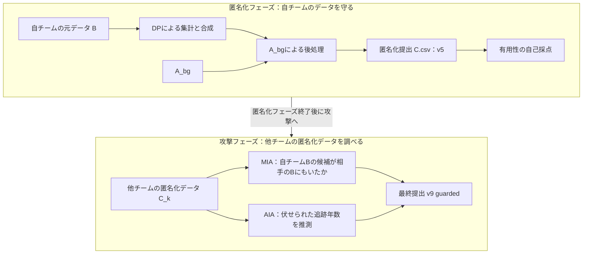

# 予備戦で使った手法を理解する

文章と図による説明資料 · v0.6 · 2026-09-10

この資料は、team24が予備戦で**何を使い、何を行い、何を提出したか**を、他の人へ説明するための原稿である。**匿名化フェーズ → 攻撃フェーズ**の順に、使ったデータ、処理の流れ、提出物、結果を説明する。実際に提出したものと、検討にとどまった手法を区別し、結果の数字には出典を付けた。

本文の「自チーム」はteam24を指す。データ名はB・C・A_bgなど、事務局の表記を用い、必要に応じて意味を補足する。自チームが決めた生成方法・設定と、事務局が定めたデータの仕様・ルールを区別して説明する。

**転帰の番号を確認する場合は、[「転帰の区分番号 outcome_state」の対応表と処理の流れ](#outcome-state)を参照する。**

## 読む順番

| 原稿 | 扱うこと | 読み終えたときに説明できること |
|---|---|---|
| [第1部：匿名化フェーズ](01_anonymization.md) | Bの準備、集計からの合成、A_bgによる調整、提出v5 | 何を使い、どの処理を経てCを作ったか |
| [第2部：攻撃フェーズ](02_attack.md) | 人物とCの比較、Bに含まれていたかの推測、追跡年数の推定、最終v9 | 何を手掛かりに推測し、どの回答を組み合わせて提出したか |
| [根拠と確認記録](SOURCES.md) | ルール、手法の出典、生成記録、照合結果 | 説明・数値をどこまで確認できているか |

**まずは第1部と第2部を通して読む。** 各部の冒頭に、行ったことの大まかな流れを示す。その後、各工程と主な設定を説明し、最後に他の人へ説明するときのまとめを置く。

匿名化編では、AIMが担当した工程と、その前後に自チームが行った処理を分け、データがどう変わったかを説明する。差分プライバシー（DP）の一般的な説明は省略する。

## 時間があるときに読む補足

仕組みや計算まで知りたくなった場合は、次の補足を参照する。

| 補足資料 | 扱うこと |
|---|---|
| [AIMの中身と、後処理の計算](SUPPLEMENT_AIM.md) | 集計の選択と分布モデルの更新、全設定とDP予算配分、A_bgのドナー選択の計算 |
| [攻撃手法の計算と判定の詳細](SUPPLEMENT_ATTACK.md) | MIAのスコア・順位の計算、AIAの採点式と判定条件、v7の集合による表記、未採用の検討 |

補足を読まなくても、本編だけで「予備戦で何を行ったか」を説明できる構成である。

## 最初に押さえる用語

| 用語 | この資料での意味 |
|---|---|
| 元データ B | 各チームに配られた1,049人の集団のデータ。「自チームB」「相手のB」で区別する |
| A_bg | 全チームが利用できる背景データ。一般的な分布や関係を学ぶ材料 |
| 匿名化データ C | 各チームがBから作成して提出する1,049行・13列のデータ。C_kは対象チームkのC |
| データの仕様 | 事務局が定めた列名、使える値の範囲、許される値の組合せなどの決まり |
| 共変量 | 年齢・検査値など、転帰を説明する側の変数。今回のCでは転帰以外の10列 |
| 希少群 | 年齢・検査値などの組合せが珍しい集団。第1部第5.2節の後処理では、事務局の公開判定器による判定を使う |
| 転帰 | 追跡した結果、どうなったか。今回のデータでは `time`・`onset`・`death` の3列で記録。具体例は第1部第3節を参照 |
| 打ち切り | 観察が終了し、その後の発症などは観測していないこと |
| MIA | メンバーシップ推論。候補の人物が相手のBに含まれていたかを推測する攻撃 |
| AIA | 属性推論。候補の人物について伏せられた追跡年数を推測する攻撃 |
| challenge | AIAで回答する候補326行をまとめたデータ。対象チームごとに用意される |
| QI | AIAの候補について公開された7属性。年齢、SBP、TG、HDL、ALT、性別、県 |
| ドナー | 合成行へコピーする値の元となるA_bgの行 |
| シャドウ実験 | 正解を把握できる疑似的な攻撃対象を作り、手法を比較する実験 |

`time=10` を、その人が10年目に必ず発症したと読まないことが大切である。発症・死亡のフラグと合わせて解釈する。また、匿名化の「v5」と攻撃の「v5」は別の版番号である。

<a id="outcome-state"></a>

## 転帰の区分番号 outcome_state

**`outcome_state` は、`time`（追跡年数）・`onset`（発症の有無）・`death`（死亡の有無）を、一つにまとめた内部用の区分番号である。** 今回は、打ち切り1区分・発症6時間帯・死亡6時間帯の計13区分を使う。番号は転帰の種類と時間帯を識別するためのもので、重症度や年数そのものを表す値ではない。

### 0〜12の番号をどう決めるか

元データの各行を、次の対応表で番号へ変換する。時間の区切りと番号の意味は自チームの生成設定で事前に固定しており、AIMが区切り方を自動で決めるわけではない。

| outcome_state | 転帰 | timeの範囲（入力を番号へ変換するとき） | onset | death |
|---:|---|---|---:|---:|
| 0 | 打ち切り（発症も死亡も観測されていない） | 追跡年数にかかわらず同じ区分 | 0 | 0 |
| 1 | 発症 | 約1日以上〜1年以下 | 1 | 0 |
| 2 | 発症 | 1年超〜2年以下 | 1 | 0 |
| 3 | 発症 | 2年超〜4年以下 | 1 | 0 |
| 4 | 発症 | 4年超〜6年以下 | 1 | 0 |
| 5 | 発症 | 6年超〜8年以下 | 1 | 0 |
| 6 | 発症 | 8年超〜10年以下 | 1 | 0 |
| 7 | 死亡 | 約1日以上〜1年以下 | 0 | 1 |
| 8 | 死亡 | 1年超〜2年以下 | 0 | 1 |
| 9 | 死亡 | 2年超〜4年以下 | 0 | 1 |
| 10 | 死亡 | 4年超〜6年以下 | 0 | 1 |
| 11 | 死亡 | 6年超〜8年以下 | 0 | 1 |
| 12 | 死亡 | 8年超〜10年以下 | 0 | 1 |

例えば、`time=3.2, onset=1, death=0` なら `outcome_state=3`、`time=3.2, onset=0, death=1` なら `9` になる。発症も死亡も観測されていなければ `0` である。境界ちょうどの値は早い側の時間帯に入るため、2年ちょうどでの発症は `2`、4年ちょうどでの発症は `3` になる。

対応の根拠は、[番号への変換処理](../workspace/opendp_aim/scripts/generate_pwscup.py#L336)と[親Cの生成方式で使う時間区分の設定](../workspace/opendp_aim/config/pwscup_aim_v4.json#L209)にある。

### 集計・合成を経て、time・onset・deathへ戻す

```text
元データBの time・onset・death
  ↓ 上の対応表で変換
outcome_state（0〜12）
  ↓ 年齢などとの組合せごとに人数を集計し、DPノイズを加える（Fixed・AIM）
ノイズ付きの集計結果
  ↓ 集計結果から分布を推定し、新しい行を合成する（Private-PGM）
合成された outcome_state（0〜12）
  ↓ 番号が表す転帰の種類と時間帯に従って変換
合成された time・onset・death
```

**ノイズを加える対象は、区分番号そのものではなく、集計した人数である。** 「ノイズ付きの集計結果から、新しい合成行とその `outcome_state` を生成する」と捉えるとよい。合成された番号も、事前に定義した0〜12のいずれかになる。

3列へ戻す際は、例えば `outcome_state=3` なら `onset=1, death=0` とし、`time` は2〜4年の区間内から一様乱数で新しく生成する。打ち切りの `0` なら、今回の設定では `time=10, onset=0, death=0` とする。**「戻す」とは、区分の意味に従って3列を生成することであり、元の人の正確な追跡年数を復元することではない。** [3列への変換処理](../workspace/opendp_aim/scripts/generate_pwscup.py#L857)で確認できる。

さらに、提出v5では、この後に**公開データA_bgのリスクが近い行から、`time`・`onset`・`death` を3列まとめて付け替える後処理**が入る。そのため、最終提出の転帰は、合成された `outcome_state` を3列へ戻した時点の値から変更される。全体の流れは[第1部：匿名化フェーズ](01_anonymization.md)の第2.3節・第5.1節、付け替えは第5.3節以降で説明する。

## 全体を一枚で見る



図の上段は自チームのCを作る処理、下段は他チームのCを調べる処理である。攻撃フェーズでは、相手ごとに異なる加工方式へ対応する。

## 説明の到達点

匿名化では、Bを集計しやすい形へ変換し、集計結果から合成表を作り、A_bgで希少群と転帰を整えてCを提出した流れを説明できることを目指す。

攻撃では、他チームのCから、人物がBに含まれていたかや追跡年数をどう推測したかを説明する。さらに、どの回答を組み合わせて最終v9を作ったか、結果から何が確認できたかを押さえる。
