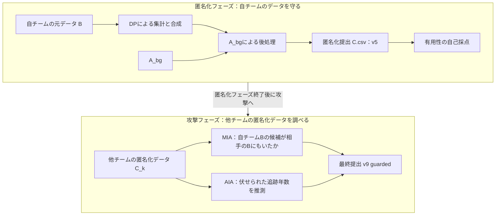

# 予備戦で使った手法を理解する

文章と図による説明資料 · v0.6 · 2026-09-10

この資料は、team24が予備戦で**何を使い、何を行い、何を提出したか**を、他の人へ説明するための原稿である。**匿名化フェーズ → 攻撃フェーズ**の順に、使ったデータ、処理の流れ、提出物、結果を説明する。実際に提出したものと、検討にとどまった手法を区別し、結果の数字には出典を付けた。

本文の「自チーム」はteam24を指す。データ名はB・C・A_bgなど、事務局の表記を用い、必要に応じて意味を補足する。自チームが決めた生成方法・設定と、事務局が定めたデータの仕様・ルールを区別して説明する。

**転帰の区分番号0〜12の対応表・決め方・集計と合成の流れは、[第1部：匿名化フェーズの第2.3節](01_anonymization.md#outcome-state)を参照する。**

## 読む順番

| 原稿 | 扱うこと | 読み終えたときに説明できること |
|---|---|---|
| [第1部：匿名化フェーズ](01_anonymization.md) | Bの準備、集計からの合成、A_bgによる調整、提出v5 | 何を使い、どの処理を経てCを作ったか |
| [第2部：攻撃フェーズ](02_attack.md) | 人物とCの比較、Bに含まれていたかの推測、追跡年数の推定、最終v9 | 何を手掛かりに推測し、どの回答を組み合わせて提出したか |
| [根拠と確認記録](SOURCES.md) | ルール、手法の出典、生成記録、照合結果 | 説明・数値をどこまで確認できているか |

**まずは第1部と第2部を通して読む。** 各部の冒頭に、行ったことの大まかな流れを示す。その後、各工程と主な設定を説明し、最後に他の人へ説明するときのまとめを置く。

匿名化編では、AIMが担当した工程と、その前後に自チームが行った処理を分け、データがどう変わったかを説明する。差分プライバシー（DP）の一般的な説明は省略する。

## 時間があるときに読む補足

仕組みや計算まで知りたくなった場合は、次の補足を参照する。

| 補足資料 | 扱うこと |
|---|---|
| [AIMの中身と、後処理の計算](SUPPLEMENT_AIM.md) | 集計の選択と分布モデルの更新、全設定とDP予算配分、A_bgのドナー選択の計算 |
| [攻撃手法の計算と判定の詳細](SUPPLEMENT_ATTACK.md) | MIAのスコア・順位の計算、AIAの採点式と判定条件、v7の集合による表記、未採用の検討 |

補足を読まなくても、本編だけで「予備戦で何を行ったか」を説明できる構成である。

## 最初に押さえる用語

| 用語 | この資料での意味 |
|---|---|
| 元データ B | 各チームに配られた1,049人の集団のデータ。「自チームB」「相手のB」で区別する |
| A_bg | 全チームが利用できる背景データ。一般的な分布や関係を学ぶ材料 |
| 匿名化データ C | 各チームがBから作成して提出する1,049行・13列のデータ。C_kは対象チームkのC |
| データの仕様 | 事務局が定めた列名、使える値の範囲、許される値の組合せなどの決まり |
| 共変量 | 年齢・検査値など、転帰を説明する側の変数。今回のCでは転帰以外の10列 |
| 希少群 | 年齢・検査値などの組合せが珍しい集団。第1部第5.2節の後処理では、事務局の公開判定器による判定を使う |
| 転帰 | 追跡した結果、どうなったか。今回のデータでは `time`・`onset`・`death` の3列で記録。具体例は第1部第3節を参照 |
| 打ち切り | 観察が終了し、その後の発症などは観測していないこと |
| MIA | メンバーシップ推論。候補の人物が相手のBに含まれていたかを推測する攻撃 |
| AIA | 属性推論。候補の人物について伏せられた追跡年数を推測する攻撃 |
| challenge | AIAで回答する候補326行をまとめたデータ。対象チームごとに用意される |
| QI | AIAの候補について公開された7属性。年齢、SBP、TG、HDL、ALT、性別、県 |
| ドナー | 合成行へコピーする値の元となるA_bgの行 |
| シャドウ実験 | 正解を把握できる疑似的な攻撃対象を作り、手法を比較する実験 |

`time=10` を、その人が10年目に必ず発症したと読まないことが大切である。発症・死亡のフラグと合わせて解釈する。また、匿名化の「v5」と攻撃の「v5」は別の版番号である。

## 全体を一枚で見る

図の上段は自チームのCを作る処理、下段は他チームのCを調べる処理である。攻撃フェーズでは、相手ごとに異なる加工方式へ対応する。

## 説明の到達点

匿名化では、Bを集計しやすい形へ変換し、集計結果から合成表を作り、A_bgで希少群と転帰を整えてCを提出した流れを説明できることを目指す。

攻撃では、他チームのCから、人物がBに含まれていたかや追跡年数をどう推測したかを説明する。さらに、どの回答を組み合わせて最終v9を作ったか、結果から何が確認できたかを押さえる。
