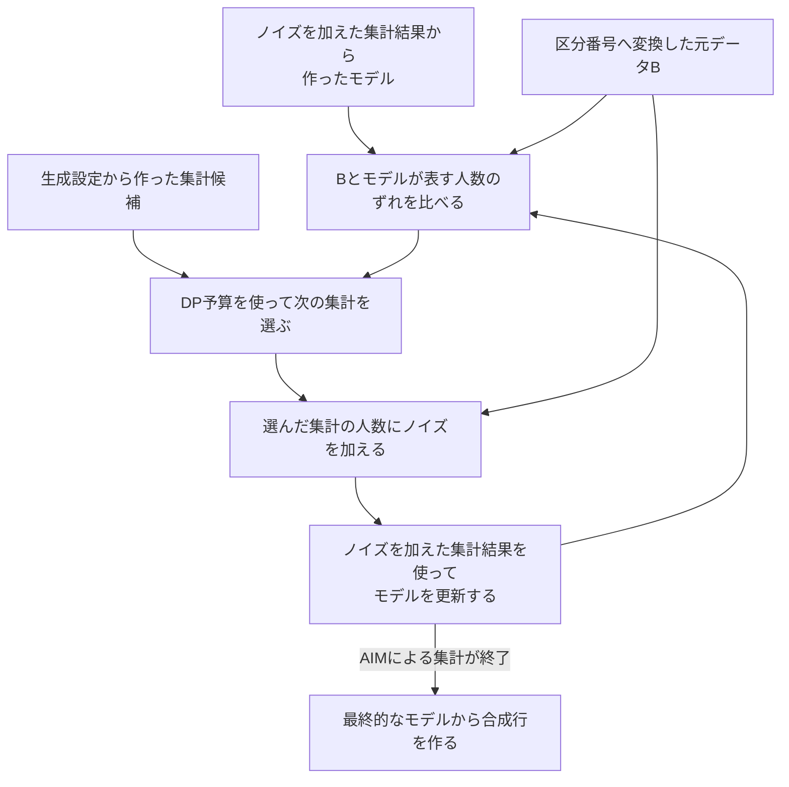
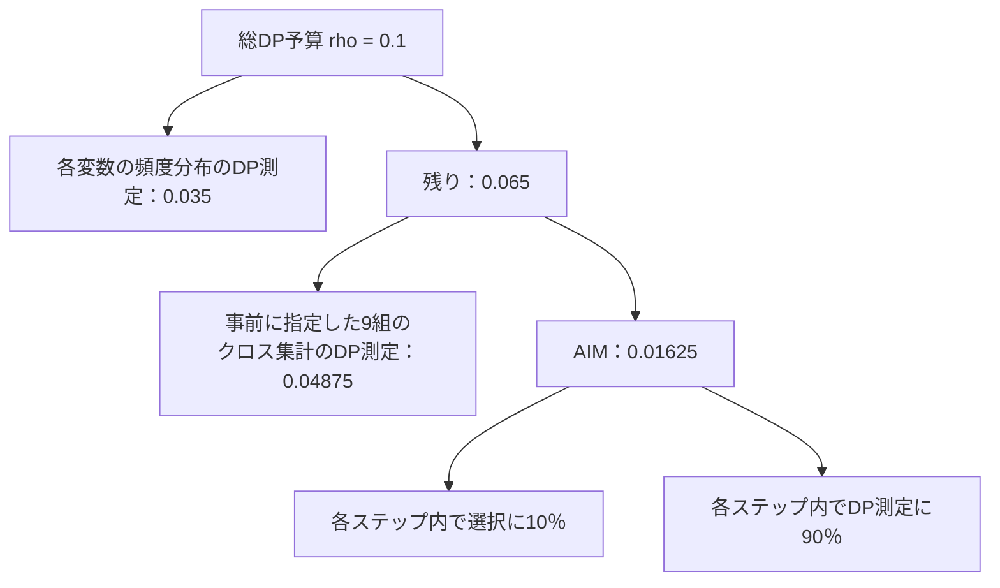

# 補足資料（任意）：AIMの中身と、後処理の計算

[全体案内](README.md) · [本編：匿名化フェーズ](01_anonymization.md)

この資料は、本編で予備戦の処理の流れを確認した後、AIMの仕組みや後処理の計算を詳しく知りたい場合に読む補足である。本編を説明するために、先にこの資料を読み込む必要はない。

A節では、AIMが何を引き継ぎ、どのように集計を選び、モデルを更新したかを説明する。実際に使ったパラメータとDP予算の配分も示す。B節では、AIMの外で行ったA_bgによる転帰の付け替えについて、似たリスクの行を選ぶ計算を説明する。

## A. AIMを含む集計・合成の仕組み

### A1. AIMと、その前後の処理は何を担当するか

本資料で「AIM本体」と呼ぶのは、現在のモデルを確認しながら次に測る集計を選び、人数にノイズを加え、その結果を使ってモデルを更新する部分である。「適応的に選ぶ」とは、このように現在のモデルに応じて、次に測る集計を選び直すことを指す。

**「ノイズを加えた集計結果」とは、元データBの区分ごとの人数や、クロス集計表の各マスの人数を数え、その値にノイズを加えて得たものである。** このように人数を数えてノイズを加える処理を、パラメータの説明などでは「DP測定」と呼ぶ。

例えば、Bのある年齢区分が20人で、ノイズを加えた値が22.3になったとする。合成に使う集計結果は、この22.3である。これは言葉の意味を示す架空例で、今回の実測値ではない。

OpenDPは、DP測定や予算管理の機能を提供するライブラリである。AIMは、その中で利用できる集計の選択・測定の方式の一つである。Private-PGMは、ノイズを加えた集計結果にできるだけ合う分布モデルを作るために使う。**分布モデルとは、変数の値の組合せごとに、何人程度いるかを計算できるようにしたものである。**［一般的な役割：[OpenDP公式API](https://docs.opendp.org/en/stable/api/python/opendp.extras.mbi.html)］

| 工程 | 行ったこと | AIM本体との関係 |
|---|---|---|
| 生成設定の準備 | 自チームが、A_bgや事務局のデータの仕様をもとに、数値の区切りや設定値を用意した | AIMより前 |
| 区分番号への変換 | 自チームの生成設定に従い、Bの数値や転帰を区分番号へ変換した | AIMより前 |
| 各変数の頻度分布の作成 | 変換後のBの内部12列について、区分ごとの人数を数え、ノイズを加えた | AIMの前に行う準備 |
| 事前に指定した9組のクロス集計 | 自チームが指定した9組のクロス集計表を作成し、各マスの人数にノイズを加えた | AIMの前に行う準備 |
| 集計の選択と、ノイズを加えた集計結果の取得 | AIMが次の集計を選び、その人数にノイズを加えた | AIM本体 |
| 分布モデルの作成・更新 | Private-PGMを使い、ノイズを加えた集計結果にできるだけ合うモデルを作った | AIMの前の集計段階と、AIMの各反復で行う |
| 合成行の作成 | OpenDPとPrivate-PGMを使い、最終的なモデルから1,049行を作った | AIMによる集計が終わった後 |
| 提出用の値への変換 | 自チームが、年齢・検査値の区分番号を数値に戻し、転帰の区分番号も3列の値へ戻した | AIM本体の外 |
| 希少群の人数・特徴の調整 | 自チームが、A_bgの行から年齢・検査値7列をまとめて移した | AIM本体の外 |
| A_bgを用いた転帰の付け替え | 自チームが、リスク指標の近いA_bgの行から、`time`・`onset`・`death`をまとめて移した | AIM本体の外 |
| v5設定での転帰の付け替えの再適用 | 自チームが、保存済みの親Cの転帰をもう一度付け替えた | AIMを再実行せずに行う後処理 |

クロス集計表（分割表）は、二つの変数の区分を組み合わせ、各組合せに該当する人数を示した表である。今回、先に集計する9組は自チームが指定し、人数の集計とノイズの付加にはOpenDPのFixedという方式を使った。Fixedは、事前に指定した集計項目をすべて測る方式の名称である。［根拠：S4・S15・S16］

モデルの作成・更新は、最後に一度だけ行う処理ではない。各変数の頻度分布、事前に指定した9組のクロス集計、AIMによる集計を通じて、順にモデルを作り直している。

### A2. AIMは何を引き継ぎ、何を候補にするか

まず、元データBの各変数の頻度分布と、事前に指定した9組のクロス集計表について、人数にノイズを加える。その集計結果から作ったモデルを、AIMの出発点とする。

**AIMは、このモデルとそれまでのノイズを加えた集計結果を引き継ぎ、区分番号へ変換したBも処理内部で参照する。** Bと現在のモデルとのずれを調べ、次にどの集計を測るかを選ぶためである。選択にもBの情報を使うため、この操作にもDP予算を使う。［根拠：S4・S16］

| AIMが使うもの | 役割 |
|---|---|
| それまでのノイズを加えた集計結果とモデル | 既に把握したBの特徴を引き継ぎ、モデルを更新する出発点にする |
| 区分番号へ変換した元データB | モデルが表す人数とのずれを調べ、選んだ集計の人数を数える |
| 自チームの生成設定 | 関心のある集計項目、重要度の重み、DP予算、モデルのサイズ制約を指定する |

先に9組を選んだのは、**事務局が有用性の評価に使うCox解析の9個の説明変数と、転帰との関係を保ちたかったためである。** Cox解析は、発症までの時間を使い、年齢や検査値などが発症の起こりやすさとどう関係するかを、複数の変数を同時に考慮して調べる手法である。自チームは、評価で使う9変数それぞれを転帰と組み合わせ、先にクロス集計する方針を決めた。変数と組合せの一覧は、本編の第3.5節に示す。［根拠：S4・S15・S20］

| 比べる点 | 事前に指定した9組のクロス集計 | AIMが選ぶ集計 |
|---|---|---|
| 集計対象の決め方 | 自チームが事前に決める | 現在のモデルとBとのずれなどを使い、AIMが処理中に選ぶ |
| 主な目的 | 評価に関係する9組を確実に集計する | モデルが十分に再現できていない特徴を補う |
| モデルの更新に使う値 | 人数にノイズを加えた集計結果 | 人数にノイズを加えた集計結果 |

**`workload`（ワークロード）は、自チームが関心のある集計項目と、その重みを指定したリストである。** 今回、AIMへ渡したのは、次の二変数39組である。先に集計した9組も、このリストに含めている。

| 集計項目 | 組合せの数 |
|---|---:|
| 転帰と、Cox解析で使う各変数 | 9 |
| 希少かどうかを示す補助列`rare_flag`と、転帰・7数値変数 | 8 |
| 性別と喫煙 | 1 |
| 年齢・BMI・SBP・TG・HDL・ALT・FPGの二変数の組合せ | 21 |
| 合計 | 39 |

7数値変数から二つを選ぶ組合せは、7×6÷2＝21組である。そのため、全体では9＋8＋1＋21＝39組になる。［根拠：S4・S15］

OpenDPは、この39組をもとに、各組合せに含まれる単変数の集計も候補に加える。例えば「年齢×BMI」からは、「年齢だけ」「BMIだけ」も候補になる。同じ単変数が複数の組合せに含まれていても、重複は一つにまとめる。

**今回の候補は、二変数39組と単変数11種類の、計50種類である。** これはモデルのサイズ制約で絞る前の候補数であり、50種類すべてを測ったという意味ではない。初めに頻度分布を作る対象は内部12列すべてであるが、`workload`の39組には県が含まれないため、AIMの候補に加わる単変数は11種類となる。［根拠：S15・S16］

一度集計した項目が、再び選ばれることもある。その場合は、同じ項目の新旧の集計結果を、それぞれのノイズの大きさに応じて組み合わせ、モデルの更新に使う。ここで増えるのは、モデルを作るための集計情報である。総DP予算を追加する操作ではなく、あらかじめAIMに配った予算内で行う。

### A3. 一つの変数の分布と、変数どうしの関係を分けて考える

表全体のうち、一部の変数だけに着目した分布を「周辺分布」と呼ぶ。例えば、年齢だけの頻度分布や、年齢と血圧のクロス集計表で表す分布が該当する。また、複数の変数の値を組み合わせた分布を「同時分布」と呼ぶ。

今回の合成では、各変数の頻度分布や二変数のクロス集計にノイズを加え、その集計結果から、内部12列全体の値の組合せを表すモデルを作る。

一つずつの変数の分布が合っていても、変数どうしの関係まで合っているとは限らない。次の二つの表は説明用の架空例であり、年齢区分と血圧区分も簡略化している。

| 集団① | 血圧区分：低 | 血圧区分：高 | 合計 |
|---|---:|---:|---:|
| 若年 | 40 | 10 | 50 |
| 高年 | 10 | 40 | 50 |
| 合計 | 50 | 50 | 100 |

| 集団② | 血圧区分：低 | 血圧区分：高 | 合計 |
|---|---:|---:|---:|
| 若年 | 25 | 25 | 50 |
| 高年 | 25 | 25 | 50 |
| 合計 | 50 | 50 | 100 |

どちらも、若年・高年は50人ずつ、血圧が低い人・高い人も50人ずつである。しかし、集団①では年齢層によって血圧の分布が異なり、集団②では同じである。

このような関係を合成データにも反映するために、各変数の頻度分布に加えて、クロス集計の結果も使う。

### A4. AIMは、どのように次の集計を選ぶか

AIMは、**元データBと現在のモデルとのずれを調べ、モデルの改善に役立ちそうな集計を選ぶ。** ここで「選ぶ」とは、次に人数へノイズを加えて、モデルの更新に使う集計項目を選ぶことである。原論文の考え方と、今回使用したOpenDP 0.15.1の処理に沿って、順に説明する。［根拠：S16、[AIM原論文・第4節](https://arxiv.org/html/2201.12677v2#S4)］

1. **モデルのサイズ制約を満たす候補に絞る。** その集計を加えた場合に、更新後のモデルが大きくなりすぎないかを確認する。制約を超える候補は、その段階の選択対象から外す。

2. **Bの人数と、現在のモデルが表す人数を比べる。** 同じ区分・同じクロス集計のマスごとに人数を比較し、差の絶対値を合計する。この合計を、モデルがBをどの程度再現できていないかの目安にする。

3. **ずれに、ノイズの影響と重要度を加味する。** ずれの合計から、ノイズの規模とマス数に応じた減点を引き、重要度の重みを掛けて選択用のスコアを作る。重要度は、自チームが指定した`workload`の重みと、候補に含まれる変数が各集計項目とどれだけ重なるかから求める。

4. **スコアの高い候補が選ばれやすくなるよう、確率的に選ぶ。** DPの仕組みで乱数を使って選ぶため、スコアが最大の候補が毎回選ばれるとは限らない。この選択にDP予算を使う。

5. **選んだ集計の人数にノイズを加え、モデルを更新する。** 新しく得た集計結果と、それまでの集計結果を使い、Private-PGMでモデルを更新する。その後、新しいモデルを基準として、次の集計を選ぶ。

例えば、A3節の集団①をBの集計結果、集団②を現在のモデルが表す人数と見立てる。各マスの差は15ずつなので、差の絶対値の合計は15＋15＋15＋15＝60となる。年齢だけ・血圧だけの頻度分布は一致していても、クロス集計ではこのずれを検出できる。これは選択基準を説明する架空例であり、実際にこの集計が選ばれたことを示すものではない。

| 選択に使う情報 | 何を判断するか |
|---|---|
| Bと現在のモデルとのずれ | その集計を、モデルがどこまで再現できているか |
| ノイズの規模と表のマス数 | ノイズの影響を考慮しても、集計を加える価値がありそうか |
| `workload`から求めた重要度 | 自チームが重視する集計と、どの程度関係する候補か |
| 更新後のモデルの大きさ | その段階のサイズ制約の範囲で扱えるか |

このように、AIMは人数のずれだけで選択を決めるわけではない。また、選択のたびに大会のU_specを採点しているわけでもない。自チームが指定した関心のある集計をもとに、Bの特徴をモデルが再現できるように選択を進める。［根拠：S4・S16］

モデルの更新に使うのは、人数にノイズを加えた集計結果である。候補の選択にBを使うことも含め、選択とDP測定を、割り当てられた予算内で進める。

最終的なモデルから合成行を作る処理は、Private-PGMが担う。OpenDPでは、ノイズを加えた集計結果から合成行を作る処理を、DP測定後の後処理として扱う。［一般的な仕組み：[OpenDP Synthetic Data](https://docs.opendp.org/en/stable/getting-started/statistical-modeling/synthetic-data.html)］

### A5. 親Cの生成で実際に使ったパラメータ

以下は、提出v5の元となった親C（release-001）の生成設定である。生成記録の設定ハッシュと、保存済み設定ファイルの一致を確認している。v5ではAIMを再実行せず、親Cに対して転帰の付け替えをもう一度行った。［根拠：S3・S15］

| 設定 | 値 | 意味 |
|---|---:|---|
| `privacy.rho` | 0.1 | 親Cの生成に割り当てた総DP予算 |
| `oneway` | all | 最初に内部12列すべての頻度分布を作り、区分ごとの人数にノイズを加える |
| `oneway_split` | 0.35 | 総予算の35％を、各変数の頻度分布のDP測定に配る |
| `fixed_budget_weight` | 3 | 残り予算を分ける際の、事前に指定した9組のクロス集計側の重み |
| `adaptive_budget_weight` | 1 | 残り予算を分ける際の、AIM側の重み。上の3と合わせて3対1で配る |
| `measure_split` | 0.9 | AIMの各ステップの予算を、DP測定に90％、選択に10％配る |
| `rounds` | 16 | AIMの最初の一回分の予算を、AIMに配った予算の16分の1にする |
| `max_size_mb` | 32 | 集計を加えた場合のモデルサイズを制限する基準値（MB） |
| `workload` | 39組 | 自チームが関心のある二変数の集計リスト。先に集計する9組を含む |
| 事前に指定したクロス集計 | 9組 | `outcome_state`と各変数を組み合わせた9種類のクロス集計 |
| `synthesis.method` | round | 最終的なモデルから合成行を作る方式。検査値を整数に丸める設定ではない |
| `output_rows` | 1,049 | 作成する合成行の数 |

`oneway`は、一つの変数について区分ごとの人数を数える集計である。twowayは、二つの変数の区分を組み合わせて人数を数えるクロス集計である。今回、最初の`oneway`は内部12列を対象とし、AIMの選択候補は、`workload`の二変数39組と、そこに含まれる単変数11種類から作る。

DP予算の配分は、次のとおりである。総予算0.1のうち、最初の頻度分布のDP測定に0.035を使い、残りの0.065を3対1に分ける。表の値は設定から計算したものであり、計算機内部でのごく小さな数値調整は省いている。

| 段階 | 計算 | DP予算ρの配分 |
|---|---|---:|
| 各変数の頻度分布のDP測定 | 0.1 × 0.35 | 0.035 |
| 事前に指定した9組のクロス集計のDP測定 | 0.1 × 0.65 × 3/4 | 0.04875 |
| AIMによる集計の選択とDP測定 | 0.1 × 0.65 × 1/4 | 0.01625 |
| 合計 |  | 0.1 |

`measure_split`＝0.9は、**AIMの各ステップ内の配分**を指定する。総予算0.1の90％をAIMの測定に配る、という意味ではない。

`rounds`＝16は、一回分の予算の初期値を決める設定であり、実際に16回集計したことを示す値ではない。今回使用したAIMは、モデルの変化がノイズの規模に比べて小さい場合、一回分の予算を増やす。割り当てられた総予算は増やさず、残り予算や候補の状況に応じて処理を終える。

`max_size_mb`＝32は、モデルのサイズ制約の基準値である。各段階で使えるサイズは、AIMの予算をどこまで使ったかに応じて変わる。プログラム全体のメモリ使用量を32MB以下に制限する設定ではない。［根拠：S16］

`workload`の各項目に付ける`weight`は、上記の予算配分の重みとは別の設定である。今回は、次の値を指定した。

| 集計項目 | 設定した`weight` |
|---|---:|
| 転帰と、Cox解析で使う各変数の9組 | 1.0 |
| 希少群に関係する8組 | 0.75 |
| 7数値変数の二変数の組合せ | 0.35 |
| 性別と喫煙 | 0.25 |

AIMでは、設定した`weight`と変数の重なりから、候補ごとの重要度を計算し直して選択に使う。例えば今回の設定では、「年齢×転帰」の重要度は13.6、「年齢×BMI」は7.7となる。これらは設定から計算した値であり、選ばれる確率や、実際の選択順序を示す値ではない。

一方、先に9組を集計するOpenDPのFixedでは、`weight`を集計項目間の予算配分に使う。9組の`weight`はいずれも1.0である。［根拠：S4・S15・S16］

後処理の`death_weight`＝0.31は、合成後にA_bgから転帰を移す行を選ぶための重みである。AIMの集計選択やDP予算の配分には使わない。計算方法を次のB節に示す。

## B. AIMの外で行った、転帰の付け替えの計算

この節では、合成行とリスク指標が近いA_bgの行を選ぶ方法を説明する。選ばれたA_bgの行を、値のコピー元という意味で「ドナー」と呼ぶ。本編の第5節・第6節で説明した転帰の付け替えを、計算まで確認したい場合に読む。

### B1. 年齢・検査値から、転帰に関係する二つの指標を計算する

合成行とA_bgの行について、年齢や検査値をそのまま並べて距離を比べると、各変数と転帰との関係を十分に考慮できない場合がある。そこで今回は、A_bgで学習したCoxモデルを使い、各行について「発症側」と「死亡側」の二つの値を計算した。

Coxモデルでは、各変数に学習した係数を掛け、その値を足し合わせる。この合計を「線形予測子」と呼ぶ。発症側・死亡側の計算は、次のように表せる。

- 発症側：η_onset = xᵀβ_onset
- 死亡側：η_death = xᵀβ_death

xは、年齢・性別・BMI・SBP・TG・HDL・ALT・FPG・喫煙の9変数を並べたものである。TG・ALTには対数変換を使う。βは、A_bgから学習した各変数の係数を並べたものであり、発症側と死亡側で別々に求めている。

次に、発症側・死亡側の値について、それぞれA_bgでの平均を引き、A_bgでの標準偏差で割る。このように尺度をそろえる処理を「標準化」と呼ぶ。合成行にも、同じA_bgの平均と標準偏差を使う。

得られる二つの値は、発症・死亡の起こりやすさを比較するリスク指標である。例えば指標が0.3であっても、発症確率や死亡確率が30％という意味ではない。［根拠：S3・S4］

### B2. v5では、リスク指標の近いA_bgの行を選び直した

v5では、保存済みの親Cの共変量10列を保ち、A_bgから転帰を移す行を選び直した。ここで行ったのは、転帰の付け替えの再適用（もう一度付け替え作業）である。

標準化した発症側・死亡側の値を、それぞれz_o、z_dとする。合成行xと、A_bgのドナー候補aとの二乗距離は、次の式で求める。

\[
d(x,a)^2=(z_o(x)-z_o(a))^2+
\{0.31\,[z_d(x)-z_d(a)]\}^2
\]

二乗距離が最も小さいA_bgの行を選び、その行の`time`・`onset`・`death`をまとめて合成行へ移す。

0.31は、死亡側の指標の差に掛ける重みである。差に0.31を掛けてから二乗するため、二乗距離の死亡側の項に掛かる係数は0.31²＝0.0961となる。

例えば、合成行とドナー候補①の指標の差が、発症側で0.2、死亡側で1.0だったとする。ドナー候補②との差は、発症側で0.5、死亡側で0.0とする。これは説明用の架空例である。

| ドナー候補 | 二乗距離の計算 | 二乗距離 |
|---|---|---:|
| ① | 0.04 ＋ 0.0961 | 0.1361 |
| ② | 0.25 ＋ 0 | 0.25 |

この二候補では、①の方がリスク指標で比べた距離が近いため、①の転帰を使う。値を移す対象は`time`・`onset`・`death`の3列であり、共変量10列は変えない。

親Cを作ったときの死亡側の重みは0.25であり、v5では0.31へ変更した。これはAIMの再実行ではなく、生成済みの表とA_bgを使って転帰をもう一度付け替える処理である。［根拠：S3・S4・S15］

## C. 仕組みを確認するための問い

1. 「ノイズを加えた集計結果」とは、どのデータの、どの値を指すか。
2. AIMが引き継ぐモデルと、処理内部で参照するBは、それぞれ何に使うか。
3. 各変数の頻度分布が同じでも、変数どうしの関係が異なるのはなぜか。
4. 事前に指定したクロス集計9組、`workload`の39組、内部の候補50種類は、それぞれ何を数えたものか。
5. AIMは、Bとモデルとのずれ以外に、何を考慮して集計を選ぶか。
6. `measure_split`＝0.9と`rounds`＝16は、それぞれ何を決める設定か。
7. 転帰の付け替えに使う`death_weight`＝0.31と、AIMのDP予算の配分はどう違うか。

根拠番号は [SOURCES.md](SOURCES.md) に対応する。

[本編に戻る](01_anonymization.md)
