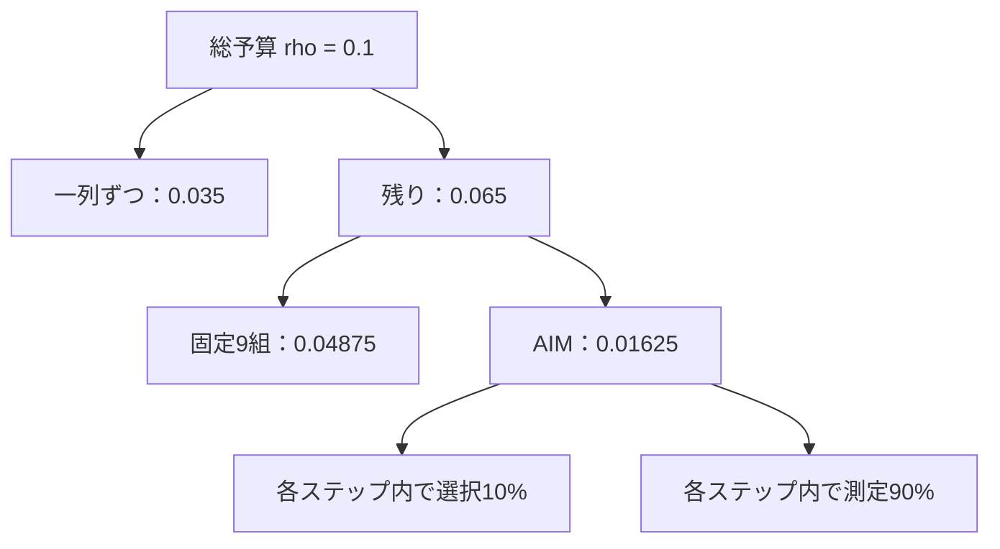

# 補足資料（任意）：AIMの中身と、後処理の計算

[全体案内](README.md) · [本編：匿名化フェーズ](01_anonymization.md)

この資料は、予備戦で行った処理を本編で理解した後、仕組みや計算まで知りたい場合に読む補足である。**本編だけで「何が行われていたか」を説明できる構成であり、この補足を先に理解する必要はない。**

A節では、OpenDP・AIM・Private-PGMの役割分担、集計の選択、分布の推定、実際のパラメータと予算配分を説明する。B節では、AIMの外で行ったA_bgによる転帰の付け替えについて、距離の計算を説明する。差分プライバシー（DP）の一般説明とコードの解説は含めない。

## A. AIMを含む集計・合成の仕組み

### A1. AIM本体と、ライブラリ・自チームの処理の境界

本資料で「AIM本体」と呼ぶのは、集計を適応的に選択・測定し、分布モデルを更新する部分である。一般に「AIMで合成した」と呼ぶときには、その結果から合成行を作るところまで広く指す場合もある。

分布モデルの推定・更新は最後に一度だけ行うのではなく、一列集計・Fixed・AIMの処理を通じて行う。AIMの各反復でも、Private-PGMの推定処理を利用してモデルを更新する。［根拠：S4・S16］

| 工程 | 誰が何を行うか | AIM本体との関係 |
|---|---|---|
| 生成設定の準備 | 自チームが、A_bgなどから区切りや係数を用意する | AIMより前 |
| 区分番号への変換 | 自チームが決めた区切りで、Bの数値や転帰を分類する | AIMより前 |
| 一列ずつのDP測定 | 自チームが全列を対象に指定し、OpenDPで人数分布を測る | AIMの前に行う初期化 |
| 固定9組のDP測定 | 自チームが9組を指定し、OpenDPの固定集計で人数表を測る | AIMとは別の工程として先に行う |
| 適応的な選択・測定 | 自チームが指定した候補・予算の範囲で、AIMが集計を選び、測る | AIM本体 |
| 分布モデルの推定・更新 | Private-PGMを使い、測定した人数分布に合うようにモデルを更新する | AIMの反復中にも、一列集計・固定集計の段階にも行う |
| 合成行の作成 | OpenDPとPrivate-PGMを使い、推定した分布から1,049行を作る | AIMによる測定が終わった後 |
| 区分番号から提出用の値への変換 | 自チームがA_bgなどを使って年齢・検査値の形に戻し、転帰の区分番号も3列の値へ戻す | AIM本体の外 |
| 希少群の修復 | 自チームがA_bgの行から年齢・検査値7列をまとめて移し、希少群の人数と特徴を整える | AIM本体の外 |
| A_bgを用いた転帰の付け替え | 自チームが、発症・死亡のリスク指標が近いA_bgの行から、time・onset・deathの3列をまとめて移す | AIM本体の外 |
| v5設定での転帰の付け替えの再適用 | 自チームが、保存済みの親Cの転帰をv5の設定でもう一度付け替える | AIMを再実行せずに行う後処理 |

固定集計の「何を測るか」は自チームの設計だが、DPで人数を測る仕組みはOpenDPのFixedを利用している。「AIM本体の外にある」と「ライブラリを使わず全部自作した」は同じ意味ではない。

OpenDPはDP測定や予算管理などの機能を提供するライブラリ、AIMはそこで使うアルゴリズムの一つである。Private-PGMは、測定結果に合う分布モデルを作るためにOpenDPから利用される。［一般的な部品の説明：[OpenDP公式API](https://docs.opendp.org/en/stable/api/python/opendp.extras.mbi.html)］

### A2. 固定集計の後、AIMは何を選んで測るか

生成処理では、最初に一列ずつの人数分布を測り、次に自チームが指定した9組の固定集計を測る。その測定結果で作ったモデルを引き継いで、AIMが集計を選択・測定し、モデルを更新する。ここで測定結果を増やし、モデルを改善していく。

例えば、固定集計で「年齢×転帰」を測った後、AIMが候補にある「年齢×BMI」を選んで測る場合が考えられる。これは仕組みを説明する例で、今回の実行で実際に選ばれた順序を示すものではない。新しい測定結果を使うことで、モデルが十分に表現できていなかった関係を補う。

ここで増えるのは、モデルの更新に使う測定結果である。未測定の組合せだけが対象ではなく、既に測った組合せを再測定することもできる。今回使用した方式では、同じ組合せの新旧の測定結果を、それぞれのノイズの大きさに応じて統合する。［根拠：S4・S16］

この段階も、親Cの生成に向けてあらかじめAIMへ配った予算内で行う。総予算0.1へ後から別の予算を足す意味ではない。AIM側への配分0.01625と各段階の内訳は、A5節に示す。

| | 固定集計 | AIMによる適応的な集計 |
|---|---|---|
| 何を測るか | 指定済みの9組を必ず測る | 候補から、モデル改善に役立つ組を選ぶ |
| 決めるタイミング | Bを測る前 | DPの手順で測定を進めながら |
| 主な役割 | 特定タスクで重要な関係を確実に測る | 現在のモデルで不足している関係を補う |
| 答えの人数 | Bを測って得る | Bを測って得る |

**workload（ワークロード）は、関心を持つ集計項目のリスト**である。今回の設定では、重複を除いたリストが39件あり、その中の9件に固定集計の指定がある。残る30件だけがAIMへ渡るのではなく、AIMには固定分を含む39件のリストを渡している。［根拠：S4］

39件の内訳は、転帰との固定9組、希少フラグに関係する8組、性別×喫煙の1組、7数値列の全二列組合せ21組である。`7×6÷2=21` なので、合計 `9+8+1+21=39` になる。

「固定集計9件」「workload39件」「反復設定16」は、それぞれ異なる数である。9は自チームが固定集計に指定した組合せの数、39は関心を持つ組合せの数、16はAIMの反復・一回当たり予算に関わる設定であり、39種類全部を16回測ったという意味ではない。

### A3. 周辺分布と同時分布

全列のうち一部の列に着目した分布を「周辺分布」、複数列の値の組合せをまとめて扱う分布を「同時分布」と呼ぶ。AIMを含む今回の合成では、一列・二列の人数分布を測り、表全体の列の組合せを表す分布を推定する。

年齢の割合と血圧区分の割合をそれぞれ保っても、年齢と血圧の関係が保たれるとは限らない。次の二つは架空例で、行合計・列合計が同じである。

| 集団① | 血圧区分：低 | 血圧区分：高 | 合計 |
|---|---:|---:|---:|
| 若年 | 40 | 10 | 50 |
| 高年 | 10 | 40 | 50 |
| 合計 | 50 | 50 | 100 |

| 集団② | 血圧区分：低 | 血圧区分：高 | 合計 |
|---|---:|---:|---:|
| 若年 | 25 | 25 | 50 |
| 高年 | 25 | 25 | 50 |
| 合計 | 50 | 50 | 100 |

年齢だけ、血圧だけの分布では両者を区別できない。集団①では年齢層によって血圧区分の割合が異なり、集団②ではどちらの年齢層でも同じ割合である。研究に使える表を作るには、複数列の組合せも測る必要がある。

### A4. AIMの反復

AIMは、自チームが指定した集計項目のリスト（workload）を受け取り、モデルの改善に役立つ集計を選び、DPで測り、その結果でモデルを更新する処理を繰り返す。何を測るかの選択にもBの情報を使うため、選択と測定の両方をDP予算の中で扱う。［一般的な仕組み：[AIM原論文](https://arxiv.org/abs/2201.12677)］

Private-PGMは、測定された低次元の集計から、複数列を合わせた分布を推定する部分を担う。OpenDPでは、DP測定後の集計から合成行を作る処理は後処理として扱われる。［一般的な仕組み：[OpenDP Synthetic Data](https://docs.opendp.org/en/stable/getting-started/statistical-modeling/synthetic-data.html)］

### A5. 親Cの生成で実際に使ったパラメータ

以下は、提出v5の元となった `release-001` の設定である。生成記録の設定ハッシュと、保存済み設定ファイルの一致を確認した。v5ではこのAIM生成を繰り返さず、転帰の付け替えを行っている。［根拠：S3・S15］

| 設定 | 値 | 意味 |
|---|---:|---|
| `privacy.rho` | 0.1 | 親Cの生成処理に割り当てた総ρ予算 |
| `oneway` | `all` | 最初に内部モデルの全12列について、一列ずつの人数分布を測る |
| `oneway_split` | 0.35 | 総予算の35%を、この一列ずつの測定へ配る |
| `fixed_budget_weight` | 3 | 残り予算の固定集計側の配分重み |
| `adaptive_budget_weight` | 1 | 残り予算のAIM側の配分重み。上の3と合わせて3対1 |
| `measure_split` | 0.9 | AIMの各ステップの予算を、測定90%・選択10%に配る |
| `rounds` | 16 | AIMの反復を制御する設定。初期一回分の予算はAIM側予算÷16 |
| `max_size_mb` | 32 | AIMが測定候補を選ぶ際のモデルサイズ制約の基準（MB） |
| `workload` | 39組 | 関心を持つ二列集計のリスト。固定9組を含む |
| 固定集計 | 9組 | `outcome_state` と9変数の二列集計 |
| `synthesis.method` | `round` | 推定分布から行を実体化する際の方式名。検査値を整数に丸める指定ではない |
| `output_rows` | 1,049 | 作成する合成行の数 |

「oneway」は一列だけで数えるという意味である。たとえば年齢区分だけの人数、性別だけの人数である。「twoway」に相当する二列集計なら、年齢区分と転帰区分の組合せで人数を数える。

予算配分を数値で示すと、次の設計になる。これは設定から計算した配分で、機械内部の浮動小数点による微小な調整を省いている。

| 段階 | 計算 | ρの配分 |
|---|---|---:|
| 一列ずつの測定 | `0.1 × 0.35` | 0.035 |
| 固定9組の測定 | `0.1 × 0.65 × 3/4` | 0.04875 |
| AIMの適応的測定・選択 | `0.1 × 0.65 × 1/4` | 0.01625 |
| 計 |  | 0.1 |

`measure_split=0.9` は全ρの90%を一律に測定へ使う指定ではなく、**AIMへ配った予算の、そのステップ内の配分**である。また `rounds=16` は実行ログ上16回測定したという証拠ではない。今回使用したAIMは、改善が小さいと一回の予算を増やし、予算・候補の状況に応じて終了する。`max_size_mb=32` も、プログラム全体のRAM使用量を32MB以下に保証する値ではない。［ライブラリの意味：S16］

集計項目ごとの `weight` も、予算配分重み3対1とは別の設定である。今回のworkloadでは、固定の転帰9組が1.0、希少関連8組が0.75、数値列の全二列組合せが0.35、性別×喫煙が0.25である。AIMでは集計の重要度、Fixedでは集計間の予算配分に使う。全固定9組のweightは同じである。

なお、後処理の `death_weight=0.31` は、AIMのDP予算や選択のパラメータではない。合成後にA_bgのドナーを選ぶ距離の設定で、本補足のB節で説明する。

## B. AIMの外で行った、転帰の付け替えの計算

この節で扱うのは、A_bgから転帰を移す行を選ぶための計算である。AIMが集計を選んだり、合成表を作ったりする計算とは別の後処理である。本編第5節・第6節の説明を、数式で確かめたい場合に読む。

### B1. 年齢・検査値を、転帰に関係する二つの指標へ変える

年齢・血圧・血糖などを並べて距離を測ると、転帰に影響する変数の重要度が十分に反映されない場合がある。そこでA_bgで学習したCoxモデルから、各行を二つの値へ写す。

- 発症についての線形予測子 `η_onset = xᵀβ_onset`
- 死亡についての線形予測子 `η_death = xᵀβ_death`

ここでxは年齢・性別・BMI・SBP・TG・HDL・ALT・FPG・喫煙の9変数を並べたもので、TG・ALTには対数変換を使う。βはA_bgから学んだ各変数の係数であり、線形予測子は各変数に係数を掛けて足し合わせた値である。

この二つの値からそれぞれA_bgの平均を引き、標準偏差で割って、尺度をそろえる。これを「標準化」と呼ぶ。得られる値は、発症・死亡の起こりやすさを比較するリスク指標であり、発症確率・死亡確率そのものではない。［根拠：S3・S4］

### B2. v5でのドナー選択

標準化後の発症・死亡の値をそれぞれ `z_o`、`z_d` とすると、合成行xとA_bgのドナーaの距離は次の形である。

\[
d(x,a)^2=(z_o(x)-z_o(a))^2+
\{0.31\,[z_d(x)-z_d(a)]\}^2
\]

最も距離が小さいA_bgの行の転帰3列を、合成行へ移して付け替える。係数0.31は**死亡側の座標に掛ける重み**である。したがって二乗距離の死亡項の係数は0.31²である。発症側と死亡側の差を、この重みで組み合わせて比較する。

架空例として、合成行とドナー候補①の標準化した指標の差が `(0.2, 1.0)`、ドナー候補②では `(0.5, 0.0)` なら、二乗距離は①が `0.04 + 0.0961 = 0.1361`、②が `0.25` である。この二候補では①の方が近い。ここで選ぶのは、転帰に関係する特徴が近いA_bgの行である。

## C. 仕組みを確認するための問い

1. 一列ずつの分布が同じでも、列どうしの関係が異なるのはなぜか。
2. 固定集計9件・workload39件・rounds16は、それぞれ何を表すか。
3. `measure_split=0.9` は、どの段階の予算を分ける設定か。
4. 転帰の付け替えに使う `death_weight=0.31` と、AIMの予算配分はどう違うか。

根拠番号は [SOURCES.md](SOURCES.md) に対応する。

[本編に戻る](01_anonymization.md)
